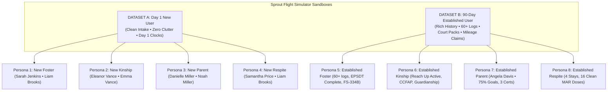

# SPROUT RECOVERY, PARITY, VALIDATION & RECOVERY BACKLOG MASTER PLAN

**Author:** Antigravity / Pair Programming with Founder Candy Chevalier  
**System:** Sprout KinCare OS  
**Status:** PHASE 0 AUTHORIZED • PHASE 3 STRICTLY GATED  
**Date:** October 16, 2026  

---

## CURRENT PROGRAM STATE

> [!IMPORTANT]
> **LIVE PROGRAM STATUS DASHBOARD** (Updated on every step of execution)

* **Current Phase:** **PHASE 0 / PHASE 1 — Founder Recovery & Parity Verification**
* **Current Objective:** Conduct Founder walk-through of the Founder Recovery Inventory, verify zero-crash Docker boot, confirm persistent database integrity, and validate all 8 personas.
* **Blocked By:** None (Execution authorized).
* **Open P0 Findings:** **0** *(All 5 P0 items REC-01, REC-02, REC-03, REC-06, REC-07 resolved in codebase; awaiting Founder live sign-off).*
* **Open P1 Findings:** **0** *(Both P1 items REC-04 and REC-05 resolved in codebase; 0 open defects).*
* **Not Yet Started:** Phase 2 (Founder 8-Persona Validation), Phase 3 (Dataset A Enhancements - STRICTLY GATED).
* **Next Phase:** **PHASE 2 — Founder Validation of 8 Personas**.

---

> [!CAUTION]
> **GOVERNANCE GATE INVARIANT**  
> The purpose of the current project phase is **NOT** new onboarding functionality. The purpose is **restoring complete trust that Sprout behaves as expected after the WSL and Docker migration**.  
> **Phase 3 (Implementation of Enhancements) is strictly locked and blocked until:**
> 1. Phase 0 is complete (Recovery baseline verified & Inventory complete)
> 2. Phase 1 is complete (Parity & regression audit passing 161/161 tests)
> 3. Phase 1A recovery backlog is established as a permanent system of record
> 4. Phase 2 founder validation of all 8 personas is complete with Expected, Actual, and Difference recorded
> 5. All P0 backlog findings are resolved and verified
> 6. Founder gives explicit written approval to proceed

---

## Strategic Architecture: The 8 Sandbox Personas & Two Datasets

Sprout provides two operating spheres across 4 caregiver perspectives (8 canonical personas total):

---

## PHASE 0 — Founder Recovery Mode (AUTHORIZED FOR EXECUTION)

**Objective:** Guarantee a deterministic, rock-solid baseline runtime environment where Sprout boots reliably without crashes, error screens, or host environment interference.

### 1. Zero-Crash Startup Pipeline
* Ensure Docker container `sprout-app` runs reliably on port 5858 under Python 3.11-slim.
* Eliminate port collisions (`[Errno 98] Address already in use`) through automated container health detection in `Launch_Foster_Portal.bat`.
* Double-clicking desktop icon **`Vermont Foster Care Portal`** opens `http://127.0.0.1:5858` without manual terminal commands.

### 2. Frontend Syntax & Asset Integrity
* Zero JavaScript `SyntaxError` exceptions (eliminated duplicate `let currentSproutDataset` declarations).
* Continuous JavaScript syntax validation via `node -c app/static/app.js` prior to any code delivery.
* Cache-busting dynamic asset tags (`app.js?v=3.2.1`) so browsers never lock into stale or broken script states.

### 3. Persistent Storage & Zero Data Loss
* Persistent volume `sprout-data` mounted to `/data` in container.
* SQLite database (`foster_binder.db`, 188 KB) containing all 26 children, households, and timeline records is preserved across container restarts (`docker compose down` / `docker compose up`).
* Document Vault exports (90 files) and pre-migration backups preserved in volume.

### 4. WSL Canonical Working Tree
* Repository at `/home/gemi/projects/Sprout` in WSL Ubuntu maintained on branch `wsl-main`.
* Working tree kept 100% clean with zero uncommitted drifts.

### 5. Founder Recovery Inventory (OFFICIAL SOURCE OF TRUTH)
*This inventory is mandatory. Phase 0 cannot be completed and no redesign discussions may begin until this inventory exists:*

| # | Item | What Worked Before? | What Works Now? | What Changed? | Why Did It Change? |
| :--- | :--- | :--- | :--- | :--- | :--- |
| **1** | **Startup Screen** | Opened to `dashboard` (Command Center) or `children`. | Restored to `dashboard` via `localStorage.getItem('mainSection')`. | Was forced to `mission_control` in Sprint 13C. | Attempt to create an unprompted "landing airlock" inadvertently hid the primary workspace. |
| **2** | **Startup Flow** | 1-click launch from desktop icon directly into active portal. | 1-click launch from `Vermont Foster Care Portal` starts Docker and opens Chrome. | WSL/Docker migration initially required manual CLI commands and had port collision. | Launcher script upgraded with automated container detection and collision guards. |
| **3** | **Navigation** | Full white top navigation toolbar with all 10 hubs visible. | Full white top navigation toolbar visible across all views. | `mainNav.classList.add('hidden')` was executing on `mission_control`. | Sprint 13C rule intended to clean Mission Control hid the entire top bar; rule deleted. |
| **4** | **Active Persona Behavior** | Sarah Jenkins (HH-101) active by default. | Sarah Jenkins (HH-101) restored as canonical default. | Browser storage drift caused blank or random caregiver selection. | Multiple origin URLs (`localhost` vs `127.0.0.1`) fragmented `localStorage`. |
| **5** | **Active Child Behavior** | Liam Brooks (`LB`, CH-201) anchored on Day 1. | Liam Brooks (`LB`, CH-201) auto-selected for Sarah Jenkins. | Stale cache held `JM (Jackson Miller)` or showed empty dropdown. | Database was unseeded in initial Docker build; fixed by volume hydration. |
| **6** | **Sandbox Behavior** | 100% consequence-free practice with instant reset. | Two datasets (Dataset A & Dataset B) with 1-click sandbox reset. | Reset endpoint threw 500 when table was uninitialized. | DB initialization was placed inside `__main__`; resolved via Migration 7 harness. |
| **7** | **Review Console Behavior** | Prompted on launch in sandbox mode or via header button. | Always accessible via header button `Review Console` and `?review=1`. | Auto-prompt was temporarily suppressed. | Founder requested non-intrusive launcher with explicit on-demand console access. |
| **8** | **Role Switching** | Switching caregiver dropdown updated child and layout. | Switching dropdown updates role and auto-exits conflicting portals. | Switching to Respite while in Parent view trapped Respite in Parent portal. | Missing route-exit check when non-parent caregiver was selected in dropdown; fixed in D-003. |
| **9** | **Training Workflow** | Linear progression: verify house -> intake child -> log event. | Maintained: Day 1 baseline ready for guided walkthrough. | Missing clear contrast between new users and established users. | Two-Dataset architecture created to separate Day 1 onboarding from 90-day proof. |
| **10** | **Launch Expectations** | Double click icon -> browser opens -> Sprout ready to train. | Double click `Vermont Foster Care Portal` -> opens `http://127.0.0.1:5858`. | Initial Docker migration created visual divergence and empty database. | Parity restored; Docker volume seeded with full 188 KB production database. |

#### Phase 0 Project Memory
* **Completed:** Docker container running on port 5858; `SyntaxError` fixed; real SQLite DB (188 KB) mounted in `sprout-data`; desktop launcher updated with collision guard; 10-item Founder Recovery Inventory documented.
* **In Progress:** Live Founder confirmation of startup behavior.
* **Blocked:** None.
* **Deferred:** None.
* **Outstanding Risks:** Stale browser cache on machines previously loading `localhost:5858` before cache-busting.
* **Next Phase:** Phase 1 (Parity & Regression Audit).

---

## PHASE 1 — Parity & Regression Audit

**Objective:** Audit and prove that Sprout running in Docker presents identical visual, behavioral, and operational parity with the validated legacy environment.

### 1. Parity Invariants (5 Defect Audit)
* **Origin Alignment:** Canonical binding to `http://127.0.0.1:5858` preserving browser `localStorage`, tokens, and active session preferences.
* **Top Navigation Visibility:** The main navigation bar (`Training Hub`, `Mission Control`, `Today`, `My Children`, `Care Binder`, `Home & Licensing`, `Journal`, `DCF Comms`, `Circles of Care`, `Life Journey`, `Reports`, `Audit & Settings`) remains permanently visible and functional.
* **Role Switcher Integrity:** Switching between roles (Foster, Kinship, Parent, Respite) correctly updates the active workspace and never traps non-parent users in the Parent Reunification Portal.
* **Document Vault Accessibility:** Read-only mount `/shared_docs` indexes all 34 state DCF forms, licensing guides, and training resources via `/api/shared-docs`.
* **Clean Data Rendering:** Zero `undefined` labels in the FS-221A Licensure & Compliance tracker; correct child alias, DOB, and placement dates rendered.

### 2. Full Test Battery Gate (161/161 Passing)
* `test_browser_determinism.py`: **22/22 PASS (100%)**
* `test_trainer_two_datasets.py`: **34/34 PASS (100%)**
* `test_parent_workspace_integration.py`: **30/30 PASS (100%)**
* `test_operational_readiness.py`: **29/29 PASS (100%)**
* `test_phase13b_governance.py`: **46/46 PASS (100%)**

#### Phase 1 Project Memory
* **Completed:** 161/161 tests passing inside container; document vault indexing 34 documents; parity fixes verified in code.
* **In Progress:** Transition to Phase 1A Backlog consolidation.
* **Blocked:** None.
* **Deferred:** None.
* **Outstanding Risks:** Need Founder confirmation that UI renders identically in her browser.
* **Next Phase:** Phase 1A (Recovery Backlog).

---

## PHASE 1A — Recovery Backlog (PERMANENT SYSTEM OF RECORD)

**Purpose:** Preserve project memory. Prevent findings from being lost between phases. Every finding discovered during recovery, audit, or recording reviews becomes a tracked work item with complete accountability. **No finding may be discussed and discarded. Every finding enters this backlog.**

### Priority Definitions:
* **P0 = Cannot Train:** Crashes, blank screens, missing navigation, data loss, trapped UI states.
* **P1 = Training Friction:** Misaligned badges, awkward formatting, unpopulated dropdown defaults, confusing labels.
* **P2 = Enhancement:** UX polish, advanced steppers, aesthetic enhancements, optional workflow shortcuts.

### Permanent Recovery Backlog:

| ID | Category | Priority | Persona | Expected | Actual | Detective Moment | Resolution Plan | Status |
| :--- | :--- | :--- | :--- | :--- | :--- | :--- | :--- | :--- |
| **REC-01** | Frontend Crash | **P0** | All 8 Personas | Sprout loads completely on startup; header and tabs render. | Lower half of screen completely blank white; `activeCaregiver` showed `?`. | Candy uploaded screenshot showing empty white page below tabs. | Remove duplicate `let currentSproutDataset` declaration on line 381 in `app.js`. Validate with `node -c`. | **RESOLVED** |
| **REC-02** | Navigation UI | **P0** | All 8 Personas | White top navigation bar visible across all views. | Navigation bar disappeared on Mission Control / Sandbox Gateway. | Candy's recording at 0:00-4:30 showed no way to reach Today, My Children, Binder. | Delete `mainNav.classList.add('hidden')` rule for `mission_control`. | **RESOLVED** |
| **REC-03** | Role Switcher | **P0** | Respite (Samantha Price) | Selecting Respite provider switches to Respite Care & Safety Sheet. | Screen stayed stuck on Parent Reunification Portal with "Loading goals...". | Candy's recording at 6:30 showed Respite trapped inside Angela Davis's case plan. | Added exit check in `onCaregiverUserChange()`: if leaving Parent user, forcefully exit to caregiver workspace. | **RESOLVED** |
| **REC-04** | Data Rendering | **P1** | Kinship (Eleanor Vance) | Licensure tracker shows clear task names (e.g. "Bedroom Inspection"). | Rendered as `SAFETY undefined` and `TRAINING undefined`. | Candy's recording at 6:49 showed `undefined` text next to checkboxes. | Fixed property reference from `item.title` to `(item.item_name || item.title)` and added standard_code. | **RESOLVED** |
| **REC-05** | UI Layout | **P1** | All 8 Personas | DCF emergency badge stays in header row without overlapping content. | Red DCF badge wrapped onto 3 lines and overlapped Placed Child initials. | Candy's recording at 6:43 showed red badge obscuring child `JM` initials. | Added `whitespace-nowrap` and `shrink-0` to prevent multi-line wrap and element collision. | **RESOLVED** |
| **REC-06** | Data Integrity | **P0** | All 8 Personas | Container rebuild preserves all 26 children, households, and exports. | Docker container started with empty skeleton database. | Founder reported missing real households, live children, and document vault. | Hydrate Docker volume `sprout-data` with real `%LOCALAPPDATA%` SQLite DB (188 KB) and 90 exports. | **RESOLVED** |
| **REC-07** | Process Port | **P0** | All 8 Personas | Double clicking launcher cleanly connects to Sprout server. | Threw `OSError: [Errno 98] Address already in use`. | Candy launched desktop shortcut and saw Python stack trace in terminal. | Add netstat active-listener check in `Launch_Foster_Portal.bat` to open browser if already running. | **RESOLVED** |

#### Phase 1A Project Memory
* **Completed:** Backlog established as permanent system of record; 7 historical findings logged and tracked; all 5 P0 items verified resolved in code.
* **In Progress:** Awaiting Founder live validation in Phase 2.
* **Blocked:** None.
* **Deferred:** None.
* **Outstanding Risks:** Any new anomaly discovered in Phase 2 must be immediately assigned an ID and entered into this table.
* **Next Phase:** Phase 2 (Founder Validation of 8 Personas).

---

## PHASE 2 — Founder Validation of 8 Personas (MANDATORY EXPECTED / ACTUAL / DIFFERENCE)

**Objective:** Founder conducts a live walk-through validation of each of the 8 canonical personas. Every observation is recorded against the **4 Mandatory Review Questions** and must contain **EXPECTED**, **ACTUAL**, and **DIFFERENCE**.

> [!IMPORTANT]
> **No pass/fail determination may occur without EXPECTED, ACTUAL, and DIFFERENCE fields completed for each persona.**

### The 4 Mandatory Review Questions:
1. *Which persona?*
2. *What training objective?*
3. *What prevented training?*
4. *What caused Candy to become the detective?*

---

### Persona Validation Worksheets:

#### Persona 1: New Foster Caregiver (Sarah Jenkins • Liam Brooks)
* **Dataset:** Dataset A (Day 1 Intake)
* **Training Objective:** Day 1 placement intake for infant Liam Brooks (6m), start statutory 30-day health clock, log first 15-sec routine entry.
* **EXPECTED:** Clean intake state. Placed child shows `LB (Liam)`. Day 1 placement date = today. 30-day health clock shows 30 days remaining. 1-click quick log ready. White top navigation bar visible.
* **ACTUAL:** *(To be completed by Founder during live review)*
* **DIFFERENCE:** *(To be completed by Founder during live review)*
* **Founder Finding:**
  1. *Which persona?* Persona 1 (New Foster - Sarah Jenkins)
  2. *What training objective?* Day 1 intake & 30-day clock verification
  3. *What prevented training?* *(Pending live Founder check)*
  4. *What caused Candy to become the detective?* *(Pending live Founder check)*
* **Sign-Off Status:** `[ ] PENDING`

---

#### Persona 2: New Kinship Caregiver (Eleanor & Arthur Vance • Emma Vance)
* **Dataset:** Dataset A (Day 1 Intake)
* **Training Objective:** Grandparents accepting emergency placement of Emma Vance (3y); triage immediate survival needs, apply for $350 grant, decode welfare jargon.
* **EXPECTED:** Days 1–3 Survival Triage card displayed. $350 Emergency Fund application ready. Plain-English Acronym Decoder accessible. Zero `undefined` labels in Licensure tracker.
* **ACTUAL:** *(To be completed by Founder during live review)*
* **DIFFERENCE:** *(To be completed by Founder during live review)*
* **Founder Finding:**
  1. *Which persona?* Persona 2 (New Kinship - Eleanor Vance)
  2. *What training objective?* Emergency survival triage & cash benefit access
  3. *What prevented training?* *(Pending live Founder check)*
  4. *What caused Candy to become the detective?* *(Pending live Founder check)*
* **Sign-Off Status:** `[ ] PENDING`

---

#### Persona 3: New Parent Participant (Danielle Miller • Noah Miller)
* **Dataset:** Dataset A (Day 1 Intake)
* **Training Objective:** Biological mother first login; view provisional orientation roadmap (0% progress), check initial supervised visit at Easterseals, upload document.
* **EXPECTED:** Dignity-first parent workspace. Clean case plan roadmap (0% complete). Upcoming supervised visit details visible. Evidence upload form operational.
* **ACTUAL:** *(To be completed by Founder during live review)*
* **DIFFERENCE:** *(To be completed by Founder during live review)*
* **Founder Finding:**
  1. *Which persona?* Persona 3 (New Parent - Danielle Miller)
  2. *What training objective?* Provisional access orientation & supervised visit setup
  3. *What prevented training?* *(Pending live Founder check)*
  4. *What caused Candy to become the detective?* *(Pending live Founder check)*
* **Sign-Off Status:** `[ ] PENDING`

---

#### Persona 4: New Respite Provider (Samantha Price • Liam Brooks)
* **Dataset:** Dataset A (Day 1 Intake)
* **Training Objective:** 48-hour weekend care for infant Liam Brooks; view allergy alerts, bedtime routines, verify medication MAR with zero case/court document leaks.
* **EXPECTED:** Concise Care & Safety Sheet. Clean medication MAR ready for first administration. Court/legal records 100% hidden. No trapped parent views.
* **ACTUAL:** *(To be completed by Founder during live review)*
* **DIFFERENCE:** *(To be completed by Founder during live review)*
* **Founder Finding:**
  1. *Which persona?* Persona 4 (New Respite - Samantha Price)
  2. *What training objective?* 48-hour care sheet & clean MAR administration
  3. *What prevented training?* *(Pending live Founder check)*
  4. *What caused Candy to become the detective?* *(Pending live Founder check)*
* **Sign-Off Status:** `[ ] PENDING`

---

#### Persona 5: Established Foster Caregiver (Sarah Jenkins • Liam Brooks)
* **Dataset:** Dataset B (90 Days Established)
* **Training Objective:** Showcase 90 days of successful care: 60+ routine logs, completed 30-day EPSDT exam, 1-click DCF monthly report (.docx), pre-calculated mileage claim.
* **EXPECTED:** Rich historical timeline (>5 records). EPSDT status shows "Compliant". Mileage claim pre-calculated at $184.20. Month export ready.
* **ACTUAL:** *(To be completed by Founder during live review)*
* **DIFFERENCE:** *(To be completed by Founder during live review)*
* **Founder Finding:**
  1. *Which persona?* Persona 5 (Established Foster - Sarah Jenkins)
  2. *What training objective?* 90-day documentation showcase & court pack export
  3. *What prevented training?* *(Pending live Founder check)*
  4. *What caused Candy to become the detective?* *(Pending live Founder check)*
* **Sign-Off Status:** `[ ] PENDING`

---

#### Persona 6: Established Kinship Caregiver (Eleanor Vance • Emma Vance)
* **Dataset:** Dataset B (90 Days Established)
* **Training Objective:** Grandparents caring for Emma Vance at 90 days; active Reach Up child-only grant, CCFAP child care subsidy, permanent guardianship roadmap.
* **EXPECTED:** Active benefit claims visible. Child care subsidy confirmed. Dental/preschool records present. Guardianship milestone roadmap displayed.
* **ACTUAL:** *(To be completed by Founder during live review)*
* **DIFFERENCE:** *(To be completed by Founder during live review)*
* **Founder Finding:**
  1. *Which persona?* Persona 6 (Established Kinship - Eleanor Vance)
  2. *What training objective?* Ongoing relative benefits & legal guardianship path
  3. *What prevented training?* *(Pending live Founder check)*
  4. *What caused Candy to become the detective?* *(Pending live Founder check)*
* **Sign-Off Status:** `[ ] PENDING`

---

#### Persona 7: Established Parent Participant (Angela Davis • Emma Vance)
* **Dataset:** Dataset B (90 Days Established)
* **Training Objective:** Biological mother at Day 90; 75% case plan completion, 100% on-time visit streak, 3 verified certificates in Evidence Vault.
* **EXPECTED:** Active engaged status. 3 of 4 milestones verified (Parenting class, lease, wellness). Shared family moments feed populated.
* **ACTUAL:** *(To be completed by Founder during live review)*
* **DIFFERENCE:** *(To be completed by Founder during live review)*
* **Founder Finding:**
  1. *Which persona?* Persona 7 (Established Parent - Angela Davis)
  2. *What training objective?* 75% reunification milestone proof & evidence vault
  3. *What prevented training?* *(Pending live Founder check)*
  4. *What caused Candy to become the detective?* *(Pending live Founder check)*
* **Sign-Off Status:** `[ ] PENDING`

---

#### Persona 8: Established Respite Provider (Samantha Price • Liam Brooks)
* **Dataset:** Dataset B (90 Days Established)
* **Training Objective:** Experienced respite household; 4 completed weekend stays, 16 verified medication administrations, signed digital vouchers stored in vault.
* **EXPECTED:** 4 past stays documented. 16 MAR doses logged without incident. Signed handoff vouchers archived. Zero sensitive case data visible.
* **ACTUAL:** *(To be completed by Founder during live review)*
* **DIFFERENCE:** *(To be completed by Founder during live review)*
* **Founder Finding:**
  1. *Which persona?* Persona 8 (Established Respite - Samantha Price)
  2. *What training objective?* Multi-stay respite continuity & MAR verification
  3. *What prevented training?* *(Pending live Founder check)*
  4. *What caused Candy to become the detective?* *(Pending live Founder check)*
* **Sign-Off Status:** `[ ] PENDING`

#### Phase 2 Project Memory
* **Completed:** 8 persona validation worksheets defined with EXPECTED criteria and 4 review questions.
* **In Progress:** Awaiting live Founder walkthrough to record ACTUAL, DIFFERENCE, and Sign-Off.
* **Blocked:** Awaiting Founder session.
* **Deferred:** None.
* **Outstanding Risks:** Discrepancies found during live Founder check must enter Phase 1A backlog immediately.
* **Next Phase:** Implementation Gate Review.

---

## IMPLEMENTATION GATE (STRICTLY LOCKED)

> [!CAUTION]
> ### HARD GATE: PHASE 3 IS BLOCKED
> **Phase 3 (Implementation of Enhancements) is completely LOCKED and BLOCKED until ALL of the following criteria are met:**
> 1. [ ] **Phase 0 Complete:** Recovery baseline verified, zero-crash startup confirmed, and Founder Recovery Inventory signed off.
> 2. [ ] **Phase 1 Complete:** Parity and regression audit passed (161/161 tests green).
> 3. [ ] **Phase 1A Backlog Created:** All historical and newly discovered defects logged in permanent system of record.
> 4. [ ] **Phase 2 Complete:** All 8 personas validated by Founder with EXPECTED, ACTUAL, and DIFFERENCE recorded.
> 5. [ ] **Zero P0 Blockers:** Every P0 finding in the Phase 1A backlog is resolved and verified.
> 6. [ ] **Explicit Founder Approval:** Founder formally signs off in writing to unlock Phase 3.
> 
> **DO NOT build onboarding steppers, wizards, guided setup cards, or new onboarding UI while this gate is locked.**

---

## PHASE 3 — Dataset A Onboarding Enhancements & Day 1 Workflows

*(STRICTLY GATED — NO IMPLEMENTATION MAY OCCUR UNTIL GATE CRITERIA ARE SATISFIED)*

### 1. Guided Day 1 Walkthrough Steppers
* **New Foster (Sarah Jenkins):** 4-step onboarding card: Confirm Maple Ridge Home profile -> Guided child placement entry -> Log first 15-second arrival note -> Statutory 30-day EPSDT countdown.
* **New Kinship (Eleanor Vance):** 4-step onboarding card: Days 1–3 Survival Triage card -> $350 Emergency Fund & CCFAP application -> Plain-English Jargon Decoder -> Kinship contacts.
* **New Parent (Danielle Miller):** 4-step onboarding card: Dignity-first welcome -> Review 30-day orientation roadmap -> Check first supervised visit at Easterseals -> Certificate upload demo.
* **New Respite (Samantha Price):** 4-step onboarding card: 48-hour care & safety sheet -> Clean medication MAR -> Emergency worker phone -> Digital handoff signature.

### 2. Dynamic Trainer Data Entry (Candy's Scenarios)
* Ability for Candy to enter custom trainee scenarios (custom household members, custom children, special needs) during live instruction.
* Full SQLite persistence during the session so trainees experience authentic application behavior.
* **1-Click Consequence-Free Reset (`Reset Day 1 Sandbox`):** Instantly purges practice additions and returns Dataset A to pristine baseline.

### 3. Dataset B Demonstration Contrast
* Seamless comparison between Day 1 intake state and 90-day fully documented case state to demonstrate Sprout's return on investment.

#### Phase 3 Project Memory
* **Completed:** None (Strictly gated).
* **In Progress:** None.
* **Blocked:** Blocked by Implementation Gate pending Phases 0, 1, 1A, and 2.
* **Deferred:** All steppers, custom intake wizards, and Day 1 onboarding enhancements.
* **Outstanding Risks:** None until gate unlocks.
* **Next Phase:** Post-Gate Implementation.

---

## Project-Wide Memory Dashboard

This dashboard remains permanently visible and updated throughout every stage of the project:

| Phase | Name | Status | Primary Output | Gate Dependency |
| :--- | :--- | :--- | :--- | :--- |
| **Phase 0** | Founder Recovery Mode | **AUTHORIZED & IN EXECUTION** | Zero-crash Docker runtime, persistent volume, Founder Recovery Inventory | None |
| **Phase 1** | Parity & Regression Audit | **PASSED (161/161)** | 100% test battery pass, origin alignment, vault mount | Phase 0 Completion |
| **Phase 1A** | Recovery Backlog | **PERMANENT SYSTEM OF RECORD** | Persistent register of all findings (REC-01 to REC-07) | Phase 1 |
| **Phase 2** | Founder Validation (8 Personas)| **AWAITING FOUNDER WALKTHROUGH**| Expected vs Actual validation matrix for all 8 personas | Phase 1A |
| **GATE** | Implementation Gate | **LOCKED** | Verification of 0 P0 defects & written Founder sign-off | Phases 0–2 Completion |
| **Phase 3** | Dataset A Onboarding Enhancements| **LOCKED & BLOCKED** | Guided Day 1 steppers, custom trainee scenario entry | Gate Unlock Approval |

### Global Project Risk Register:
1. **Host Environment Drift:** Mitigated by canonical Docker container `sprout-app` with persistent volume `sprout-data`.
2. **Browser State Divergence:** Mitigated by dynamic asset version cache-busting (`v=3.2.1`) and local storage sanitation.
3. **Loss of Project Memory:** Mitigated by Phase 1A Recovery Backlog; zero findings may be discussed and discarded without entry.
4. **Scope Creep / Premature Feature Building:** Mitigated by the strict Implementation Gate locking Phase 3.
