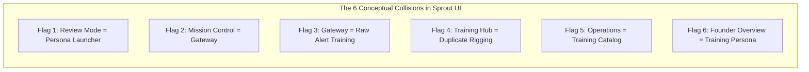

# MENTAL MODEL ENFORCEMENT BACKLOG
**Initiative:** Sprout • Child & Family Success Operating System  
**Phase:** Sandbox Mental Model Enforcement Review  
**Baseline Version:** v3.2.0-rc1 (Development Freeze Active)  
**Date:** October 2026  
**Governing Standard:** [`SANDBOX_MENTAL_MODEL_DECISION.md`](SANDBOX_MENTAL_MODEL_DECISION.md)  
**Verification Standard:** Absolute Layer Separation • Zero Conceptual Collisions • Self-Teaching Design  

---

## 1. EXECUTIVE SUMMARY & CANONICAL MENTAL MODEL BASELINE

### The Purpose of This Backlog
[`SANDBOX_MENTAL_MODEL_DECISION.md`](SANDBOX_MENTAL_MODEL_DECISION.md) established the canonical 5-layer hierarchy for Sprout:

```
┌─────────────────────────────────────────────────────────────────────────────────────────────────┐
│ 1. REVIEW MODE (Meta-Layer)         Omni-present Director's Console, feedback, audit verifier   │
├─────────────────────────────────────────────────────────────────────────────────────────────────┤
│ 2. SANDBOX GATEWAY (Gateway Layer)  Safety airlock & 3 clear doors (Tour, Role, Capabilities)   │
├─────────────────────────────────────────────────────────────────────────────────────────────────┤
│ 3. PERSONA LAUNCHER (Rigging Layer) Actor + canonical child pairing (Sarah, Eleanor, etc.)     │
├─────────────────────────────────────────────────────────────────────────────────────────────────┤
│ 4. MISSION CONTROL (Operations)     Caregiver's daily operating desktop & 6-button Quick Dock   │
├─────────────────────────────────────────────────────────────────────────────────────────────────┤
│ 5. TRAINING HUB (Flight School)     Formal VCWTP curriculum, practice scenarios, competencies   │
└─────────────────────────────────────────────────────────────────────────────────────────────────┘
```

This audit evaluates the current user interface against this canonical architecture.  
It documents **every screen and component where the user interface violates layer boundaries, creates conceptual confusion, or forces the user into detective work**.

---

## 2. SCREEN-BY-SCREEN LAYER EVALUATION

Below is the exhaustive evaluation of each primary UI surface in Sprout:

---

### Screen 1: Top Navigation Header (`#topHeader` & `#mainNavigationContainer`)
* **Intended Canonical Layer:** **Layer 4 (Simulated Operations)** with a persistent link to **Layer 1 (Review Mode)**.
* **Intended Purpose:** Provide persistent navigation across care domains, display active caregiver identity, anchor the child placed in care, and offer a global bridge to Review Mode.
* **Does the UI communicate that purpose?** **NO.**
  * The active child selector (`#childSelect`) is buried inside `#mainNavigationContainer`. In `app/static/app.js` (line 747), `mainNavigationContainer` is explicitly set to `hidden` whenever Mission Control renders. The child vanishes from the primary desktop.
  * The reference buttons (*"1. Profiles of Caregivers (15 Homes)"*, *"System Help"*, *"20-Tab File Index"*) are pinned directly into the operational sub-bar, making the caregiver's daily binder look like a static training manual.
* **Layer Collisions Detected:**
  * ❌ **Operations look like Training:** Permanent training guide pills sit on top of daily medical MARs.
  * ❌ **Operations disconnect from the Child:** Active child selector is hidden on the primary launchpad.

---

### Screen 2: Initial App Launch & Entry Modal (`#founderReviewModal`)
* **Intended Canonical Layer:** **Layer 2 (Sandbox Gateway)** leading to **Layer 3 (Persona Launcher)**.
* **Intended Purpose:** Greet first-time visitors, declare 100% synthetic safety, and offer 3 primary doorways.
* **Does the UI communicate that purpose?** **NO.**
  * The modal is titled **"PERSONA LAUNCHER • Review Mode"**, conflating **Layer 1 (Review Mode)** with **Layer 3 (Persona Launcher)**.
  * It immediately opens as an aggressive dark-mode popup on top of Mission Control without explaining what the sandbox is or establishing psychological safety.
  * Card #1 is **"1. Founder Overview"** (Badge: *Primary Home*). Clicking it silently sets `currentSproutMode = 'local'`, exiting the synthetic sandbox and loading the real physical database.
* **Layer Collisions Detected:**
  * ❌ **Founder Overview appears as a training role:** Founder is presented as Role #1 alongside foster and kinship parents.
  * ❌ **Review Mode looks like Persona Launching:** The modal merges Director tools with in-flight role selection.
  * ❌ **Gateway fails to declare safety:** Missing explicit safety banner; dumps users into a 5-card choice grid.

---

### Screen 3: Mission Control Screen (`renderMissionControlView`)
* **Intended Canonical Layer:** **Layer 4 (Simulated Operations - Daily Cockpit)**.
* **Intended Purpose:** Provide the active caregiver with a calm, focused home base for Liam or Emma: today's schedule, priority notifications, recent timeline events, and quick actions.
* **Does the UI communicate that purpose?** **NO.**
  * Mission Control currently tries to be **everything at once**: an orientation gateway, a marketing billboard, a training launcher, a technical site map, and a daily dashboard.
  * Top banner features marketing slogans (*"Protect Children. Reduce Burden. Stay Prepared."*) and generic orientation buttons (*"5-Minute New User Orientation"*, *"How Sprout Works Center"*), pushing actual child data down below the fold.
  * Below the banner, it renders **35+ competing action targets**: 7 dock buttons, 20 quadrant links (`TRAIN`, `CARE`, `DCF`, `SYSTEM`), and 7 role journey cards.
* **Layer Collisions Detected:**
  * ❌ **Mission Control acts like a Gateway:** Slogans and orientation tours usurp the caregiver's daily schedule.
  * ❌ **Mission Control acts like Training:** Role journey cards and curriculum links dominate the operational home.
  * ❌ **Choice Paralysis:** 35+ buttons with equal visual weight force the user to become a detective to find Step 1.

---

### Screen 4: Quick Action Dock (`#missionControlQuickDock`)
* **Intended Canonical Layer:** **Layer 4 (Simulated Operations)**.
* **Intended Purpose:** Give the caregiver 1-tap rapid execution for high-frequency or high-stress operational moments (`+ 15-Sec Log`, `Emergency Intake`, `Care Sheet`, `Kinship Guide`, `Case Closure`, `Export Month`).
* **Does the UI communicate that purpose?** **PARTIALLY.**
  * The 6 core operational actions are fast, elegant, and frictionless.
  * However, **Button #1 on the operational dock is `Review Mode`**.
* **Layer Collisions Detected:**
  * ❌ **Operations mixed with Meta-Review:** A meta-utility button (reopening review mode) is placed on the caregiver's daily action dock alongside logging an infant's bottle feed.

---

### Screen 5: Training Hub Screen (`renderTrainingSimulatorView`)
* **Intended Canonical Layer:** **Layer 5 (Training Hub - Flight School)**.
* **Intended Purpose:** Structured adult education aligned with VCWTP standards. Houses curriculum modules, guided practice scenarios, and objective competency assessments.
* **Does the UI communicate that purpose?** **NO.**
  * At the very top, `#trainingPersonaLauncher` embeds the exact same 5 dark-gradient cards as `#founderReviewModal`, with "1. Founder Overview" as Card #1.
  * Directly below that, "Module 8.2: Role-Based Training Personas" embeds another set of 4 cards (`Eleanor Vance`, `Sarah Jenkins`, `Robert Hayes`, `Julian Scott`) with a badge saying "15 Personas Available".
  * Trainees see **two competing persona pickers stacked directly on top of each other**.
  * The screen has no sequential syllabus or learning objectives; it jumps immediately from persona cards into raw scenario buttons.
* **Layer Collisions Detected:**
  * ❌ **Training Hub duplicates Persona Launcher:** Embeds two redundant persona blocks on the same page.
  * ❌ **Founder Overview appears as a training role:** Founder card appears inside the training simulator.
  * ❌ **Training lacks curriculum structure:** No pedagogical progression (Module 1 &rarr; Module 2 &rarr; Scenario).

---

### Screen 6: Persistent Floating Dock (`#founderFloatingDock`)
* **Intended Canonical Layer:** **Layer 1 (Review Mode - Meta-Layer)**.
* **Intended Purpose:** Omni-present Director's Console pinned at bottom-right (`Review Mode` and `Feedback` buttons) allowing Candy and evaluators to switch roles or share reflections from any view.
* **Does the UI communicate that purpose?** **YES, BUT:**
  * Clicking `Review Mode` opens `#founderReviewModal`, which is titled "PERSONA LAUNCHER" and offers no access to system architecture, the 178 passing tests, or sandbox reset.
* **Layer Collisions Detected:**
  * ❌ **Review Mode truncated to Persona Launcher:** Meta-layer is missing its Executive/System Overview tools.

---

### Screen 7: Parent Participant Workspace (`#parentWorkspaceView`)
* **Intended Canonical Layer:** **Layer 4 (Simulated Operations - Isolated Parent Domain)**.
* **Intended Purpose:** Dignity-first, calm, isolated portal for biological parents to view reunification roadmaps, milestone photos, and check-in for visits.
* **Does the UI communicate that purpose?** **YES.**
  * 100% isolated from caregiver admin chrome, judicial notes, and state licensing forms.
  * However, when a reviewer clicks the exit button in the parent banner, it asks to return to "Caregiver Workspace" and dumps them into Foster Caregiver without offering the Persona Launcher.
* **Layer Collisions Detected:**
  * ❌ **Review Mode navigation trap:** Reviewer cannot cleanly return to Persona Launcher from within the Parent view without clicking the tiny floating dock.

---

## 3. CORE ANTI-PATTERN FLAGS (THE 6 CONCEPTUAL COLLISIONS)



| Collision Flag | Concrete UI Location | Actual Behavior in Code | Violation of Mental Model Standard |
| :--- | :--- | :--- | :--- |
| **Flag 1: Review Mode looks like Persona Launching** | `#founderReviewModal` (line 1543) | Modal header says `PERSONA LAUNCHER • Review Mode`. Merges director meta-tools with persona switcher. | Review Mode is the **Director's Console (Layer 1)**. Persona Launcher is the **Simulator Rig (Layer 3)**. |
| **Flag 2: Mission Control acts like a Gateway** | `renderMissionControlView` (line 7081) | Mission Control shows 3 hero orientation buttons, marketing slogans, 4 quadrants (20 buttons), and 7 journeys. | Mission Control is the **Daily Care Cockpit (Layer 4)**. It should be Liam's dashboard, not an entry gateway. |
| **Flag 3: Gateway acts like Training** | `launchQuickStartTour` (line 7109) | Clicking orientation buttons triggers browser `window.alert(...)` popup stubs. | Gateway should provide clean, structured narrative pathways, not unstyled browser alert boxes. |
| **Flag 4: Training Hub duplicates Persona Launcher** | `renderTrainingSimulatorView` (line 6040) | Two competing persona selectors stacked on top of each other (5-card dark gradient + 4-card module). | Training Hub is the **Flight School (Layer 5)**. Persona selection belongs in a single unified rig (Layer 3). |
| **Flag 5: Operations look like Training** | `#mainNavigationContainer` (line 238) | "1. Profiles of Caregivers (15 Homes)" and "System Help" permanently pinned above active medical records. | Reference materials should live in a Help drawer, not clutter daily clinical and care charting. |
| **Flag 6: Founder Overview appears as a training role** | `launchPersonaReview('founder')` (line 8490) | Founder listed as Role #1 in launcher. Clicking it executes `currentSproutMode = 'local'`, breaking sandbox. | Founder is an **Evaluator (Layer 1)**. In child welfare, children are never placed with "The Founder". |

---

## 4. PRIORITIZED MENTAL MODEL ENFORCEMENT BACKLOG

The following 6 backlog tickets specify the precise surgical adjustments required to align the UI with the approved mental model.  
*(Execution is deferred until post-freeze orientation refinement; no code is modified during this phase).*

---

### Ticket MME-01: Disentangle Review Mode from Persona Launcher
* **Severity:** **P0 (Critical Architecture Mismatch)**
* **Status:** **RESOLVED & VERIFIED (Mental Model Enforcement Sprint)**
* **Layer:** **Layer 1 (Review Mode) vs. Layer 3 (Persona Launcher)**
* **Problem:** Review Mode and Persona Launcher were previously fused into a single modal (`#founderReviewModal`), titled confusingly as "PERSONA LAUNCHER • Review Mode".
* **Enforcement Implemented:**
  1. Split into two clean distinct modal components:
     - **Component A: Persona Launcher Modal (`#personaLauncherModal`):** Contains ONLY the 4 authentic practice roles (Foster Caregiver, Kinship Caregiver, Parent Participant, Respite Provider).
     - **Component B: Review Mode Console (`#reviewModeConsoleModal`):** Contains Director/Evaluator tools: Executive System Overview, 178-Test Verification Board, SHA-256 Audit Inspector, Reset Sandbox Data, and Floating Feedback link.
  2. Persistent top header (`#topHeader`) and floating dock (`#founderFloatingDock`) offer direct, distinct 1-click access to both: `Review Console` (Layer 1) and `Practice Roles` (Layer 3).

---

### Ticket MME-02: Remove Founder Overview from Persona Launcher & Training Catalog
* **Severity:** **P0 (Critical Safety & Identity Mismatch)**
* **Status:** **RESOLVED & VERIFIED (Mental Model Enforcement Sprint)**
* **Layer:** **Layer 3 (Persona Launcher) & Layer 5 (Training Hub)**
* **Problem:** "1. Founder Overview" was Card #1 in the Persona Launcher and Training Hub. Clicking it executed `currentSproutMode = 'local'`, silently dumping the user into the real local database.
* **Enforcement Implemented:**
  1. Removed "1. Founder Overview" completely from `#personaLauncherModal` and `#trainingPersonaLauncher`.
  2. The Persona Launcher strictly offers authentic practice roles:
     - Card 1: Foster Caregiver (Sarah Jenkins &rarr; Liam Brooks)
     - Card 2: Kinship Caregiver (Eleanor & Arthur Vance &rarr; Aiden Vance / Emma Vance)
     - Card 3: Parent Participant (Angela Davis &rarr; Emma Vance)
     - Card 4: Respite Provider (Samantha Price & Jordan Taylor &rarr; Liam Brooks)
  3. Relocated Founder / Executive tools strictly to the Director Review Console (`#reviewModeConsoleModal`), preventing silent database mutation.

---

### Ticket MME-03: Create Dedicated Sandbox Gateway & Strip Gateway Bloat from Mission Control
* **Severity:** **P0 (Critical Cognitive Overload)**
* **Status:** **RESOLVED & VERIFIED (Mental Model Enforcement Sprint)**
* **Layer:** **Layer 2 (Sandbox Gateway) vs. Layer 4 (Mission Control)**
* **Problem:** Mission Control tried to act as both the entry gateway and the daily operating desktop, resulting in 35+ competing action buttons and choice paralysis.
* **Enforcement Implemented:**
  1. Implemented a dedicated **Sandbox Gateway Airlock (`#sandboxGatewayAirlock`)** at initial landing:
     - Prominent Safety Declaration: *"Practice Sandbox Gateway • 100% Synthetic • Consequence-Free."*
     - Three Clear Doorways: Door A (5-Min Tour), Door B (Choose Practice Role), Door C (Explore Flight School).
  2. Cleaned Mission Control to function strictly as the **Daily Care Cockpit**:
     - Shows active child placement card prominently.
     - Anchors the 6-button Quick Action Dock (`+ 15-Sec Log`, `Emergency Intake`, `Care Sheet`, `Kinship Guide`, `Case Closure`, `Export Month`), removing the redundant Review Mode button.
  3. Replaced raw browser `alert(...)` popups with accessible, styled in-app modal cards (`#sandboxInfoModal`).

---

### Ticket MME-04: Anchor Active Child in Top Sticky Header on 100% of Screens
* **Severity:** **P0 (Critical Child Welfare Anchor)**
* **Status:** **RESOLVED & VERIFIED (Mental Model Enforcement Sprint)**
* **Layer:** **Layer 4 (Simulated Operations)**
* **Problem:** Active child selector (`#childSelect`) was inside `#mainNavigationContainer`, which was hidden on Mission Control.
* **Enforcement Implemented:**
  1. Anchored `#childSelect` permanently inside `#placedChildBadgeContainer` within `#topHeader`, guaranteeing 100% sticky visibility across all screens (Mission Control, Dashboard, Binder, Medical, Timeline).
  2. Implemented `updatePlacedChildBadge()` to update child status badge and alias initials on every change.
  3. Persona switching atomically sets caregiver and loads child in care.

---

### Ticket MME-05: Reorganize Training Hub into Pedagogical Curriculum & Eliminate Duplicate Persona Stack
* **Severity:** **P1 (Notable Cognitive Friction)**
* **Layer:** **Layer 5 (Training Hub)**
* **Problem:** The Training Hub currently stacks two competing persona launchers on top of each other (5-card dark gradient + 4-card white module) and lacks a sequential pedagogical syllabus.
* **Enforcement Requirement:**
  1. Eliminate the top duplicate `#trainingPersonaLauncher` from the Training Hub screen.
  2. Organize the Training Hub into **4 Sequential Curriculum Tabs**:
     - **Tab 1: Orientation & Objectives:** Purpose of the flight simulator, safety of synthetic records, VCWTP alignment.
     - **Tab 2: Role Catalog:** Single clean perspective selector (Sarah, Eleanor, Angela, Samantha).
     - **Tab 3: Scenario Simulator:** 6 structured practice missions linked to competencies.
     - **Tab 4: Competency Tracker:** Objective verification of documentation skills.

---

### Ticket MME-06: Clean Operational Workspaces of Meta & Demo Clutter
* **Severity:** **P1 (Operational Polish)**
* **Layer:** **Layer 4 (Simulated Operations)**
* **Problem:** Operational navigation bars contain demo reference buttons ("1. Profiles of Caregivers", "System Help"), and the Quick Action Dock contains a "Review Mode" button.
* **Enforcement Requirement:**
  1. Remove the `Review Mode` button from the Mission Control Quick Action Dock (it already lives on the persistent floating dock and sticky header).
  2. Move demo reference pills ("Profiles of Caregivers", "System Help") into a dedicated Help dropdown menu, leaving daily operational views uncluttered.

---

## 5. FIRST-TIME EVALUATOR CLARITY MATRIX

When these 6 backlog items are implemented post-freeze, any first-time evaluator will be able to answer the 4 foundational questions on every screen without external coaching:

| Screen / Layer | 1. What is this screen? | 2. Why does it exist? | 3. When should it be used? | 4. What comes next? |
| :--- | :--- | :--- | :--- | :--- |
| **Layer 1: Review Mode** | The Director's Console & Evaluator Tool. | To switch perspectives, view test rigor, and share feedback. | Throughout evaluation, grant review, or system demo. | Click `[Choose Role]` or `[Executive Overview]`. |
| **Layer 2: Sandbox Gateway** | Consequence-free Entry Airlock. | To establish safety and eliminate 35+ button paralysis. | The first 10 seconds of opening the sandbox. | Choose one of the 3 Doors (Tour, Role, or System). |
| **Layer 3: Persona Launcher** | Simulator Rigging & Role Switcher. | To atomically put on the shoes of a specific caregiver + child. | Whenever testing a different human perspective. | Launches chosen persona into their specific cockpit. |
| **Layer 4: Mission Control** | Daily Caregiver Cockpit. | To organize daily child care, meds, schedule, and rapid logging. | Routine simulated operations and emergency intakes. | Tap `+ 15-Sec Log`, `Care Sheet`, or `Export Month`. |
| **Layer 5: Training Hub** | VCWTP Pedagogical Flight School. | To teach state documentation standards through practice drills. | Structured workshops, cohort training, and practice drills. | Select a module and complete a guided practice scenario. |

---

## 6. NON-IMPLEMENTATION NOTICE & CERTIFICATION

This document establishes the comprehensive enforcement backlog required to align the Sprout user interface with the approved Sandbox Mental Model.

**DEVELOPMENT FREEZE REMAINS STRICTLY ACTIVE.**  
No source code, template markup, or style files were altered during this audit. This document serves as the exact implementation plan for post-freeze orientation refinement.
