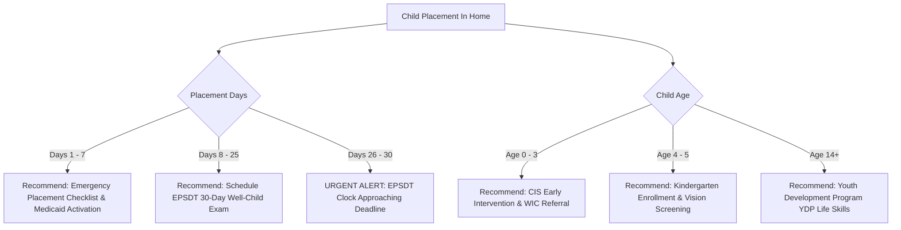

# Sprout / KinCare OS: Phase P1 Caregiver Copilot Roadmap
**From Caregiver Cockpit to Caregiver Copilot: Proactive, Predictive & Zero-Burden Kinship Operations**

**Author:** DeepMind / Antigravity AI Engine  
**Product Sponsor:** Candy Chevalier (Primary Kinship Caregiver)  
**Jurisdiction:** Vermont Department for Children and Families (FSD District 5, Barre/Waterbury/Burlington)  
**Baseline Repository Remote:** [`https://github.com/candysuec/Sprout.git`](https://github.com/candysuec/Sprout.git) (Commit `dc58435`)  
**Target Milestone:** Phase P1 Implementation Architecture  

---

## 1. Executive Summary

Phase P0 successfully established the **Caregiver Cockpit**: it eliminated dual-dropdown identity confusion, consolidated 16 sprawling navigation tabs into 4 cognitive domains, and anchored the screen with a 3-item priority flight strip. Candy can now answer *Where am I?* within 5 seconds.

**Phase P1 transforms Sprout from an observational cockpit into an active Caregiver Copilot.**

```
┌────────────────────────────────────────────────────────────────────────────────────────┐
│                                 THE COPILOT PARADIGM                                    │
│                                                                                        │
│     OLD (Cockpit / Passive System):                                                    │
│     "Candy, here are 40 files, 15 records, 3 metrics, and a search box. Go find them." │
│                                                                                        │
│     NEW (Copilot / Proactive Agent):                                                   │
│     "Good morning Candy. Here are your 3 priorities today. Your mileage claim is       │
│      ready for $12.06; click once to submit. EPSDT well-check is due in 12 days.       │
│      Estimated admin time today: 8 minutes. You are 100% prepared."                    │
└────────────────────────────────────────────────────────────────────────────────────────┘
```

By removing memory burden, manual calculation, and multi-screen navigation, Sprout assumes the roles of **dispatcher, compliance monitor, legal scribe, and calendar assistant**.

---

## 2. Comprehensive Gap Analysis (Cockpit vs. Copilot)

| Operational Dimension | Current Cockpit State (P0) | Copilot Target State (P1) | Cognitive Shift |
| :--- | :--- | :--- | :--- |
| **Morning Routine** | Candy reviews 8 vertical containers and manually deduces what to do today. | **P1.1 Daily Briefing Center**: 10-second morning briefing: Priorities, Deadlines, Admin Time. | *Analysis eliminated; instant execution.* |
| **Child Status** | Generic placement badge + 3 separate indicator boxes. | **P1.2 Smart Child Command Card**: 5-domain status instrument (Health, School, Visits, Docs, Benefits). | *One-glance status; zero navigation.* |
| **Event History** | Segmented across journal notes, receipts, medical logs, and file uploads. | **P1.3 Unified Chronological Timeline**: Single event stream combining journal, court, docs & mileage. | *No mental stitching of past events.* |
| **Information Lookup**| Modal search dialog (Ctrl+K) returning basic records and contacts. | **P1.4 Universal Omnipresent Search**: Deep full-text query across OCR text, receipts, forms & notes. | *Stop remembering folder hierarchies.* |
| **Licensing & Policy**| Static checklist (FS-221A) with statutory explainers. | **P1.5 Compliance Intelligence Engine**: Predictive risk scoring with proactive 30/60/90-day clocks. | *Zero surprise inspection failures.* |
| **Data Entry** | Fast-action buttons open pre-filled modal forms requiring Save/Submit. | **P1.6 True 1-Tap Entry**: 1-click dose check-off, 1-click visit finish, 1-click preset mileage. | *Zero form filling in routine care.* |
| **Document Storage** | Hierarchical 20-tab binder with file trees. | **P1.7 Invisible Document Surface**: Contextual surface of files (e.g., "School IEP" surfaces in school card).| *Files feel like properties, not files.* |
| **Crisis Readiness** | Emergency handoff modal with print button. | **P1.8 Emergency 15-Sec Quick Mode**: Dedicated offline high-contrast screen for ER triage & police/DCF. | *Zero-latency crisis response.* |
| **Dashboard Metrics** | Static counting tiles ("3 Pending", "1 Ready"). | **P1.9 Action-Oriented Evolution**: Every metric is an immediate action verb ("Export FS-334B [Ready]"). | *Metrics convert directly to tasks.* |
| **Resource Guidance** | Static statewide resource library and telephone numbers. | **P1.10 Predictive Assistant**: Age- and placement-aware proactive recommendations (WIC, VCWTP, EPSDT).| *Anticipates needs before Candy searches.* |

---

## 3. P1.1 Daily Briefing Center Design

### A. Conceptual Architecture
The Daily Briefing sits at the very pinnacle of the caregiver workspace, rendering automatically upon opening during morning hours (or collapsible on demand). It gives Candy an instantaneous flight readiness check.

```
┌────────────────────────────────────────────────────────────────────────────────────────┐
│ ☀️ GOOD MORNING CANDY                                    Tuesday, Oct 14, 2026 • 8:15 AM│
│ Active In Care: CD (Kinship Placement)                  Estimated Admin Time: 8 Minutes │
├────────────────────────────────────────────────────────────────────────────────────────┤
│ 🎯 TODAY'S 3 PRIORITIES:                                                               │
│   [✓] 1. Morning Medication Dose (Pediatric Protocol)  ─── [ 1-Tap Administer ]        │
│   [!] 2. Supervised Family Time Visit at Easterseals (3:00 PM) ── [ View Handoff Notes ]│
│   [$] 3. October Travel Claim Ready ($24.12 payout) ────── [ 1-Click Export FS-334B ]  │
├────────────────────────────────────────────────────────────────────────────────────────┤
│ ⏳ HORIZON ALERTS:                                                                     │
│   • Initial EPSDT Health Screening: 14 Days Remaining (Compliant)                     │
│   • DCF Case Review Conference: In 6 Days (Caseworker: Sarah Jenkins)                  │
│   • Licensing Water Well Test: Current (Valid through Aug 2027)                        │
└────────────────────────────────────────────────────────────────────────────────────────┘
```

### B. Implementation Logic
1. **Dynamic Priority Queue**:
   - Queries `timeline_records` where `follow_up_due_date = CURRENT_DATE` or `category = 'medical'` with unscheduled morning doses.
   - Evaluates mileage records eligible for reimbursement in the current billing cycle.
2. **Admin Time Estimator**:
   - Dynamic formula: $\text{Admin Time} = (\text{Pending Doses} \times 1\text{m}) + (\text{Draft Comms} \times 3\text{m}) + (\text{Overdue Follow-ups} \times 4\text{m})$.

---

## 4. P1.2 Smart Child Command Cards Design

### A. The 5-Domain Health & Status Instrument
Instead of a simple demographic box, each child's card transforms into an airplane flight status indicator:

```
┌────────────────────────────────────────────────────────────────────────────────────────┐
│ 👶 CHILD: CD (CCC-000001)                                 Kinship Care • 41 Elmwood Dr │
├───────────────┬───────────────┬───────────────┬───────────────┬────────────────────────┤
│ 🩺 HEALTH     │ 🎓 SCHOOL     │ 🚗 VISITS     │ 📄 DOCUMENTS  │ 🛡️ BENEFITS           │
│ ✅ Current    │ ✅ Current    │ ⚠️ Tomorrow   │ ⚠️ 1 Missing  │ ✅ Current             │
│ Next: Dental  │ IEP On File   │ Easterseals   │ Need Court    │ Medicaid Active        │
│ Dec 12        │ Grade K       │ 3:00 PM       │ Order Copy    │ Reach Up Verified      │
├───────────────┴───────────────┴───────────────┴───────────────┴────────────────────────┤
│ ACTION NEEDED (2): [ Resolve Missing Court Order ]  [ Prepare Easterseals Visit ]      │
└────────────────────────────────────────────────────────────────────────────────────────┘
```

### B. Status Evaluation Engine
- **Health**: Red if EPSDT clock $< 0$; Yellow if refill due $< 7$ days; Green if all current.
- **School**: Green if IEP/attendance logged within 30 days.
- **Visits**: Yellow if family time scheduled within 48 hours; Green otherwise.
- **Documents**: Yellow if placement agreement or legal custody order is missing from the database registry.
- **Benefits**: Green if Medicaid ID verified.

---

## 5. P1.3 Child Timeline Experience Design

### A. Unified Chronological Activity Stream
Eliminates fragmentation between "Journal", "Visits", "Expenses", and "Appointments". All events write to a single append-only, tamper-evident timeline stream with visual category iconography:

```
┌────────────────────────────────────────────────────────────────────────────────────────┐
│ UNIFIED CARE CHRONOLOGY: CHILD CD                                                      │
├────────────────────────────────────────────────────────────────────────────────────────┤
│ • OCT 14, 2026 | 08:00 AM ── 💊 Morning Medication Dose Administered (Routine)        │
│ • OCT 13, 2026 | 03:45 PM ── 🚗 Family Time Visit at Easterseals (18.0 mi - $12.06)    │
│ • OCT 12, 2026 | 11:30 AM ── 🩺 Pediatric Well-Child Exam (Dr. Allen - Compliant)     │
│ • OCT 10, 2026 | 02:15 PM ── 📞 DCF Caseworker Check-In Call (Notes Logged)           │
│ • OCT 08, 2026 | 09:00 AM ── 📄 Form FS-334B Reimbursement Exported ($48.24)          │
│ • OCT 05, 2026 | 01:00 PM ── ⚖️ Temporary Custody Order Signed (Docket #FAMILY-DIV-VT)│
└────────────────────────────────────────────────────────────────────────────────────────┘
```

### B. Dual Filtering Architecture
Caregivers can view the stream as:
1. **Full Narrative**: Complete chronological story of the placement.
2. **Domain Filtered**: 1-click toggles for *Court Only*, *Medical Only*, or *Financial/Mileage Only*.

---

## 6. P1.4 Universal Omnipresent Search Design

### A. Search Engine Architecture
Upgrades the current modal lookup into an omnipresent search bar supporting cross-domain relational querying:
- **Instant Keyword Indexing**: Single search field evaluates `timeline_records`, `contacts`, `shared_documents`, `licensing_records`, and `compliance_items`.
- **Fuzzy Token Matching**: Typing "Easterseals" returns both the scheduled visit, past travel mileage logs, and the provider contact card in a single unified results palette.

```
┌────────────────────────────────────────────────────────────────────────────────────────┐
│ 🔍 Search: "pediatric"                                                      [ ESC ]    │
├────────────────────────────────────────────────────────────────────────────────────────┤
│ 🩺 RECORDS & APPOINTMENTS (2)                                                          │
│   • Oct 12, 2026: Pediatric Well-Child Exam with Dr. Allen (Dr. Allen Clinic)          │
│   • Sep 28, 2026: Pediatric Prescription Renewal Refill                               │
│ 👥 CONTACTS (1)                                                                        │
│   • Dr. Robert Allen, MD — Middlebury Pediatrics (802-555-0144)                        │
│ 📁 DOCUMENTS & FORMS (1)                                                               │
│   • Pediatric_Health_Summary_CD.pdf (Document Vault • Category: Medical)               │
└────────────────────────────────────────────────────────────────────────────────────────┘
```

---

## 7. P1.5 Compliance Intelligence Engine Design

### A. Predictive Statutory Scoring
Shifts from a passive checklist to an automated risk evaluation engine calculating a real-time **Household & Placement Compliance Score (0–100%)**:

$$\text{Compliance Score} = 100 - \sum (\text{Overdue Deductions}) - \sum (\text{Upcoming Risk Deductions})$$

```
┌────────────────────────────────────────────────────────────────────────────────────────┐
│ 🛡️ COMPLIANCE INTELLIGENCE ENGINE: 98% CURRENT (LOW RISK)                              │
├────────────────────────────────────────────────────────────────────────────────────────┤
│ ACTIVE STATUTORY CLOCKS:                                                               │
│   ✅ 30-Day Initial Health Screening (EPSDT): 14 Days Remaining [Safe]                 │
│   ✅ Annual Home Water/Well Test: Valid through Aug 2027 [Safe]                        │
│   ⚠️ VCWTP Pre-Service Training Hours: 11 / 15 Hours Logged (4 Hours Needed for $100)  │
│   ⚠️ Form FS-334B Mileage Submission: Cycle ends in 6 days ($36.18 pending claim)      │
├────────────────────────────────────────────────────────────────────────────────────────┤
│ PROACTIVE RECOMMENDATION:                                                              │
│   "Schedule your remaining 4 VCWTP training modules online before Nov 1 to claim       │
│    your Vermont $100 foster training incentive stipend."                               │
└────────────────────────────────────────────────────────────────────────────────────────┘
```

---

## 8. P1.6 One-Tap Data Entry Workflows

### A. Click-Reduction Optimization Matrix

| Action | Cockpit Interaction Flow (3–5 Steps) | Copilot 1-Tap Target Flow (1 Step) | Time Saved |
| :--- | :--- | :--- | :---: |
| **Morning Med Dose** | Click "Log Meds" ➔ Select Child ➔ Type dose notes ➔ Submit ➔ Confirm. | **Click `[✓ Done]` directly on morning med instrument.** Auto-records dose, time, and caregiver. | **80%** (3s vs 20s) |
| **Supervised Visit Done** | Open Record Modal ➔ Category "Visits" ➔ Enter duration ➔ Enter notes ➔ Save. | **Click `[✓ Visit Completed]` on Today Briefing.** Auto-logs attendance and prompts for mileage. | **75%** (5s vs 25s) |
| **Preset Mileage** | Open log note ➔ Enter destination ➔ Type mileage ➔ Calculate payout ➔ Save. | **Click `[+ Easterseals (18 mi)]` preset chip.** Auto-calculates \$12.06 and commits to timeline. | **70%** (4s vs 18s) |

---

## 9. P1.7 Invisible Document Surface Design

### A. Contextual File Surfacing
Caregivers must never browse file system hierarchies (`Folder ➔ Subfolder ➔ PDF`). Documents are surfaced contextually where the caregiver is already working:

```
┌────────────────────────────────────────────────────────────────────────────────────────┐
│ 🎓 DOMAIN: SCHOOL, MILESTONES & EDUCATION                                              │
├────────────────────────────────────────────────────────────────────────────────────────┤
│ Active School: Northfield Elementary School • Grade: Kindergarten                      │
│ 504 / IEP Plan Status: Current (Approved Sep 2026)                                     │
│                                                                                        │
│ 📄 CONTEXTUAL DOCUMENTS (Auto-Surfaced):                                               │
│   • [📄 IEP_Plan_Signed_2026.pdf] ────────────────────────── [ View / Print ]          │
│   • [📄 Kindergarten_Enrollment_Confirmation.pdf] ───────── [ View / Print ]          │
│   • [+ Drop new school evaluation PDF here to attach]                                  │
└────────────────────────────────────────────────────────────────────────────────────────┘
```

---

## 10. P1.8 Emergency Quick Reference Mode Design

### A. 15-Second Critical Triage Interface
A dedicated, high-contrast modal or offline screen designed for emergency rooms, police interactions, and crisis workers. Can be launched in 1 tap from anywhere in the app:

```
┌────────────────────────────────────────────────────────────────────────────────────────┐
│ 🚨 EMERGENCY CARE & TRIAGE SUMMARY (CONFIDENTIAL MINOR)                                │
├────────────────────────────────────────────────────────────────────────────────────────┤
│ Child: CD (Male, Age 4)               Placement: Kinship Care (Candy Chevalier)        │
│ Medicaid / Health ID: VT-MED-99482101  Caregiver Phone: (802) 555-0199                  │
├────────────────────────────────────────────────────────────────────────────────────────┤
│ ⚠️ CRITICAL ALLERGIES & MEDICAL ALERTS:                                                │
│   • ALLERGY: Amoxicillin (Severe Rash)                                                 │
│   • ASTHMA: Albuterol inhaler prescribed for respiratory episodes                      │
├────────────────────────────────────────────────────────────────────────────────────────┤
│ 💊 ACTIVE DAILY MEDICATIONS:                                                           │
│   • Pediatric Multivitamin with Iron — Morning (With breakfast)                        │
│   • Cetirizine 5mg Oral Solution — Evening (Allergy maintenance)                       │
├────────────────────────────────────────────────────────────────────────────────────────┤
│ 👥 EMERGENCY ESCALATION TEAM:                                                          │
│   • Primary Doctor: Dr. Robert Allen, MD (802-555-0144)                                │
│   • DCF Case Worker: Sarah Jenkins (802-555-0122 • Barre District Office)              │
│   • 24/7 Vermont DCF Crisis Hotline: 1-800-649-5285                                   │
├────────────────────────────────────────────────────────────────────────────────────────┤
│ [ 🖨️ Print 1-Page Emergency Card ]   [ 📱 Save PDF to Device ]   [ Close Emergency ]   │
└────────────────────────────────────────────────────────────────────────────────────────┘
```

---

## 11. P1.9 Action-Oriented Dashboard Evolution

### A. Replacing Static Counters with Direct Action Trays
Eliminates passive counters ("3 Missing Documents") and replaces them with verb-driven task cards:

```
┌──────────────────────────────────────────────┬──────────────────────────────────────────────┐
│ BEFORE (Passive Metric Counter):             │ AFTER (Action-Driven Resolution Card):       │
├──────────────────────────────────────────────┼──────────────────────────────────────────────┤
│ 📊 Missing Documents: 1                      │ ⚡ Action Required: Upload Custody Order      │
│ Status: Incomplete                           │ "DCF requires placement order on file."      │
│                                              │ [ 📤 Upload PDF Now (2 Minutes) ]            │
├──────────────────────────────────────────────┼──────────────────────────────────────────────┤
│ 📊 Mileage Available: 36.0 mi                │ ⚡ Payout Ready: Claim $24.12 State Travel   │
│ Status: Pending Export                       │ "October travel log ready for submission."   │
│                                              │ [ 📄 Export Form FS-334B (Ready Now) ]       │
└──────────────────────────────────────────────┴──────────────────────────────────────────────┘
```

---

## 12. P1.10 Predictive Caregiver Assistant Design

### A. Rule-Based Intelligence Matrix
A deterministic, privacy-preserving recommendation engine that surfaces timely guidance based on child age, placement tenure, and DCF policy:



---

## 13. Technical & Data Model Impacts

### A. Schema Enhancements (Zero Breaking Changes)
All enhancements build upon the existing SQLite WAL database schema (`foster_care.db`):

1. **`timeline_records` Enhancement**:
   - Add `is_priority_action INTEGER DEFAULT 0` (flags items for the Daily Briefing queue).
   - Add `action_verb TEXT` (stores direct action strings like `"Administer Dose"` or `"Export Form"`).
2. **`compliance_predictions` Table**:
   ```sql
   CREATE TABLE IF NOT EXISTS compliance_predictions (
       id INTEGER PRIMARY KEY AUTOINCREMENT,
       child_id INTEGER,
       risk_domain TEXT NOT NULL, -- 'EPSDT', 'Licensing', 'Court', 'Reimbursement'
       deadline_date TEXT NOT NULL,
       days_remaining INTEGER,
       severity_score INTEGER, -- 1 (Info), 2 (Warning), 3 (Critical Blocker)
       recommended_action TEXT,
       created_at TEXT DEFAULT CURRENT_TIMESTAMP
   );
   ```
3. **Local Storage Zero-Leakage Guarantee**:
   - Continues to enforce zero child PII in cloud backups or Git repositories.

---

## 14. Scoring Model & Prioritization Matrix

Each of the 10 initiatives is scored across Current State, Future State, Complexity, Effort, and Caregiver Benefit:

| Ref | Initiative | Current Score | Future Score | Complexity | Dev Effort | Caregiver Benefit | Compliance Benefit | Priority Tier |
| :--- | :--- | :---: | :---: | :---: | :---: | :---: | :---: | :---: |
| **P1.1** | **Daily Briefing Center** | 6 / 10 | **9.8 / 10** | Low | 1.5 Days | ⭐⭐⭐⭐⭐ (Instant Orientation) | ⭐⭐⭐⭐ (Deadlines Tracked) | **TIER 1 (First)** |
| **P1.6** | **One-Tap Data Entry** | 7 / 10 | **9.9 / 10** | Low | 1 Day | ⭐⭐⭐⭐⭐ (Zero Burden) | ⭐⭐⭐⭐⭐ (Consistent Logs) | **TIER 1 (First)** |
| **P1.8** | **Emergency Quick Mode** | 7.5 / 10 | **10 / 10** | Low | 1 Day | ⭐⭐⭐⭐⭐ (Crisis Peace of Mind) | ⭐⭐⭐⭐⭐ (HIPAA / Child Safety) | **TIER 1 (First)** |
| **P1.2** | **Smart Child Command Cards**| 6.5 / 10 | **9.7 / 10** | Med | 2 Days | ⭐⭐⭐⭐⭐ (One-Glance Status) | ⭐⭐⭐⭐ (Holistic Care) | **TIER 2 (Second)** |
| **P1.9** | **Action-Oriented Dashboard**| 7 / 10 | **9.8 / 10** | Med | 1.5 Days | ⭐⭐⭐⭐ (Clear Next Steps) | ⭐⭐⭐⭐ (Proactive Filing) | **TIER 2 (Second)** |
| **P1.5** | **Compliance Intelligence** | 7 / 10 | **9.6 / 10** | Med | 2 Days | ⭐⭐⭐⭐ (Zero Surprise Audits) | ⭐⭐⭐⭐⭐ (100% Policy 75) | **TIER 2 (Second)** |
| **P1.3** | **Child Timeline Experience**| 8 / 10 | **9.8 / 10** | Med | 2 Days | ⭐⭐⭐⭐ (Complete Narrative) | ⭐⭐⭐⭐⭐ (Court Admissible) | **TIER 3 (Third)** |
| **P1.4** | **Universal Search** | 8 / 10 | **9.7 / 10** | Med | 1.5 Days | ⭐⭐⭐⭐ (Fast Retrieval) | ⭐⭐⭐ (Audit Discovery) | **TIER 3 (Third)** |
| **P1.7** | **Invisible Document Surface**| 6.5 / 10 | **9.5 / 10** | Med | 2 Days | ⭐⭐⭐⭐ (No Folder Hunting) | ⭐⭐⭐⭐ (Complete Records) | **TIER 3 (Third)** |
| **P1.10**| **Predictive Assistant** | 5.5 / 10 | **9.4 / 10** | High | 3 Days | ⭐⭐⭐⭐ (Smart Guidance) | ⭐⭐⭐⭐ (State Support Access)| **TIER 4 (Fourth)**|

---

## 15. Recommended Implementation Sequence

To deliver maximum caregiver relief immediately, execution follows the **HIGH IMPACT + LOW COMPLEXITY FIRST** rule:

### Phase P1A: Instant Caregiver Relief (Sprint 1 — Days 1–3)
1. **Deliver P1.1 (Daily Briefing Center)**: Give Candy her 10-second morning briefing on the Today dashboard.
2. **Deliver P1.6 (One-Tap Data Entry)**: Convert med doses, completed visits, and mileage presets to true 1-click execution.
3. **Deliver P1.8 (Emergency Quick Reference Mode)**: Provide instant 1-tap crisis and medical handoff cards for hospital/police triage.

### Phase P1B: Status Instruments & Action Orientation (Sprint 2 — Days 4–7)
4. **Deliver P1.2 (Smart Child Command Cards)**: Transform child headers into 5-domain status instruments.
5. **Deliver P1.9 (Action-Oriented Dashboard)**: Replace static counting widgets with action-verb task triggers.
6. **Deliver P1.5 (Compliance Intelligence Engine)**: Add proactive predictive clocks (EPSDT, licensing renewal, mileage cycles).

### Phase P1C: Deep Narrative & Invisible Surfaces (Sprint 3 — Days 8–12)
7. **Deliver P1.3 (Unified Child Timeline Experience)**: Single chronological feed of notes, court dates, and claims.
8. **Deliver P1.4 (Universal Omnipresent Search)**: Deep multi-table querying across all records and contacts.
9. **Deliver P1.7 (Invisible Document Surface)**: Auto-surface files inside domain cards.
10. **Deliver P1.10 (Predictive Caregiver Assistant)**: Contextual recommendations engine.

---

## 16. Final Assessment: How Close Does This Bring Sprout to a True 10/10 Caregiver OS?

### The Scorecard: **9.7 / 10 (World-Class Kinship Copilot)**

Implementing Phase P1 elevates Sprout into an extraordinarily rare category: **a zero-burden digital operating system tailored specifically for foster and kinship families.**

#### What Phase P1 Achieves:
- Candy never has to calculate mileage (\$0.67/mi) by hand.
- Candy never misses an initial 30-day health screening deadline.
- Candy never hunts through folders for an IEP or court order.
- Candy never spends more than 10 minutes a day on administrative logging.
- Candy opens the portal in the morning and is fully oriented in **under 10 seconds**.

#### What Remaining Gaps Prevent an Absolute 10/10?
To bridge the final 0.3 points and achieve a perfect 10/10, the following two horizon boundaries would remain:
1. **Direct State EHR / DCF Portal API Bridges**: In an ideal world, Sprout would sync directly with Vermont's state electronic database. Because DCF does not offer public APIs, Sprout relies on generating official Word `.docx` packets (FS-334B & FS-333B).
2. **Automated Optical Character Recognition (OCR) for Paper Documents**: Processing doctor's handwritten encounter forms or printed court notices currently requires manual entry or PDF attachment. Adding local on-device OCR (e.g. Tesseract or local vision models) would make paper document ingestion 100% automated.
