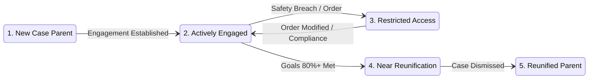

# PARENT PARTICIPANT DEMO & TESTING SCENARIOS
**Initiative:** Sprout  
**Project:** Child & Family Success Operating System  
**Document Focus:** Standardized Parent Lifecycle Simulation Profiles  
**Version:** Sprout v3.2 Foundation Baseline  

---

## 1. Executive Purpose

To ensure that the **Parent Participant Workspace** can be systematically tested across all real-world stages of child welfare cases, Sprout defines 5 benchmark scenarios. 

Each scenario specifies:
- **Case Context & Demographics**
- **Goals** (Case plan milestones and progress levels)
- **Evidence** (Uploaded certificates, leases, verification documents)
- **Family Time** (Visitation cadence, supervision level, check-in history)
- **Visibility** (What notes and milestones are shared vs. masked)
- **Status** (Lifecycle state in the 10-state access lifecycle)



---

## 2. Benchmark Parent Scenarios

---

### Scenario 1: New Case Parent (Orientation & Intake)
- **Persona:** *Danielle Miller* • **Child:** *CH-203 Noah Miller*
- **Lifecycle State:** `INVITED / PROVISIONAL` (Stage 2)
- **Emotional / System Context:** High stress, overwhelming grief, distrust of the child welfare system. Needs immediate clarity on court expectations without being overwhelmed by administrative bureaucracy.

| Dimension | Specification & Data Values |
| :--- | :--- |
| **Goals** | **Initial 30-Day Stabilization:**<br>1. Attend Preliminary Hearing (Completed)<br>2. Complete Intake Assessment with FSW (In Progress)<br>3. Enroll in DCF-Approved Parenting Class (Pending Enrollment)<br>4. Establish Reliable Phone / Contact Check-Ins (Active) |
| **Evidence** | - Signed Preliminary Hearing Notice (`.pdf`)<br>- Contact Update Verification Form |
| **Family Time** | - **Schedule:** Weekly 1.0 Hour Supervised Visits at DCF District Office (Tuesdays 2:00 PM - 3:00 PM)<br>- **Check-In History:** 1 visit scheduled; 0 completed.<br>- **Support Note:** Transportation bus passes provided by caseworker. |
| **Visibility** | - **Allowed Note Classifications:** `shared_family` only (caregiver has approved 1 positive photo and 1 school attendance note).<br>- **Masked Fields:** Caregiver home address, caregiver contact info, school address. |
| **System Status** | `PROVISIONAL_ACCESS` • Passwordless magic-token onboarding active. |

---

### Scenario 2: Actively Engaged Parent (Consistent Progress)
- **Persona:** *Angela Davis* • **Child:** *CH-201 Liam Brooks*
- **Lifecycle State:** `ACTIVE_PARTICIPATION` (Stage 4)
- **Emotional / System Context:** Highly motivated, building collaborative trust with foster caregiver. Diligently completing classes and establishing home stability.

| Dimension | Specification & Data Values |
| :--- | :--- |
| **Goals** | **Reunification Case Plan Progress: 75% Complete**<br>1. 12-Week Nurturing Parenting Course: 10/12 Sessions Completed (83%)<br>2. Safe & Stable Housing: 2-Bedroom Lease Approved & Verified (Completed)<br>3. Weekly Individual Counseling: 8 Consecutive Weeks Attended (100%)<br>4. Health & Wellness Screenings: Consistent Negative Screens (100% Compliant) |
| **Evidence** | - `Easterseals_Session10_Attendance.pdf` (Verified & Included in Court Packet)<br>- `Apartment_Lease_Agreement_Signed.pdf` (Verified by FSW)<br>- `Counseling_Letter_Dr_Aris.pdf` (Active) |
| **Family Time** | - **Schedule:** Twice Weekly 2.0 Hour Semi-Supervised Visits at Easterseals Family Center (Tuesdays & Thursdays 3:30 PM - 5:30 PM)<br>- **Check-In History:** 12/12 visits attended on-time (100% Record).<br>- **1-Tap Check-In:** Active with GPS timestamp logging. |
| **Visibility** | - **Allowed Note Classifications:** `shared_family` (reading victories, artwork keepsakes, milestone photos).<br>- **Masked Fields:** Foster caregiver working journal notes, internal DCF communications, licensing files. |
| **System Status** | `ACTIVE_ENGAGED` • Two-way notification drafts enabled for positive milestones. |

---

### Scenario 3: Restricted Parent (Protective Safety Gate)
- **Persona:** *Jason Vance* • **Child:** *CH-202 Emma Vance*
- **Lifecycle State:** `RESTRICTED_ACCESS` (Stage 5)
- **Emotional / System Context:** History of volatile confrontation or active no-contact order with caregiver. Requires strict legal firewalling while preserving right to view child wellness updates under court decree.

| Dimension | Specification & Data Values |
| :--- | :--- |
| **Goals** | **Court-Mandated Protective Orders:**<br>1. Complete Certified Batterers Intervention / Anger Management (0/24 Weeks)<br>2. Submit to Bi-Weekly Court Screens (Suspended)<br>3. Engage in Supervised Virtual Check-In (Pending GAL Review) |
| **Evidence** | - Court Condition Order (`Court_Order_Docket_2026_09.pdf`) |
| **Family Time** | - **Schedule:** Virtual Visits Only (Zoom / Teams supervised by DCF worker; 30 minutes bi-weekly). Zero in-person visits permitted.<br>- **Check-In:** Monitored by DCF staff. |
| **Visibility** | - **HIGH-CONFLICT MASKING ACTIVE:**<br>  - Caregiver residence address: `[PROTECTED - SEALED]`<br>  - Caregiver phone & email: `[PROTECTED - SEALED]`<br>  - Child school & daycare location: `[PROTECTED - SEALED]`<br>  - Photo metadata: EXIF and GPS coordinates stripped 100%.<br>- **Allowed Classifications:** `shared_family` positive health milestones only (no geographic hints). |
| **System Status** | `HIGH_CONFLICT_RESTRICTED` • Zero direct caregiver communication links. |

---

### Scenario 4: Near Reunification Parent (Unsupervised Transition)
- **Persona:** *Maria Lin* • **Child:** *CH-207 Lucas Lin*
- **Lifecycle State:** `EXPANDED_TRIAL_REUNIFICATION` (Stage 7)
- **Emotional / System Context:** Final stages of court case. Trial home visits underway. Parent and caregiver act as co-caregivers with full shared schedules.

| Dimension | Specification & Data Values |
| :--- | :--- |
| **Goals** | **Final Transition Milestones: 95% Complete**<br>1. Parenting Course: Graduated (Certificate on File)<br>2. Stable Independent Employment: 6 Months Verified Paystubs (Completed)<br>3. Trial Overnight Visits: 4 Weekend Overnights Completed Successfully (Completed)<br>4. Pediatric Care Continuity Handoff: Medical records reviewed with pediatrician (Completed) |
| **Evidence** | - `Parenting_Graduation_Certificate.pdf`<br>- `Proof_of_Income_W2_2026.pdf`<br>- `Home_Safety_Inspection_Approval.pdf` |
| **Family Time** | - **Schedule:** Unsupervised Full-Weekend Overnights (Friday 5:00 PM to Sunday 6:00 PM). Parent manages pickup and dropoff.<br>- **Care Handoff:** Access to Care & Safety Sheet and medication schedule. |
| **Visibility** | - **Expanded Domain Access:** Gains access to daily medication administration logs, bedtime routines, pediatric appointment calendar.<br>- **Masked Fields:** Historical court petitions and foster parent financial stipends. |
| **System Status** | `TRIAL_HOME_PLACEMENT` • Pre-dismissal monitoring active. |

---

### Scenario 5: Reunified Parent (Long-Term Family Success)
- **Persona:** *Rachel Sullivan* • **Child:** *CH-211 Claire Sullivan*
- **Lifecycle State:** `GRADUATED_REUNIFIED` (Stage 10)
- **Emotional / System Context:** Court case dismissed. Legal custody returned in full to parent. Parent continues using Sprout as their personal, offline family binder.

| Dimension | Specification & Data Values |
| :--- | :--- |
| **Goals** | **100% Case Plan Completion** (Case closed successfully in Vermont Family Court). |
| **Evidence** | - `Court_Order_Closing_Custody.pdf`<br>- Full Child Lifebook Keepsake (`.docx`) |
| **Family Time** | - **Status:** Converted to permanent family custody. No state visitation scheduling. |
| **Visibility** | - **Full Family Operating System Authority:** All child health, education, developmental, and milestone history preserved in parent's private local vault.<br>- **Historical DCF Case Files:** Permanently sealed and archived under non-destructive governance. |
| **System Status** | `REUNIFIED_FAMILY_OS` • Platform functions as private personal family organizer with zero DCF reporting requirements. |

---

## 3. Automated Scenario Selection Matrix

In the application's practice sandbox, selecting a parent persona immediately loads the corresponding scenario fixtures:

```javascript
const PARENT_SCENARIO_FIXTURES = {
  "scenario-1": { name: "Danielle Miller", state: "PROVISIONAL", child: "CH-203", conflict: "standard" },
  "scenario-2": { name: "Angela Davis", state: "ACTIVE_ENGAGED", child: "CH-201", conflict: "standard" },
  "scenario-3": { name: "Jason Vance", state: "HIGH_CONFLICT", child: "CH-202", conflict: "high_conflict" },
  "scenario-4": { name: "Maria Lin", state: "NEAR_REUNIFICATION", child: "CH-207", conflict: "standard" },
  "scenario-5": { name: "Rachel Sullivan", state: "REUNIFIED", child: "CH-211", conflict: "standard" }
};
```
