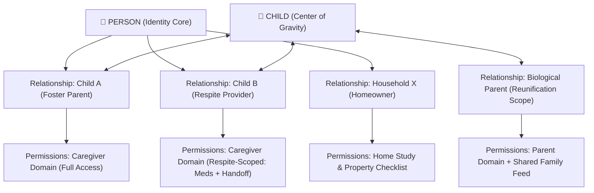

# PEOPLE & RELATIONSHIP MODEL (FUTURE-STATE DISCOVERY)
**Initiative:** Sprout  
**Project:** Child & Family Success Operating System  
**Document Type:** Strategic Concept Discovery (Future Architecture Horizon)  
**Database Action:** NONE (Concept Documentation Only • Database Schema Frozen)  

---

## 1. Executive Insight: The "People" Paradigm

In legacy child welfare systems, human beings are fragmented into rigid, siloed database entities:
- A "Foster Parent" table
- A "Biological Mother" table
- A "Caseworker" table
- A "Kinship Provider" table

This creates severe structural brittleness:
1. When a kinship aunt becomes a legal guardian, her record must be exported and recreated.
2. When a foster parent adopts a child, their account identity breaks.
3. When a biological parent successfully reunifies and continues using the platform for childhood medical tracking, their "parent" role prevents access to caregiver tools.
4. When a secondary caregiver provides weekend respite for another family, they require multiple disparate logins.

### The Unified Realization

> **Every participant in Sprout is simply a PERSON.**
>
> What differentiates them is not their database identity, but their:
> 1. **Relationships** (How they are connected to specific children and households)
> 2. **Roles** (The authority they hold in that specific relationship)
> 3. **Permissions** (What data domains and classifications they may view or edit)
> 4. **Participation Status** (Active, invited, suspended, graduated, reunified)



---

## 2. The Core Entity Architecture (Conceptual Model)

```
┌─────────────────────────────────────────────────────────────┐
│                          PERSON                             │
│  (id, legal_name, preferred_name, phone, email, credentials) │
└──────────────────────────────┬──────────────────────────────┘
                               │
                               ▼
┌─────────────────────────────────────────────────────────────┐
│                    RELATIONSHIP EDGE                        │
│  (person_id, target_child_id, target_household_id)          │
│                                                             │
│  • Relationship Type:                                       │
│    - Biological Parent                                      │
│    - Foster Caregiver (Licensed)                            │
│    - Kinship Caregiver (Grandparent, Aunt/Uncle, Sibling)   │
│    - Legal Guardian / Custodian                             │
│    - Respite Provider                                       │
│    - Guardian ad Litem (GAL)                                │
│    - DCF Family Services Worker (FSW)                       │
│    - Therapist / Medical Specialist                         │
│                                                             │
│  • Effective Dates: (start_date, end_date)                  │
│  • Legal Custody Status: (State DCF, Conditional, Full)     │
│  • Physical Placement Status: (Active, Historical, Respite) │
│  • Participation Status: (Active, Gated, Closed)            │
└──────────────────────────────┬──────────────────────────────┘
                               │
                               ▼
┌─────────────────────────────────────────────────────────────┐
│                    PERMISSION PROFILE                       │
│  • Allowed Domains: [child, case, caregiver, parent]        │
│  • Allowed Note Classifications:                            │
│    [private, working, official, shared_family]              │
│  • High-Conflict Masking: (true / false)                    │
│  • Export Authority: [monthly_summary, respite_card, none]  │
└─────────────────────────────────────────────────────────────┘
```

---

## 3. Real-World Lifecycles Supported by this Model

### Case 1: The Reunification Evolution
- **Phase A (Active DCF Custody):**
  - Person: *Angela Davis*
  - Relationship to Child *CH-201*: `Biological Parent`
  - Role: `Parent Participant`
  - Permissions: Parent Domain (`parent_goals`, `parent_evidence`), `shared_family` note view, Supervised Family Time calendar.
- **Phase B (Conditional Custody / Trial Home Placement):**
  - Relationship evolves to: `Primary Physical Custodian (Conditional)`
  - Permissions expand: Gains access to daily routines, medication schedule, school IEP tracking.
- **Phase C (Reunification Finalized & Case Dismissed):**
  - Relationship evolves to: `Full Legal Custodian & Parent`
  - Permissions expand: Full family operating system authority. All historical case and working records remain archived under non-destructive governance.

### Case 2: The Kinship Guardian Evolution
- **Phase A (Informal Kinship Placement):**
  - Person: *Eleanor Vance*
  - Relationship to Child *CH-202*: `Kinship Relative (Grandmother)`
  - Focus: Immediate health intake, Reach Up child-only benefit tracking, Circles of Care.
- **Phase B (Permanent Legal Guardianship):**
  - Relationship evolves to: `Permanent Legal Guardian`
  - Case notes close; platform transitions seamlessly into long-term medical and developmental archive.

### Case 3: The Multi-Role Caregiver
- **Person:** *Samantha Price*
  - **Edge 1:** Primary Foster Caregiver for *CH-207* (Full caregiver permissions).
  - **Edge 2:** Weekend Respite Provider for *CH-201* (Scoped permissions: Care & Safety Sheet, active medications, allergy alerts, soothing plan; zero court, financial, or placement history visible).

---

## 4. Preservation & Migration Safeguards

1. **Zero Immediate Code Churn:**
   - The current SQLite schema (`children`, `households`, `timeline_records`, `contacts`, `parent_users`) perfectly supports Sprout v3.1 and v3.2.
   - Do **NOT** rewrite database tables or foreign keys during Phase 13.
2. **Implementation Bridge:**
   - The Authorization Middleware designed for Phase 13 already treats the incoming request actor as a `Person` contextualized by `child_id` and `role`.
   - When the platform eventually transitions to a normalized graph model (Phase 16+), existing tables will map 1:1 into `Person` and `Relationship` nodes without data loss.
