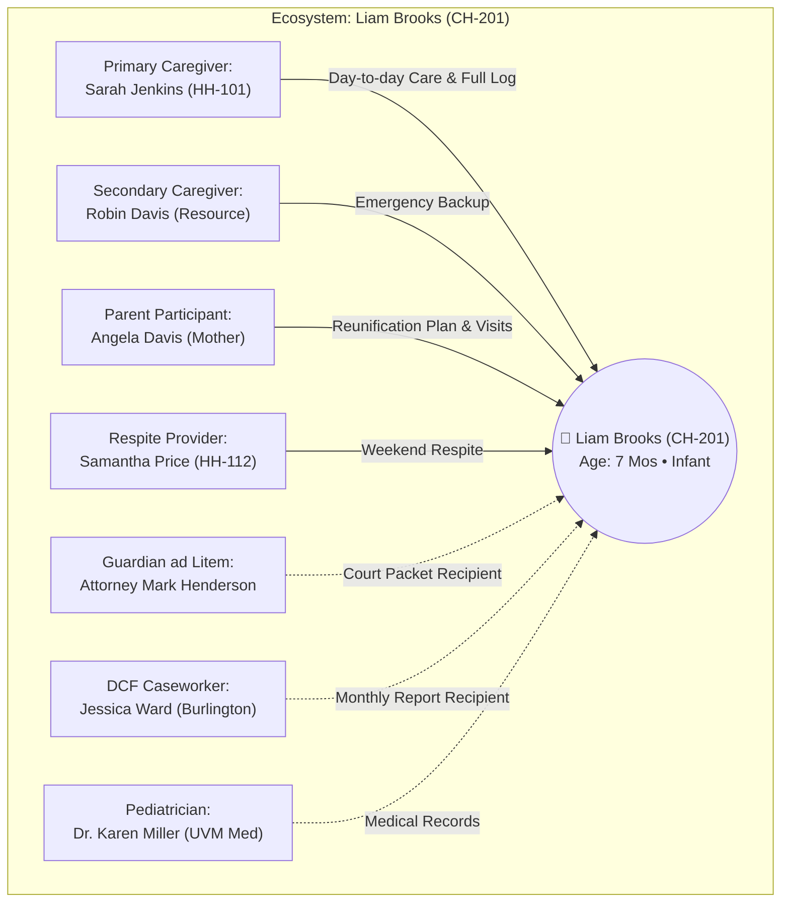

# SAMPLE CHILD COMMUNITY PACKAGE
**Initiative:** Sprout  
**Project:** Child & Family Success Operating System  
**Purpose:** Multi-Party Ecosystem Fixtures for End-to-End System & Permission Testing  
**Version:** Sprout v3.2 Foundation Baseline  

---

## 1. Overview & Testing Purpose

To test Sprout as an entire **Operating System** rather than a single-user app, every child must exist within a complete, multi-party **Circle of Care Community**.

For every child, the system maps:
1. **Primary Caregiver** (Day-to-day care, RPPS authority, full logger)
2. **Secondary Caregiver** (Household partner, co-caregiver, backup)
3. **Parent Participants** (Biological parents engaged in case plan / family time)
4. **Legal Guardian** (Where state DCF custody has transitioned or kin holds guardianship)
5. **Respite Provider** (Temporary care provider with health-scoped access)
6. **Guardian ad Litem (GAL)** (Court appointed child advocate; recipient of court packets)
7. **DCF Family Services Worker (FSW)** (District caseworker; recipient of monthly reports)
8. **Key Service Providers** (Pediatrician, therapist, IEP coordinator)

---

## 2. Benchmark Child Communities (5 Normalized Test Ecosystems)

---

### Community 1: Infant in Foster Care with Active Reunification
- **Child Reference:** `CH-201` • **Alias / Initials:** `LB` • **Full Name (Protected):** Liam Brooks
- **Age:** 7 Months (Infant) • **Legal Custody:** Vermont DCF Custody
- **Permanency Goal:** Reunification with Mother • **Conflict Mode:** Standard (Cooperative)

| Role in Ecosystem | Person Name & Identity | Specific Relationship | Assigned Permissions | Participation Status |
| :--- | :--- | :--- | :--- | :---: |
| **Primary Caregiver** | **Sarah Jenkins** (`HH-101`) | Licensed Foster Caregiver | Full Caregiver Domain (`child`, `case`, `caregiver`). RPPS authority. | **Active Placement** |
| **Secondary Caregiver** | **Robin Davis** | Approved Fictive Kin / Resource | View daily logs, emergency card, medication schedule. | **Active Backup** |
| **Parent Participant** | **Angela Davis** | Biological Mother | Scoped Parent Domain (`parent_goals`, `parent_evidence`). Shared Family Feed. 1-Tap Check-In. | **Active (Stage 4)** |
| **Parent Participant** | **Marcus Brooks** | Biological Father | Gated Parent Domain (Contact info pending court confirmation). | **Invited / Pending** |
| **Legal Guardian** | **State of Vermont (DCF)** | Statutory Legal Custodian | External Recipient of Monthly Word Progress Reports. | **Statutory Custody** |
| **Respite Provider** | **Samantha Price** (`HH-112`) | Licensed Weekend Respite | Scoped Care & Safety Sheet only (meds, allergies, soothing, ER contacts). | **Active Respite** |
| **Guardian ad Litem** | **Mark Henderson, Esq.** | Court-Appointed GAL | Recipient of 90-Day Court Chronology Packets. | **Active Legal Party** |
| **DCF Caseworker** | **Jessica Ward, MSW** | Burlington District FSW | Recipient of Monthly Status Reports & FS-334B Mileage. | **Active Caseworker** |
| **Service Provider** | **Dr. Karen Miller** | Pediatrician (UVM Children's) | Medical provider directory & immunization ledger. | **Active Provider** |
| **Service Provider** | **Laura Higgins, Easterseals** | Family Time Visit Supervisor | Schedule coordinator for Thursday visits. | **Active Provider** |

---

### Community 2: Kinship Relative Placement with Grandparent Guardianship
- **Child Reference:** `CH-202` • **Alias / Initials:** `EV` • **Full Name (Protected):** Emma Vance
- **Age:** 3 Years (Toddler) • **Legal Custody:** Conditional Custody Order (CCO) to Grandmother
- **Permanency Goal:** Permanent Kinship Guardianship • **Conflict Mode:** Moderate

| Role in Ecosystem | Person Name & Identity | Specific Relationship | Assigned Permissions | Participation Status |
| :--- | :--- | :--- | :--- | :---: |
| **Primary Caregiver** | **Eleanor Vance** (`HH-113`) | Maternal Grandmother | Full Kinship Caregiver Domain. Reach Up ledger, school enrollment. | **Active Custodian** |
| **Secondary Caregiver** | **Arthur Vance** (`HH-113`) | Maternal Grandfather | Co-Caregiver / Joint Custodian. Full daily access. | **Active Co-Custodian** |
| **Parent Participant** | **Chloe Vance** | Biological Mother | Supervised Family Time, Shared Family Feed, Goal Tracking. | **Active (Stage 3)** |
| **Legal Guardian** | **Eleanor Vance** | Conditional Court Custodian | Legal decision authority under Vermont family court CCO. | **Court Appointed** |
| **Respite Provider** | **Hannah Abbott** (`HH-109`) | Kinship Sibling / Aunt | Emergency respite provider. Health-scoped access. | **Active Kin Respite** |
| **Guardian ad Litem** | **Patricia Walsh, Esq.** | Court-Appointed GAL | Receives annual review briefs. | **Active Legal Party** |
| **DCF Caseworker** | **Timothy Davis, FSW** | Barre District Office | Quarterly kinship compliance reviews. | **Active Caseworker** |
| **Service Provider** | **Therapist Rebecca Ross** | Early Childhood Specialist | Trauma-informed play therapy notes. | **Active Provider** |

---

### Community 3: School-Age Sibling Group with High-Conflict Masking
- **Child Reference:** `CH-203` • **Alias / Initials:** `NM` • **Full Name (Protected):** Noah Miller
- **Age:** 8 Years (School Age) • **Legal Custody:** Vermont DCF Custody
- **Permanency Goal:** Reunification • **Conflict Mode:** **HIGH-CONFLICT MODE ACTIVE**

| Role in Ecosystem | Person Name & Identity | Specific Relationship | Assigned Permissions | Participation Status |
| :--- | :--- | :--- | :--- | :---: |
| **Primary Caregiver** | **David Miller** (`HH-103`) | Licensed Foster Caregiver | Full Caregiver Domain. **Physical address shielded from parent.** | **Active Placement** |
| **Secondary Caregiver** | **Emily Miller** (`HH-103`) | Licensed Foster Caregiver | Full Caregiver Domain. | **Active Co-Caregiver** |
| **Parent Participant** | **Jason Miller (Father)** | Biological Father | **High-Conflict Mode Scoped:** Caregiver address, school name, and GPS coordinates 100% masked. | **Restricted Access** |
| **Parent Participant** | **Sarah Miller (Mother)** | Biological Mother | Structured Family Feed only. Supervised center visits. | **Active (Stage 2)** |
| **Respite Provider** | **Elena Ramos** (`HH-105`) | Specialized Respite Provider | Care & Safety Sheet only. | **On-Call Respite** |
| **Guardian ad Litem** | **Rachel Green, Esq.** | Child GAL | High-conflict review packet recipient. | **Active Legal Party** |
| **DCF Caseworker** | **Brian O'Connor, FSW** | Rutland District Office | Case oversight and visit coordination. | **Active Caseworker** |
| **Service Provider** | **Principal Steven Hayes** | Elementary School | IEP documentation (location masked in exports). | **Active School** |

---

### Community 4: Teen in Therapeutic Care Preparing for Independent Living
- **Child Reference:** `CH-204` • **Alias / Initials:** `SH` • **Full Name (Protected):** Sophia Hayes
- **Age:** 16 Years (Adolescent) • **Legal Custody:** DCF Custody / YDP
- **Permanency Goal:** Another Planned Permanent Living Arrangement (APPLA / Independent Living)

| Role in Ecosystem | Person Name & Identity | Specific Relationship | Assigned Permissions | Participation Status |
| :--- | :--- | :--- | :--- | :---: |
| **Primary Caregiver** | **Robert Hayes** (`HH-104`) | Specialized Foster Caregiver | Full Caregiver Domain. Driver ed, part-time work RPPS approvals. | **Active Placement** |
| **Secondary Caregiver** | **Laura Hayes** (`HH-104`) | Specialized Foster Caregiver | Youth transitional lifebook coordination. | **Active Co-Caregiver** |
| **Parent Participant** | **None Active** | Uninvolved / Rights Relinquished | Archived historical records; zero portal access. | **Closed / Inactive** |
| **Youth Participant** | **Sophia Hayes (Future)** | Minor Youth (Phase 17 Horizon) | Future self-authored Lifebook and goals. | **Deferred** |
| **Youth Caseworker** | **Megan Clark, YDP** | Youth Development Specialist | Independent living stipend and housing voucher tracking. | **Active Transition** |
| **Guardian ad Litem** | **Carol Baker, Esq.** | Teen Advocate GAL | Transition review briefs. | **Active Legal Party** |
| **DCF Caseworker** | **Amanda Stone, FSW** | St. Albans District Office | Permanency review audits. | **Active Caseworker** |

---

### Community 5: Real Working Family Baseline (Production Context)
- **Child Reference:** `CD` • **Initials:** `CD` • **Placement Type:** Primary Foster Placement
- **Age:** Young Child • **Legal Custody:** Vermont DCF Custody
- **Permanency Goal:** Reunification / Fictive Kin Support • **Conflict Mode:** Standard

| Role in Ecosystem | Person Name & Identity | Specific Relationship | Assigned Permissions | Participation Status |
| :--- | :--- | :--- | :--- | :---: |
| **Primary Caregiver** | **Candy Chevalier** | Primary Foster Caregiver | Full System Authority across all domains and views. | **Active Primary** |
| **Secondary Caregiver** | **Robin Davis** | Homeowner & Resource Caregiver | Co-Caregiver access, home study documents. | **Active Homeowner** |
| **Resource Support** | **Mallory Wheeler** | Secondary / Extended Family | Handoff and emergency card access. | **Active Support** |
| **Parent Participant** | **Angela Davis** | Biological Parent | Dedicated Parent Workspace (Goals, Evidence, Family Time). | **Active Participant** |
| **DCF Team** | **District Caseworker** | Vermont DCF Family Services | Output Consumer (Monthly Reports, Travel Forms). | **External Consumer** |

---

## 3. Test Harness Verification Guidelines

1. **Dual-Sphere Switch Test:**
   - In Sandbox Mode, selecting `HH-101` automatically mounts `Community 1` (Sarah Jenkins & Liam Brooks).
   - In Local Mode, selecting `Candy Chevalier` automatically mounts `Community 5` (CD & Family).
2. **Permission Boundary Audit:**
   - Logging in as `Angela Davis` MUST return 403 Forbidden on `/api/records?category=incident`.
   - Logging in as `Samantha Price` MUST only receive health records from `/api/children/CH-201/records`.
   - In `Community 3`, exporting court packets MUST automatically redact `David Miller's` street address.
