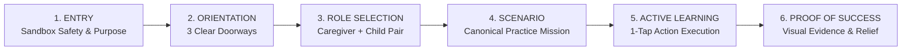
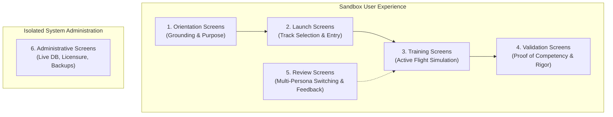
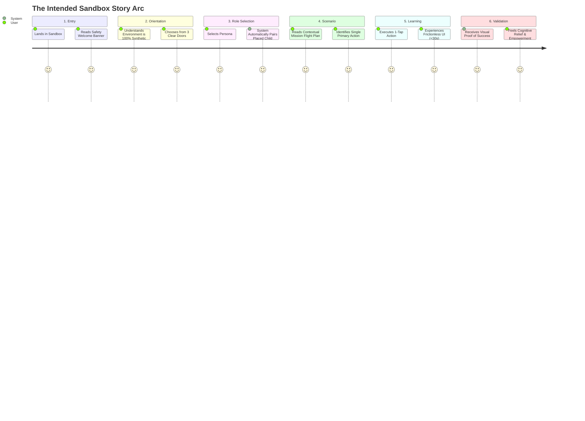

# SPROUT SANDBOX JOURNEY MAP
**Initiative:** Sprout • Child & Family Success Operating System  
**Phase:** Sandbox Journey Mapping & Intended Experience Design  
**Baseline Version:** v3.2.0-rc1 (Development Freeze Active)  
**Verification Date:** October 2026  
**Governing Documents:** [`SANDBOX_ORIENTATION_REPORT.md`](SANDBOX_ORIENTATION_REPORT.md), [`TRAINING_VALIDATION_REPORT.md`](TRAINING_VALIDATION_REPORT.md)  
**Founder OS Standard:** Intentional Storytelling • Self-Teaching Design • Zero Detective Work  

---

## 1. EXECUTIVE SUMMARY & INTENDED EXPERIENCE ARCHITECTURE

### The Core Design Philosophy
The Sprout Sandbox is not an empty demo, not a random playground, and not a technical testing harness.  
It is a **Caregiver Flight Simulator** and a **Guided System Showcase**.

> **The Founder Operating Standard:**
> A user entering the sandbox should **never** ask:
> - *"Where do I start?"*
> - *"Who am I right now?"*
> - *"What was I supposed to do here?"*
> - *"Did that work?"*
> 
> Every user moves through an intentional, self-guiding story arc:
> **Entry &rarr; Grounding &rarr; Role Selection &rarr; Canonical Scenario &rarr; Active Learning &rarr; Proof of Success**.



---

## 2. THE THREE-STEP COGNITIVE ONBOARDING SEQUENCE

When an unassisted person opens the Sprout Sandbox for the very first time, the system executes three clear, sequential steps:

```mermaid
sequenceDiagram
    autonumber
    actor User as First-Time User
    participant Gateway as Step 1: Sandbox Gateway
    participant Context as Step 2: Role & Child Anchoring
    participant Action as Step 3: Action & Success Proof

    User->>Gateway: Enters Sprout Sandbox
    Gateway-->>User: "Welcome to Sprout Sandbox • 100% Synthetic & Safe"
    Note over Gateway,User: Declares environment safety; presents 3 clear doors.
    User->>Context: Selects Role (e.g. Kinship Caregiver)
    Context-->>User: Anchors Caregiver (Eleanor Vance) + Child (Emma Vance)
    Note over Context,User: Displays "Flight Plan" Briefing Card with single recommended action.
    User->>Action: Clicks Recommended Action (e.g. Kinship Guide)
    Action-->>User: Immediate value delivered (<15s) + Visual Proof of Success
```

### STEP 1: What Should Happen First? (Grounding & Psychological Safety)
**Experience Objective:** Eliminate fear of making mistakes, clarify the environment, and offer 3 unmistakable doorways.

1. **Immediate Safety Declaration:**  
   The user is greeted with a calming, clear orientation banner:
   > *"Welcome to the Sprout Practice Sandbox. You are in a 100% synthetic, consequence-free flight simulator. Nothing you do here can break real records or notify state officials. Feel free to explore, log, and test without fear."*
2. **The 3 Doorways (Replacing 35+ Button Analysis Paralysis):**  
   Instead of overwhelming the user with dozens of menus, the entry screen presents **three primary doors**:
   - **Door A: [▶ Begin 5-Minute Guided Tour]** &rarr; For first-time evaluators, donors, or legislators who want the narrative story.
   - **Door B: [Choose a Practice Role]** &rarr; For trainees, foster parents, kinship caregivers, and respite providers who want hands-on role play.
   - **Door C: [Explore System Capabilities]** &rarr; For experienced caseworkers, supervisors, or founders who want full access to all tools.

---

### STEP 2: What Should Happen Second? (Role & Canonical Child Anchoring)
**Experience Objective:** Answer *Who am I?* and *Who is the child in my care?* before any action is taken.

1. **Atomic Role + Child Pairing:**  
   When a role is selected, the system atomically locks the caregiver and child together:
   - **Foster Caregiver** &rarr; Sarah Jenkins (HH-101) caring for **Liam Brooks** (CH-201, 6-month-old infant).
   - **Kinship Caregiver** &rarr; Eleanor & Arthur Vance (HH-113) caring for **Emma Vance** (CH-202, 3-year-old toddler granddaughter).
   - **School-Age Foster** &rarr; Robert Hayes (HH-104) caring for **Noah Miller** (CH-203, 8-year-old school-age boy).
   - **Respite Provider** &rarr; Samantha Price (HH-106) providing 48-hour care for **Liam Brooks**.
   - **Parent Participant** &rarr; Angela Davis working toward reunification with **Emma Vance**.
2. **Contextual Flight Plan Briefing Card:**  
   A high-contrast briefing banner appears at the top of the screen:
   - **Your Active Identity:** Eleanor Vance (Grandparent Kinship)
   - **Your Placed Child:** Emma Vance (Age 3 • Granddaughter)
   - **Your Scenario Mission:** Day 1 Relative Triage & State Benefits Discovery
   - **Your Next Click:** `[Open Kinship Fast-Track Guide]`

---

### STEP 3: What Should Happen Third? (Hands-On Execution & Immediate Proof of Success)
**Experience Objective:** Provide instant gratification in under 30 seconds, demonstrating that Sprout eliminates burden.

1. **Execute the Single Recommended Action:**  
   The user clicks the highlighted button (e.g. `+ 15-Sec Log`, `Kinship Guide`, `Care Sheet`, or `Export Month`).
2. **Immediate Proof of Success:**  
   The action completes instantly, and the system shows explicit, calming confirmation:
   - *Example (Daily Log):* "Saved to Liam's timeline in 11 seconds • Categorized as Routine Care • Cryptographic SHA-256 hash sealed."
   - *Example (Kinship):* "Found $350 emergency fund & Dr. Dynasaur healthcare • Acronyms decoded into plain English."
   - *Example (Monthly Report):* "Official Vermont DCF Progress Report generated in .docx format • 4 hours of paperwork eliminated."
3. **Clear "What Next?" Pathway:**  
   The user is never left hanging at a dead end. They are offered:
   - `[Try Next Scenario]` or `[Switch Role]` or `[Share Feedback]`.

---

## 3. ROLE-BY-ROLE JOURNEY BLUEPRINTS (8 ROLES)

---

### ROLE 1: TRAINER (VCWTP INSTRUCTOR)
* **Why are they entering?**  
  To lead a 3-hour cohort of 15 new foster and kinship parents; needs a consequence-free simulator to teach documentation habits without trainees fearing state databases.
* **What are they trying to learn?**  
  How Sprout facilitates adult learning, eliminates tech anxiety, and visually demonstrates data sovereignty (e.g., proving that biological parents cannot see foster home addresses).
* **What scenario should they start with?**  
  **Scenario: The 15-Minute Cohort Flight Simulation.**  
  Demonstrating Foster Caregiver daily logging &rarr; toggling to Parent Participant Workspace to visually verify the privacy barrier.
* **What should they click first?**  
  `[Open Training Hub]` &rarr; `[Module 8.3: Flight Simulation Exercises]`
* **What should success look like?**  
  The trainer can demonstrate the 15-second logger, show that notes are marked `working`, switch to the Parent Workspace to prove that private notes are 100% hidden, and reset the sandbox for the next cohort in 1 click.

---

### ROLE 2: EVALUATOR (FOUNDATION DIRECTOR / STATE IT ARCHITECT)
* **Why are they entering?**  
  To evaluate Sprout's technical credibility, data privacy compliance, statutory alignment (Vermont Title 33), and operational viability for foundation grant funding or statewide adoption.
* **What are they trying to learn?**  
  Does Sprout operate reliably offline-first? Is the data model sound? Does it enforce role-based access control? Does it avoid costly SACWIS/CCWIS mainframe integrations by generating standardized `.docx` artifacts?
* **What scenario should they start with?**  
  **Scenario: Governance, Security & Output Integrity Audit.**
* **What should they click first?**  
  `[▶ System Overview & Architecture Gateway]` &rarr; `[Inspect Audit Blockchain]`
* **What should success look like?**  
  The evaluator views 178 passing automated tests, inspects the unbroken SHA-256 cryptographic audit chain, verifies EXIF GPS scrubbing on images, exports an authentic DCF monthly report, and confirms zero cloud server dependency.

---

### ROLE 3: LEGISLATOR / CIVIC STAKEHOLDER / PHILANTHROPIST
* **Why are they entering?**  
  To understand the human and policy impact: Why does Sprout matter for Vermont children, and how does it prevent foster caregiver burnout?
* **What are they trying to learn?**  
  The tangible return on investment: Replacing 6 hours of painful bureaucratic monthly paperwork with 15 seconds a day, keeping siblings together, and reducing administrative trauma for grandparents.
* **What scenario should they start with?**  
  **Scenario: The Executive Impact Story (Before Sprout vs. With Sprout).**
* **What should they click first?**  
  `[▶ 5-Minute Executive Story Tour]`
* **What should success look like?**  
  Within 5 minutes, the stakeholder sees:
  1. An 11:00 PM late-night emergency intake completed in 5 clicks.
  2. A 1-click Care & Safety Sheet ready for an emergency room doctor in 20 seconds.
  3. A biological mother logging on to track her court-approved reunification goals with dignity.
  4. An official DCF progress report generated in 1 click.

---

### ROLE 4: NEW CAREGIVER (FIRST-TIME FOSTER PARENT)
* **Why are they entering?**  
  Just received their first foster placement 4 hours ago; emotionally exhausted, anxious, and terrified of doing something wrong or missing a state deadline.
* **What are they trying to learn?**  
  "How do I record my foster child's medications and daily bedtime routine without learning complex legal software?"
* **What scenario should they start with?**  
  **Scenario: First Evening Routine Log & Care Sheet Review (Sarah Jenkins + Liam Brooks).**
* **What should they click first?**  
  `[+ 15-Sec Log]` (Highlighted in bright emerald on the Quick Action Dock).
* **What should success look like?**  
  The caregiver records: "Liam took his evening bottle (6oz) and settled to sleep at 8:15 PM with his bunny" in 14 seconds. The event appears instantly on the timeline with zero jargon, and the Care Sheet confirms Liam's pediatrician phone number is right at hand.

---

### ROLE 5: KINSHIP CAREGIVER (GRANDPARENT / RELATIVE)
* **Why are they entering?**  
  Grandparents (e.g. Eleanor & Arthur Vance) suddenly taking custody of their 3-year-old granddaughter Emma after a crisis; completely unfamiliar with child welfare; worried about finances and legal rights.
* **What are they trying to learn?**  
  "What do I need to do in the first 48 hours? What emergency cash is available to help me buy a car seat and crib? What does 'CHINS' mean?"
* **What scenario should they start with?**  
  **Scenario: Days 1–3 Kinship Triage & Benefit Discovery (Eleanor Vance + Emma Vance).**
* **What should they click first?**  
  `[Kinship Fast-Track Guide]` (Pinned prominently with compass icon).
* **What should success look like?**  
  The grandmother reads the plain-English 48-hour checklist; discovers the $350 emergency Family Support Fund and Reach Up cash grants; sees that CHINS simply means child protection court proceedings; and reads the "What Can Wait" section, which relieves her guilt and anxiety.

---

### ROLE 6: RESPITE PROVIDER (WEEKEND CAREGIVER)
* **Why are they entering?**  
  Arriving on Friday afternoon to care for Liam for 48 hours to give the primary foster parent a break; needs vital medical and safety facts without seeing private case history.
* **What are they trying to learn?**  
  "What is Liam allergic to? What medications does he take? What helps him calm down when he cries at night? Who do I call if there is an emergency?"
* **What scenario should they start with?**  
  **Scenario: 48-Hour Weekend Respite Intake (Samantha Price + Liam Brooks).**
* **What should they click first?**  
  `[Care Sheet]` (One-tap action on dock).
* **What should success look like?**  
  In under 30 seconds, Samantha sees Liam's peanut allergy (flagged in red), asthma inhaler dosage, favorite bedtime plush toy, and the pediatrician/caseworker phone numbers. She taps `[Print / Export Care Brief]` for her refrigerator. All private case court documents remain strictly hidden.

---

### ROLE 7: DCF WORKER (FAMILY SERVICES CASEWORKER)
* **Why are they entering?**  
  Overworked caseworker managing 25 cases; preparing for an upcoming court permanency hearing; tired of chasing caregivers for illegible handwritten notes.
* **What are they trying to learn?**  
  "How can Sprout give me objective, court-admissible monthly summaries and verified visit check-in records without me spending nights re-typing notes?"
* **What scenario should they start with?**  
  **Scenario: Monthly Progress Review & Court Affidavit Export.**
* **What should they click first?**  
  `[Export Month]` (Cyan button on dock).
* **What should success look like?**  
  The caseworker downloads a clean, formatted `.docx` monthly summary that cleanly categorizes medical visits, EPSDT exams, school attendance, and timestamped parent visitation check-ins, with private caregiver journal notes automatically filtered out.

---

### ROLE 8: CANDY (FOUNDER & LEAD ARCHITECT)
* **Why are they entering?**  
  To conduct end-to-end quality assurance on the training content, verify that all personas flow smoothly, ensure zero cognitive friction, and capture qualitative impressions.
* **What are they trying to learn?**  
  "Does the sandbox teach itself without my presence? Can any visitor understand who they are, what to test, and what success looks like without me explaining it?"
* **What scenario should they start with?**  
  **Scenario: Complete 8-Role Sandbox Validation & Feedback Review.**
* **What should they click first?**  
  `[Review Mode]` (Sticky header or persistent floating dock) &rarr; Select any of the practice roles.
* **What should success look like?**  
  Candy can switch between all training personas in 1 click, verify that each persona atomically loads with their designated child and scenario briefing, confirm that the Training Hub guides learning pedagogically, and record reflections via the floating feedback button in 1 tap without exiting sandbox mode.

---

## 4. SCREEN TAXONOMY & COGNITIVE CLASSIFICATION

To eliminate confusion between system administration, training simulation, and live workflows, all screens in Sprout are classified into six distinct functional archetypes:



| Screen Category | Primary Purpose | Key Screens in Sprout | Target Audience | Anti-Pattern Prevented |
| :--- | :--- | :--- | :--- | :--- |
| **1. Orientation Screens** | Establish psychological safety, declare synthetic environment, and answer *Where am I?* | • Sandbox Welcome Gateway<br/>• Mission Control Orientation Banner<br/>• Kinship Fast-Track Welcome | First-time visitors, evaluators, new trainees | **Detective Work:** User never guesses if data is real or synthetic. |
| **2. Launch Screens** | Provide high-contrast, uncluttered doorways to specific learning journeys. | • Role Persona Launcher<br/>• 5-Minute Tour Hero Card<br/>• Mission Control Quick Action Dock | All users seeking a starting point | **Choice Overload:** Replaces 35+ competing links with 3 clear doors. |
| **3. Training Screens** | Provide consequence-free practice environments for daily care and emergency moments. | • Training Hub Flight Simulator<br/>• 6 Practice Scenarios<br/>• Two-Step Smart Logger<br/>• Emergency Placement Wizard | Foster parents, kinship caregivers, respite providers | **Memory Layer:** Step-by-step progressive disclosure eliminates memorization. |
| **4. Validation Screens** | Provide objective proof of learning, statutory compliance, and data integrity. | • Caregiver Competency Checks<br/>• 1-Click DCF Monthly Report (.docx)<br/>• Keepsake Lifebook Generator<br/>• 178 Automated Test Board | Trainers, evaluators, DCF caseworkers | **Manual Integrator:** Automated document generators replace manual collation. |
| **5. Review Screens** | Enable seamless switching between testing perspectives and qualitative reflection. | • Review Mode Global Modal<br/>• Floating Feedback Capture Modal<br/>• Role Journey Detail Modals | Candy, evaluators, legislative analysts | **Application Restart:** 1-click persona switching preserves active state. |
| **6. Administrative Screens** | System-level maintenance, physical database backups, and live family records (**Strictly separated from sandbox simulation**). | • Real Family Workspace (`local` mode)<br/>• SQLite Backup & Restore Harness<br/>• FS-221A District Licensure Audit | Founder, System Administrator | **Context Pollution:** Prevents accidental mixing of synthetic demo data with real family files. |

---

## 5. THE SIX-STAGE STORY ARC FOR EVERY USER

Every user entering the sandbox traverses this unified, predictable narrative journey:



1. **ENTRY:** Lands in Sprout Sandbox; sees clear watermark and calming orientation banner.
2. **ORIENTATION:** Knows immediately: *This is a safe practice environment; nothing will break; here are my 3 paths.*
3. **ROLE SELECTION:** Chooses a practice perspective (Foster, Kinship, Parent, Respite); system instantly pairs them with their canonical child.
4. **SCENARIO:** Reads a brief 2-sentence "Flight Plan" outlining the situational challenge and the recommended first click.
5. **LEARNING:** Executes the workflow in <30 seconds (logs a med, decodes an acronym, prints a care card, or exports a report).
6. **VALIDATION:** Sees visual proof that the task was completed, data was sealed, and hours of administrative burden were eliminated.

---

## 6. CONCLUSION & CERTIFICATION

This Journey Map establishes the intentional, human-centered story of the Sprout Sandbox.  
It replaces accidental clutter with deliberate pedagogy, choice overload with clear guidance, and technical ambiguity with psychological safety.

**Development Freeze remains strictly active.** No UI modifications or code changes have been implemented during this mapping phase. This blueprint serves as the exact design specification for upcoming post-freeze orientation refinement.
