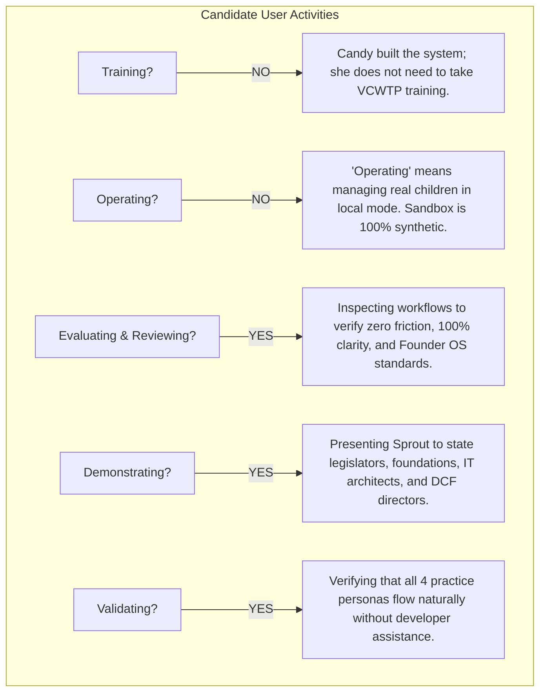
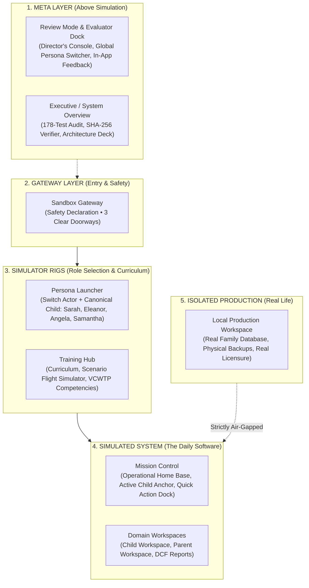

# SPROUT SANDBOX MENTAL MODEL DECISION
**Initiative:** Sprout • Child & Family Success Operating System  
**Phase:** Sandbox Architecture & Conceptual Mental Model Resolution  
**Baseline Version:** v3.2.0-rc1 (Development Freeze Active)  
**Date:** October 2026  
**Governing Documents:** [`SANDBOX_ORIENTATION_REPORT.md`](SANDBOX_ORIENTATION_REPORT.md), [`SANDBOX_JOURNEY_MAP.md`](SANDBOX_JOURNEY_MAP.md), [`FOUNDER_ORIENTATION_DASHBOARD.md`](FOUNDER_ORIENTATION_DASHBOARD.md), [`PROJECT_STATE.md`](PROJECT_STATE.md)  
**Founder OS Standard:** Intentional Hierarchy • Zero Detective Work • Absolute Clarity  

---

## 1. EXECUTIVE SUMMARY & THE CONCEPTUAL CONTRADICTION

### The Problem Statement
A critical conceptual contradiction exists in the current Sprout Sandbox design:
The system currently treats **"Founder Overview"** as both:
1. **A Training Persona** (Card #1 in the Persona Launcher alongside Foster Caregiver, Kinship Caregiver, Parent Participant, and Respite Provider).
2. **An Administrative & Review Utility** (Global review launcher, feedback collection harness, and system-level switcher to live local data).

This dual identity causes severe cognitive friction:
- **Trainees and Caseworkers** see "Founder Overview" as a persona and ask: *"Who is the Founder? Is that a state casework role? Am I supposed to be playing the role of Candy?"*
- **Clicking "Launch Founder View"** silently executes `currentSproutMode = 'local'`, tearing the user out of the synthetic practice sandbox and dumping them into the real local database without warning.
- **Evaluators and Reviewers** struggle to determine whether they are in "Training Mode", "Review Mode", "Demonstration Mode", or "Live System Mode".

This document resolves this contradiction once and for all.

---

## 2. WHAT IS CANDY DOING WHEN USING THE SANDBOX?

To establish the correct mental model, we must first answer: **What is Candy's true activity when she enters the sandbox?**



### The Determination:
When Candy enters the sandbox, she is **NOT Training** and she is **NOT Operating**.

Candy is acting as an **EVALUATOR, DEMONSTRATOR, AND VALIDATOR**:
1. **Demonstrating:** Presenting Sprout to state legislators, foundation grant makers, and child welfare leaders to prove that administrative burden can be eradicated.
2. **Evaluating:** Inspecting the system through the eyes of real users to ensure no detective work, memory dependency, or jargon slips through.
3. **Validating:** Verifying that the 4 child welfare personas (Sarah, Eleanor, Angela, Samantha) remain intact, safe, and emotionally resonant.

> **Key Takeaway:** Candy is standing in the **Control Tower (Meta-Layer)** observing and demonstrating the flight simulator. She is **never an in-flight student pilot (Trainee Persona)**.

---

## 3. WHAT SHOULD "FOUNDER OVERVIEW" BE?

Should "Founder Overview" be:
- A Training Persona?
- An Evaluation Tool?
- A Review Utility?
- An Administrative Function?
- Or something else?

### The Rigorous Architectural Breakdown

| Proposed Classification | Is It Correct? | Why or Why Not? |
| :--- | :---: | :--- |
| **A Training Persona** | ❌ **FALSE** | **Fatal Conceptual Flaw.** In child welfare, a child is placed with a foster parent, a kinship grandparent, an adoptive family, or a group facility. A child is *never placed with "The Founder"*. There is no statutory role in Vermont Title 33 for "The Founder". Putting Founder inside a training curriculum confuses every trainee and caseworker. |
| **An Administrative Function** | ❌ **MISPLACED** | **Hazardous Boundary Bleed.** System administration (database backups, encryption key rotation, physical local database management) belongs to the live production system (`local` mode). Putting live administrative switches inside a synthetic sandbox creates the dangerous illusion that sandbox actions affect live records, or conversely, causes accidental exits from the sandbox. |
| **An Evaluation Tool & Review Utility** | ✅ **CORRECT** | **Accurate Vantage Point.** "Founder Overview" is an **Executive Demonstration & Evaluation Tool**. It is a meta-utility that allows an evaluator or demonstrator to view the aggregate system architecture, inspect the 178 passing tests, review the SHA-256 audit chain, and monitor system-wide Circle of Care networks from 30,000 feet. |

### The Official Determination:
> ### 🏛️ ARCHITECTURAL DECISION:
> **"Founder Overview" is an EVALUATION TOOL and SYSTEM DEMONSTRATION VANTAGE POINT.**  
> It is **NOT** a training persona. It must be **completely removed from the Persona Launcher**.
>
> In the Sandbox, it is retitled to:
> **`Executive Overview`** or **`System Architecture & Audit Gateway`**.
>
> It lives on the **Review / Meta-Layer**, accessible to Candy and evaluators, completely separated from the 4 practice caregiver personas.

---

## 4. DE-TANGLING THE 5 CORE SANDBOX CONCEPTS

Currently, the system blends together five different concepts into overlapping buttons and modals. Here is the authoritative separation of boundaries:



---

### Concept 1: Sandbox Gateway
* **What it is:** The Entry Hall and Psychological Safety Barrier.
* **Why it exists:** To eliminate fear and prevent analysis paralysis before the user clicks anything.
* **What it is for:** Declares with 100% clarity: *"You are in the Sprout Sandbox. All data is synthetic and consequence-free."* It cuts through 35+ competing buttons by presenting **Three Doorways**:
  - **Door A:** [▶ 5-Minute Guided Tour] (For stakeholders and donors).
  - **Door B:** [Choose a Practice Role] (For trainees and caregivers).
  - **Door C:** [Explore System Capabilities] (For evaluators and supervisors).
* **When to use it:** The very first second a user enters the sandbox.

---

### Concept 2: Mission Control
* **What it is:** The Operational Home Base and Daily Working Desktop.
* **Why it exists:** To provide the caregiver with a single calm cockpit that answers: *What matters today? Who is in my care? What is next?*
* **What it is for:** Simulates the actual software a foster or kinship parent lives in every day. Displays the active child placement, today's schedule, priority notifications, and the 6-button Quick Action Dock (`+ 15-Sec Log`, `Emergency Intake`, `Care Sheet`, `Kinship Guide`, `Case Closure`, `Export Month`).
* **When to use it:** Everyday routine logging, checking reminders, or launching rapid 1-tap workflows.

---

### Concept 3: Training Hub
* **What it is:** The Pedagogical Curriculum and Flight School (aligned with VCWTP standards).
* **Why it exists:** To teach child welfare documentation practices through structured, scenario-based adult education.
* **What it is for:** It does NOT run daily care; it guides **practice missions**. It houses:
  - 4 Sequential Learning Modules (Intake, Daily MAR, Incident Reporting, Court Preparation).
  - 6 Hands-on Practice Scenarios (e.g. *Scenario 1: Friday Night 11:00 PM Emergency Placement*).
  - Objective Competency Checks.
* **When to use it:** When leading a training cohort, attending a workshop, or practicing a specific high-stress procedure before it happens in real life.

---

### Concept 4: Persona Launcher
* **What it is:** The Simulator Rigging and Role-Play Identity Switcher.
* **Why it exists:** To enable instant empathy by allowing any user to step into the shoes of different child welfare actors.
* **What it is for:** Atomically pairs an Actor with their Canonical Child:
  1. **Foster Caregiver:** Sarah Jenkins &rarr; caring for Liam Brooks (Infant, Age 6 mos).
  2. **Kinship Caregiver:** Eleanor & Arthur Vance &rarr; caring for Emma Vance (Granddaughter, Age 3).
  3. **Parent Participant:** Angela Davis &rarr; reunifying with Emma Vance.
  4. **Respite Provider:** Samantha Price &rarr; 48-hour weekend care for Liam Brooks.
  5. **DCF Caseworker:** Kassidy &rarr; supervising case plan and court summaries.
* **When to use it:** Whenever a user wants to test how Sprout looks, protects privacy, and functions from a different stakeholder's perspective.

---

### Concept 5: Review Mode (The Director's Console)
* **What it is:** The Persistent Meta-Layer and Evaluator Harness.
* **Why it exists:** To give Candy and external evaluators omni-present visibility and feedback capture without interrupting active workflows or restarting the app.
* **What it is for:** Floats non-intrusively above the application (`#founderFloatingDock`). It provides:
  - 1-Click access to the Persona Launcher from any screen.
  - 1-Click access to the Executive Overview (system architecture, test suite results).
  - 1-Tap Floating Feedback Modal (*What worked? What was confusing?*).
  - Consequence-free Reset of Sandbox data to pristine factory condition.
* **When to use it:** During executive demonstrations, grant reviews, QA audits, and Founder walkthroughs.

---

## 5. FIRST-TIME EVALUATOR MENTAL MODEL CHEAT-SHEET

If an external evaluator (e.g., State IT Director or Philanthropic Grant Officer) asks: *"Explain what each area of Sprout is for"*, here is the unmistakable explanation:

```
┌────────────────────────────────────────────────────────────────────────────────────────────────┐
│                                   THE SPROUT SANDBOX STACK                                     │
├──────────────────────┬──────────────────────────────────────────┬──────────────────────────────┤
│ Concept              │ Why It Exists & What It Is For           │ When To Use It               │
├──────────────────────┼──────────────────────────────────────────┼──────────────────────────────┤
│ 1. Review Mode       │ Meta-console for evaluators & Candy.     │ Anytime you want to switch   │
│    (Director Deck)   │ Lets you swap roles, view system health, │ personas, give feedback, or  │
│                      │ or give feedback without restarting.     │ inspect architecture.        │
├──────────────────────┼──────────────────────────────────────────┼──────────────────────────────┤
│ 2. Sandbox Gateway   │ Psychological safety & entry airlock.    │ First 10 seconds of opening  │
│    (Entry Airlock)   │ Clarifies data is 100% synthetic and     │ the sandbox.                 │
│                      │ offers 3 high-contrast doors.            │                              │
├──────────────────────┼──────────────────────────────────────────┼──────────────────────────────┤
│ 3. Persona Launcher  │ Simulator role switcher. Atomically puts │ When you want to experience  │
│    (Role Rigging)    │ on the hat of Foster Parent, Kinship     │ Sprout through a specific    │
│                      │ Relative, Respite Provider, or Parent.   │ human perspective.           │
├──────────────────────┼──────────────────────────────────────────┼──────────────────────────────┤
│ 4. Mission Control   │ The actual daily operating desktop.      │ Everyday simulated care:     │
│    (Care Cockpit)    │ Shows active child, today's priorities,  │ logging meds, checking info, │
│                      │ and 6-button Quick Action Dock.          │ 1-click DCF monthly report.  │
├──────────────────────┼──────────────────────────────────────────┼──────────────────────────────┤
│ 5. Training Hub      │ Flight school and formal curriculum.     │ Structured practice, cohort  │
│    (Flight School)   │ Aligned with VCWTP training; contains    │ workshops, and scenario-     │
│                      │ guided scenarios and competency checks.  │ based flight drills.         │
└──────────────────────┴──────────────────────────────────────────┴──────────────────────────────┘
```

---

## 6. STRICT BOUNDARY ENFORCEMENT RULES

To maintain this mental model permanently and prevent future regressions, the following structural rules are locked:

1. **Rule 1: No Administrative Leaks in the Sandbox.**  
   Clicking any button inside the Practice Sandbox must **NEVER** switch the application to `currentSproutMode = 'local'`. The sandbox remains strictly quarantined to synthetic memory and sample databases.
2. **Rule 2: No Founder Persona in Training Catalogs.**  
   The Persona Launcher and Training Hub must only present genuine child welfare roles (Foster, Kinship, Parent, Respite, Caseworker). Candy is the Evaluator/Demonstrator, not a trainee.
3. **Rule 3: Executive Overview Lives on the Meta-Layer.**  
   System architecture, automated test proofs (178/178), and cryptographic audit chain verification belong in an **Executive Overview** accessible via Review Mode, completely decoupled from caregiver flight simulation.
4. **Rule 4: Child Anchoring Is Mandatory.**  
   Selecting a training persona must atomically select their canonical child. The Active Child must never vanish from view on Mission Control.

---

## 7. CONCLUSION & NON-IMPLEMENTATION NOTICE

This document authoritatively resolves the conceptual contradiction:
- **Founder Overview is an Evaluation & Demonstration Tool (Meta-Layer)**, not a training persona and not a sandbox admin tool.
- **The 5 sandbox concepts are strictly distinct, complementary layers**, not overlapping competitors.

**DEVELOPMENT FREEZE REMAINS STRICTLY ACTIVE.**  
No source code or UI files were altered in this decision phase. This mental model specification governs all future post-freeze refinement.
