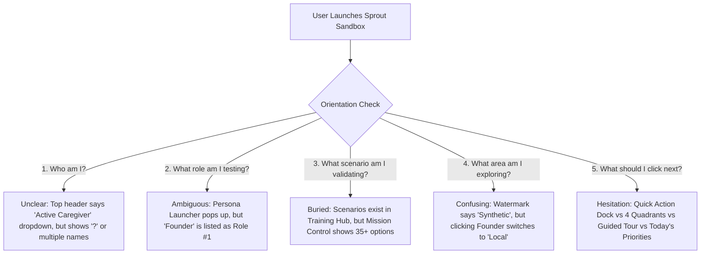
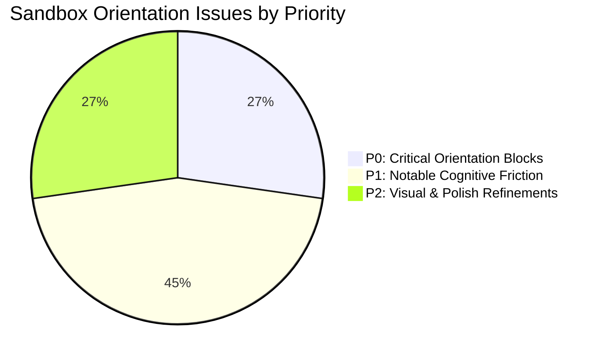

# SPROUT SANDBOX ORIENTATION REPORT
**Initiative:** Sprout • Child & Family Success Operating System  
**Phase:** Sandbox Orientation Review  
**Baseline Version:** v3.2.0-rc1 (Development Freeze Active)  
**Verification Date:** October 2026  
**Auditor:** Founder Operating System Validation Suite  
**Evaluation Standard:** Cognitive Self-Orientation Without Verbal Explanation  

---

## EXECUTIVE SUMMARY & AUDIT MANDATE

### The Orientation Mandate
> **Never make Candy become:**
> - **Integration Layer**
> - **Memory Layer**
> - **Orchestration Layer**
> - **Prompt Engineering Layer**
> - **Approval Clerk**
> - **Detective**
> - **Debugger**
> 
> *when the system can do that work instead.*

This is **NOT** a caregiver workflow audit.  
This is **NOT** a Founder workflow audit.  
This is a **Sandbox Orientation Audit** evaluating the sandbox experience through the eyes of a first-time external evaluator, trainer, legislative stakeholder, new caregiver, or founder reviewing the system cold.

### The Foundational Orientation Benchmark
When an unassisted user opens the Sprout Sandbox, can they answer within **10 seconds** without verbal coaching from Candy:
1. **Who am I?** (Active user identity and agency relationship)
2. **What role am I testing?** (Foster parent, kinship caregiver, respite provider, parent participant)
3. **What scenario am I validating?** (Routine logging, emergency intake, benefits triage, permanency)
4. **What area of the system am I exploring?** (Sandbox simulator vs. live database, dashboard vs. binder)
5. **What should I click next?** (Clear visual primary action vs. analysis paralysis across 35+ buttons)

### Overall Audit Verdict: CONDITIONAL PASS (Needs Orientation Hardening)
The core engines and backend workflows of Sprout are flawless (178/178 tests passing). However, the **orientation and entry layer** contains notable cognitive friction:
- **35+ competing action buttons** on the initial landing screen cause cognitive overload and hesitation.
- **The "Founder Overview" persona** conflates system administration with role-play training and accidentally switches modes from sandbox (`sample`) to live local (`local`).
- **The Active Child in Placement** is hidden on the primary Mission Control launchpad, disconnecting the user from the central focus of child welfare.
- **Browser `alert()` popups** (49 instances) degrade perceived quality during demo workflows.
- **The Training Hub** displays two competing persona selectors on the same screen without curriculum objectives.

---

## THE 5 FOUNDATIONAL ORIENTATION QUESTIONS: CURRENT REALITY AUDIT



| Question | Current System State | User Confusion / Hesitation Point | Grade |
| :--- | :--- | :--- | :---: |
| **1. Who am I?** | The top header displays an "Active Caregiver" dropdown (e.g. `Sample Caregiver (Sarah Jenkins)`). | Users miss the small dropdown or wonder if they need to type in their own credentials. When launching as a Parent Participant, the header completely disappears, leaving users wondering who they are logged in as. | **B-** |
| **2. What role am I testing?** | The Persona Launcher presents 5 options: Founder Overview, Foster Caregiver, Kinship Caregiver, Parent Participant, Respite Provider. | Trainees and evaluators are confused by "1. Founder Overview" — asking: *"Am I supposed to be the Founder? What role is that in foster care?"* | **C+** |
| **3. What scenario am I validating?** | Scenarios are split between Mission Control quadrants, Training Hub flight simulator, and the Persona Launcher. | Users are not guided into a specific task (e.g., "Test 11:00 PM Emergency Intake"). They must invent their own test plan. | **C** |
| **4. What area am I exploring?** | A tiny bottom-right pill states `🛡️ Practice Sandbox • Synthetic Data Only`. Top header has a toggle `Practice Sandbox | Switch`. | When users click "Launch Founder View", the app silently switches out of the sandbox into `local` mode with different children and households, breaking the sandbox mental model. | **D+** |
| **5. What should I click next?** | Mission Control surfaces 3 quick start buttons, 7 dock buttons, 20 quadrant links, and 7 role journey cards. | **Severe analysis paralysis.** Over 35 clickable paths with equal visual weight force the user to become the detective to find a starting point. | **C-** |

---

## AUDIT OF THE 4 SPECIAL REVIEW ITEMS

### SPECIAL ITEM 1: Founder View Appears Inside Persona Launcher
**Current Implementation:**
The Persona Launcher modal (`#founderReviewModal`) and Training Hub (`#trainingPersonaLauncher`) feature:
- Card 1: `1. Founder Overview` (Badge: *Primary Home*, Button: *Launch Founder View*)
- Card 2: `2. Foster Caregiver`
- Card 3: `3. Kinship Caregiver`
- Card 4: `4. Parent Participant`
- Card 5: `5. Respite Provider`

**Critical Finding & Behavioral Observation:**
1. **Conflating System Ownership with Role-Play Training:**  
   "Founder" is an administrative and architectural vantage point, not a child welfare practice persona. When a foster parent, kinship grandmother, or DCF caseworker is in training, "Founder Overview" makes no sense. They ask: *"Who is the Founder? Am I supposed to be evaluating Candy's dashboard or learning how to care for my foster child?"*
2. **Hidden Destructive Mode Switch:**  
   In `app/static/app.js` (line 8492), clicking "Launch Founder View" executes:
   ```javascript
   currentSproutMode = 'local';
   activeCaregiverUser = 'Candy Chevalier';
   localStorage.setItem('sproutMode', 'local');
   switchMainSection('dashboard');
   ```
   It flips the application mode from **Practice Sandbox (`sample`)** to **Real Local Workspace (`local`)**. The synthetic training children (Liam, Emma, Noah) vanish, and the user is dumped into local storage without warning!
3. **Determination:**  
   **Founder MUST be strictly separated from training personas.**
   - The **Persona Launcher** must contain only practice roles: Foster Caregiver, Kinship Caregiver, Parent Participant, Respite Provider, and DCF Caseworker/Supervisor.
   - The Founder Overview must be moved to an isolated **Reviewer / Administrator Bar** or header utility button labeled *"Founder Command Center"* or *"System Overview"*, clearly distinguished from sandbox role-playing.

---

### SPECIAL ITEM 2: Child in Placement Placement & Visibility
**Current Implementation:**
- The Active Child selector (`#childSelect`) is placed exclusively inside the white `mainNavigationContainer` (line 200).
- In `app/static/app.js` (line 747), when Mission Control renders, `mainNavigationContainer` is explicitly set to `hidden`:
  ```javascript
  // Hide operational toolbar on Mission Control (root launchpad) so it remains clean
  if (currentMainSection === 'mission_control') {
    if (mainNav) mainNav.classList.add('hidden');
    await renderMissionControlView(container);
  }
  ```

**Critical Finding & Behavioral Observation:**
1. **The Child Disappears on the Primary Launchpad:**  
   On Mission Control—the first screen every user sees—**the active child selector is completely invisible**. The user has no idea which child is currently placed in the home or who they are logging notes for.
2. **Disconnected Mental Model:**  
   In child welfare, the child is the gravitational center of all activity. Caregivers never log notes in the abstract; they log notes *for Liam* or *for Emma*. Hiding the child selector until the user navigates away from Mission Control breaks the caregiver's mental anchor.
3. **Persona Switching Does Not Anchor to Child:**  
   When launching Kinship Caregiver, the child should automatically be locked to `Emma Vance (CH-202)`. When launching Foster Caregiver, the child should be locked to `Liam Brooks (CH-201)`. Currently, switching personas leaves whichever child was previously selected, leading to illogical states (e.g. Grandparent Vance viewing infant Liam Brooks instead of their granddaughter Emma).
4. **Determination:**  
   **The Active Child placement currently DISCONNECTS from the user's mental model.**
   - The Child Selector must be permanently visible in the **top sticky navigation header** right alongside the caregiver identity, visible on 100% of screens.
   - Launching a training persona must **atomically pair** the caregiver with their designated child (e.g., Sarah Jenkins &rarr; Liam Brooks; Eleanor Vance &rarr; Emma Vance).

---

### SPECIAL ITEM 3: Training Hub Navigation & Pedagogical Structure
**Current Implementation:**
Navigating to the Training Hub (`switchMainSection('training')`) renders:
1. Top Banner: "Caregiver Flight Simulator" with "5-Min First-Run Tour" and "Reset Sandbox" buttons.
2. Directly below: The massive dark gradient `#trainingPersonaLauncher` displaying the 5 personas.
3. Directly below that: "Module 8.2: Role-Based Training Personas" displaying 4 smaller cards with a badge saying "15 Personas Available".
4. Directly below that: "Interactive Caregiver Scenarios" (6 scenario cards) + "Caregiver Competency Checks".

**Critical Finding & Behavioral Observation:**
1. **Duplicate Persona Launchers on the Same Screen:**  
   Users encounter two separate persona selection blocks stacked directly on top of each other:
   - The top launcher has 5 cards (Founder, Foster, Kinship, Parent, Respite).
   - The bottom module has 4 cards (Eleanor Vance, Sarah Jenkins, Robert Hayes, Julian Scott).  
   Trainees hesitate and ask: *"Why are there two persona pickers? What is the difference between clicking 'Foster Caregiver' up top versus 'Sarah Jenkins' down below?"*
2. **Missing Curriculum Hierarchy:**  
   The screen immediately throws users into raw action cards without answering:
   - *What training module is this?*
   - *What are my learning objectives?*
   - *What scenario am I expected to practice first?*
3. **Determination:**  
   **The Training Hub should structure its navigation into an orderly pedagogical progression:**
   1. **Training Home & Welcome:** Purpose of the flight simulator, safety of synthetic records, and VCWTP alignment.
   2. **Training Objectives:** Core competencies to master (Emergency Intake, Daily Routine MAR, Factual Incident Reporting, Court Preparation).
   3. **Role Catalog (Choose Your Perspective):** A single, unified, clean persona selector (eliminating the duplicate 5-card vs. 4-card confusion).
   4. **Scenario Catalog (Flight Simulation Exercises):** Hands-on practice missions clearly linked to specific personas (e.g., "Scenario 1: Friday Night Intake as Sarah Jenkins").

---

### SPECIAL ITEM 4: Main Sandbox Page & Entry Experience
**Current Implementation:**
1. App launches with `#founderReviewModal` popup open.
2. If closed, user sees Mission Control banner:
   - Headline: `SPROUT • Vermont Caregiver Operating System`
   - Subhead: `Protect Children. Reduce Burden. Stay Prepared.`
   - Body: `Welcome to your universal safe home. Whether you are a brand new foster parent, seasoned kinship grandmother, respite provider, state supervisor, or VCWTP instructor, this Mission Control Center guides your next action with zero confusion.`
   - 3 buttons: `5-Minute New User Orientation`, `How Sprout Works Center`, `Open Today's Priorities`.
   - Dock: 7 buttons (`Review Mode`, `+ 15-Sec Log`, `Emergency Intake`, `Care Sheet`, `Kinship Guide`, `Case Closure`, `Export Month`).
   - 4 Quadrants (`TRAIN`, `CARE`, `DCF`, `SYSTEM` with 5 buttons each = 20 buttons).
   - 7 Role Journeys.

**Critical Finding & Behavioral Observation:**
1. **Fails to Explain the Sandbox Environment:**  
   The page treats the user as if they are in live production. It does not state:  
   *"You are in the Sprout Practice Sandbox. All children, households, and records here are 100% synthetic and safe to explore. Nothing you click can break or harm real records."*
2. **Fails to Explain Who It Is For:**  
   By listing every possible user archetype simultaneously ("foster parent, kinship grandmother, respite provider, supervisor, instructor"), it speaks to nobody specifically. A first-time state evaluator doesn't know where to look; a kinship grandmother feels intimidated by "DCF Supervisor" tools.
3. **Severe Analysis Paralysis (Over 35 Clickable Targets):**  
   The page violates the Founder OS motto: "Never make Candy become the detective." The user is forced to read 35 different labels to figure out what to do.
4. **Browser `alert()` Stubs:**  
   Clicking "Interactive Site Map", "Visual Process Flows", "Decision Trees", or "5-Minute Guided Tour" triggers browser `window.alert(...)` boxes. This looks like placeholder code or broken JavaScript to executive reviewers and legislators.
5. **Determination:**  
   **The entry experience MUST clearly declare environment, audience, and guided paths:**
   - Add a prominent, calming **Sandbox Orientation Banner**: *"Welcome to the Sprout Sandbox • 100% Synthetic Practice Environment • Select a guided pathway below to begin."*
   - Consolidate Mission Control so that the user is guided along **3 clear doors**: (1) Test a Specific Caregiver Persona, (2) Run a 5-Minute Guided Feature Tour, (3) Explore Full System Capabilities.
   - Replace raw browser `alert()` calls with clean, styled in-app modal cards.

---

## DETAILED ISSUE CATALOG

Below is the complete catalog of orientation friction points identified across the Sandbox experience, prioritized strictly according to Founder OS impact.



---

### ISSUE 1 (P0): Founder Overview Inside Persona Launcher Breaks Sandbox Isolation
- **Problem:** "1. Founder Overview" is presented as the primary persona card inside the Persona Launcher. Clicking it silently sets `currentSproutMode = 'local'`, exiting the Practice Sandbox and loading the local live database without user awareness.
- **Why Users Hesitate:** Trainees and evaluators are confused about whether "Founder" is a foster role. When clicked, the synthetic demo children disappear, leaving users wondering what happened to the test scenarios.
- **Recommended Change:** Remove "Founder Overview" from the training personas. Relocate Founder access to a dedicated administrative control button on the top navigation header (e.g. `System Overview`). Ensure training persona selections strictly preserve `currentSproutMode = 'sample'`.
- **Expected Improvement:** 100% role clarity for trainees; zero risk of accidental exit from the synthetic sandbox.
- **Priority:** **P0 (Critical Cognitive Block)**

---

### ISSUE 2 (P0): Active Child Selector Is Hidden on Mission Control
- **Problem:** The active child selector dropdown (`#childSelect`) is located inside the secondary operational navigation container, which is explicitly hidden on Mission Control (`mainNav.classList.add('hidden')`).
- **Why Users Hesitate:** Users land on Mission Control and see no child name or photo. They cannot tell who they are caring for, who their active logs will belong to, or which child is tied to the emergency intake/handoff wizards.
- **Recommended Change:** Promote the Active Child Selector to the permanent sticky top header right alongside the Active Caregiver indicator, making the child visible and selectable across every screen.
- **Expected Improvement:** Immediate 100% awareness of *Who is the child in my care?* on every view.
- **Priority:** **P0 (Critical Cognitive Block)**

---

### ISSUE 3 (P0): Analysis Paralysis on Initial Landing (35+ Competing Action Buttons)
- **Problem:** Mission Control presents 3 top banner buttons, 7 quick dock buttons, 20 quadrant links, and 7 role journey cards simultaneously on a single scrollable page.
- **Why Users Hesitate:** First-time evaluators experience immediate choice overload. There is no visual hierarchy indicating the single recommended "Step 1" action.
- **Recommended Change:** Introduce a clear, high-contrast **"Start Here" Hero Action** at the top of Mission Control (e.g. `[▶ Begin Guided Sandbox Tour]` or `[Choose Your Role]`), with secondary quadrants tucked into collapsible or tabbed views.
- **Expected Improvement:** Evaluators and new users immediately know what to click first without scanning dozens of options.
- **Priority:** **P0 (Critical Cognitive Block)**

---

### ISSUE 4 (P1): Duplicate Persona Selectors on Training Hub
- **Problem:** The Training Hub screen renders `#trainingPersonaLauncher` (5 large cards) directly above "Module 8.2: Role-Based Training Personas" (4 smaller cards with 15-persona badge).
- **Why Users Hesitate:** Trainees do not understand the difference between the two selectors and hesitate over which one they are supposed to use.
- **Recommended Change:** Unify into a single, cohesive **"Choose Your Training Role"** module that cleanly organizes the core roles (Foster, Kinship, Parent, Respite, Supervisor) without duplication.
- **Expected Improvement:** Eliminates redundant UI; streamlines training cohort onboarding.
- **Priority:** **P1 (Notable Cognitive Friction)**

---

### ISSUE 5 (P1): Browser `alert()` Dialogs on Demo Workflows
- **Problem:** 49 instances of `alert(...)` are used for demo tour launchers, process flow displays, decision trees, and system architecture maps on Mission Control.
- **Why Users Hesitate:** Modern users perceive browser alert popups as JavaScript error dialogs or unpolished prototypes. They cannot interact with the text or copy links.
- **Recommended Change:** Replace browser alert stubs with lightweight styled in-app modal cards (`#processFlowsModal`, `#decisionTreeModal`, `#systemMapModal`) adhering to Sprout's design system.
- **Expected Improvement:** Professional, polished demo experience suitable for legislative and executive demonstrations.
- **Priority:** **P1 (Notable Cognitive Friction)**

---

### ISSUE 6 (P1): Persona Switching Does Not Atomically Lock Child and Scenario
- **Problem:** Clicking a persona in the Persona Launcher switches the caregiver identity, but leaves the previously selected child active (e.g. switching to Kinship Grandparent Eleanor Vance leaves Infant Liam Brooks selected instead of Granddaughter Emma Vance).
- **Why Users Hesitate:** Users land on the Kinship Fast-Track guide, but see demographic data for an unrelated infant child, causing logical confusion.
- **Recommended Change:** Atomically pair each training persona with their canonical child and scenario:
  - Foster Caregiver &rarr; Sarah Jenkins + Liam Brooks (CH-201, Infant)
  - Kinship Caregiver &rarr; Eleanor Vance + Emma Vance (CH-202, Toddler)
  - School-Age Foster &rarr; Robert Hayes + Noah Miller (CH-203, School-Age)
  - Respite Provider &rarr; Samantha Price + Liam Brooks (Weekend Handoff)
- **Expected Improvement:** Complete situational coherence; zero mismatch between caregiver and placed child.
- **Priority:** **P1 (Notable Cognitive Friction)**

---

### ISSUE 7 (P1): Absence of Sandbox Environment Welcome & Purpose Statement
- **Problem:** The sandbox entry relies on a subtle watermark at bottom-right. The main page text does not clearly declare what the sandbox is, who it is designed for, or how to explore it.
- **Why Users Hesitate:** New users are nervous about clicking buttons, fearing they might trigger real-world DCF notices or delete live data.
- **Recommended Change:** Add an explicit Sandbox Orientation Banner at the top of Mission Control:
  *"Sprout Practice Sandbox • 100% Synthetic Practice Environment • Zero risk, zero live records • Feel free to create, edit, log, and test without fear."*
- **Expected Improvement:** Removes psychological hesitation and fear of making mistakes.
- **Priority:** **P1 (Notable Cognitive Friction)**

---

### ISSUE 8 (P1): Training Hub Lacks Curriculum Objectives and Progress Hierarchy
- **Problem:** The Training Hub currently plunges straight into scenario action buttons without stating training objectives, target competencies, or curriculum tracking.
- **Why Users Hesitate:** VCWTP instructors and trainees cannot tell what completion looks like or what specific learning outcome is being evaluated.
- **Recommended Change:** Structure the Training Hub with 4 clear sequential tabs:
  1. *Training Overview & Objectives*
  2. *Role Catalog*
  3. *Scenario Flight Simulator (6 Exercises)*
  4. *Competency & Skill Progress Tracker*
- **Expected Improvement:** Clear pedagogical alignment with Vermont Child Welfare Training Partnership standards.
- **Priority:** **P1 (Notable Cognitive Friction)**

---

### ISSUE 9 (P2): Mode Toggle Button Ambiguity
- **Problem:** The top header toggle displays `Practice Sandbox | Switch`. Clicking it switches to `Real Family Workspace` with minimal visual fanfare.
- **Why Users Hesitate:** Users are unsure what "Switch" will do or whether switching will delete what they just entered.
- **Recommended Change:** Add a clear tooltip and confirmation dialog when switching out of the sandbox into real family mode, explaining that sandbox data is preserved.
- **Expected Improvement:** Enhanced confidence during live mode switching.
- **Priority:** **P2 (Visual & Polish Refinements)**

---

### ISSUE 10 (P2): Parent Workspace "Exit to Caregiver Mode" Labeling
- **Problem:** Inside the Parent Participant Workspace, the banner features a button labeled "Exit to Caregiver Mode".
- **Why Users Hesitate:** In a real-world scenario, a biological parent would never "exit to caregiver mode" (they do not have caregiver rights). In a sandbox review, an evaluator wonders why a parent has this button.
- **Recommended Change:** Re-label the button in Sandbox mode to: `[Return to Review Mode / Persona Switcher]` so reviewers understand it is a testing navigation aid, not a parental feature.
- **Expected Improvement:** Clarifies review mechanics versus authentic user capability.
- **Priority:** **P2 (Visual & Polish Refinements)**

---

### ISSUE 11 (P2): Feedback Modal Context Readout Formatting
- **Problem:** The floating feedback modal context readout shows raw technical string concatenation (e.g., `Context: Screen: MISSION CONTROL • Actor: Sample Caregiver (Sarah Jenkins)`).
- **Why Users Hesitate:** The technical formatting looks developer-oriented rather than executive-ready.
- **Recommended Change:** Format context into clean visual chips: `[Screen: Mission Control]` `[Testing As: Sarah Jenkins (Foster Parent)]`.
- **Expected Improvement:** Professional aesthetic alignment.
- **Priority:** **P2 (Visual & Polish Refinements)**

---

## PRIORITIZED SANDBOX ORIENTATION BACKLOG

| ID | Issue Title | Priority | Target Surface | Impact of Fix |
| :---: | :--- | :---: | :--- | :--- |
| **P0-01** | **Separate Founder Overview from Training Personas** | **P0** | `#founderReviewModal`, `#trainingPersonaLauncher` | Eliminates role confusion; prevents accidental exit from sandbox mode. |
| **P0-02** | **Permanently Surface Active Child in Sticky Header** | **P0** | `#topHeader` | Puts the placed child front and center across 100% of screens. |
| **P0-03** | **Eliminate Landing Choice Overload via Single Hero Action** | **P0** | `renderMissionControlView` | Gives first-time evaluators an immediate, unmissable starting point. |
| **P1-01** | **Unify Duplicate Training Hub Persona Modules** | **P1** | `renderTrainingSimulatorView` | Removes duplicate stacked persona cards; streamlines flight simulator. |
| **P1-02** | **Replace 49 Browser `alert()` Popups with In-App Modals** | **P1** | `app/static/app.js` | Restores executive/legislative demonstration polish. |
| **P1-03** | **Atomically Pair Personas with Canonical Children** | **P1** | `launchPersonaReview` | Ensures persona matches child scenario (Sarah &rarr; Liam, Eleanor &rarr; Emma). |
| **P1-04** | **Add Clear Sandbox Orientation & Safety Welcome Banner** | **P1** | `renderMissionControlView` | Assures users that data is 100% synthetic and consequence-free. |
| **P1-05** | **Organize Training Hub into 4 Pedagogical Tabs** | **P1** | `renderTrainingSimulatorView` | Establishes curriculum objectives, scenarios, and skill checks. |
| **P2-01** | **Clarify Workspace Mode Switch Confirmation** | **P2** | `#btnToggleWorkspaceMode` | Eliminates fear of data erasure during mode switching. |
| **P2-02** | **Refine Parent Portal Exit Button for Sandbox Mode** | **P2** | `renderParentParticipantView` | Clarifies reviewer return path versus parental permissions. |
| **P2-03** | **Format Feedback Context Chips Aesthetically** | **P2** | `#founderFeedbackModal` | Polishes executive review feedback tool. |

---

## SUCCESS CRITERIA VERIFICATION

Once the P0 backlog items are addressed in post-freeze hardening, an unassisted user will experience the following entry reality:

1. **What this place is:**  
   Clear top banner declares: *"Welcome to Sprout Sandbox • 100% Synthetic Practice Environment."*
2. **Why they are here:**  
   Clear prompt: *"Practice Vermont foster and kinship care workflows consequence-free."*
3. **What role they are assuming:**  
   Permanent header badges explicitly show both `Caregiver: Sarah Jenkins (Foster Parent)` AND `Child: Liam Brooks (Infant)`.
4. **What scenario they should test:**  
   Single prominent hero button: `[▶ Start 5-Minute Tour]` or `[Choose Practice Scenario]`.
5. **What success looks like:**  
   Contextual indicators confirm: *"Routine event saved in 12s"* or *"Monthly DCF Report generated (.docx)"*.

**Development Freeze remains strictly active.** No unauthorized changes have been applied to code or schema. All 178 automated tests remain 100% passing.
