# SPRINGBOARD ENHANCEMENT PROJECT: Phased Implementation Plan
## Sprout / KinCare OS — Technical Summary & System Map v2

---

## 1. Project Framing & Scope Strategy

The objective is to expand the existing baseline document into a **production-ready architectural reference document (`Technical Summary & System Map v2`)** encompassing Sections 1 through 18.

To deliver this with zero ambiguity, rigorous engineering precision, and complete adherence to project core principles (Privacy First, Local First, Foster Care Safe, Zero-Leakage GitHub Policy, Strict Sample/Local Isolation, and Vermont DCF Caregiver Focus), the work is partitioned into **5 Structured Phases**.

---

## 2. Phased Execution Roadmap

```mermaid
flowchart TD
    subgraph Phase1["Phase 1: Foundations & Security Baseline"]
        P1_A["Audit Existing Sec 1-6 Baseline"]
        P1_B["Sec 7: Auth & Identity Model<br/>(State Transitions & Impersonation Prevention)"]
        P1_C["Sec 8: Authorization & RBAC Matrix<br/>(Welcome vs Sample vs Local Access)"]
    end

    subgraph Phase2["Phase 2: Data, Persistence & Contracts"]
        P2_A["Sec 9: Full SQLite ER Architecture<br/>(9 Relational Schemas & Foreign Keys)"]
        P2_B["Sec 10: Complete API Contract Reference<br/>(REST Endpoints, Error Enums, Security)"]
        P2_C["Sec 11: OneDrive Architecture<br/>(Metadata Index in DB vs Content in OneDrive)"]
    end

    subgraph Phase3["Phase 3: Operational Integrity & Resilience"]
        P3_A["Sec 12: Audit Logging Engine<br/>(Immutable Ledger: Time, Actor, Action, Target)"]
        P3_B["Sec 13: Backup & Recovery Runbooks<br/>(Disaster Recovery, File Corruption & Hardware Swap)"]
        P3_C["Sec 16: Document Compliance Engine<br/>(Predictive Expiry Alerts & State Rules)"]
    end

    subgraph Phase4["Phase 4: Operations, QA & Performance"]
        P4_A["Sec 14: Deployment & Workstation Topology<br/>(Hardware, Python/Bottle, Folder Blueprint)"]
        P4_B["Sec 15: Full Testing & Verification Suite<br/>(Unit, Integration, PII Isolation, Regressions)"]
        P4_C["Sec 17: Performance & Scalability Boundaries<br/>(Capacity Limits, Benchmarks, Index Optimization)"]
    end

    subgraph Phase5["Phase 5: Strategy, Assembly & Verification"]
        P5_A["Sec 18: 3-Phase Future Roadmap<br/>(Caseworker Portal, Digital Signs, Mobile)"]
        P5_B["Assemble Unified Master Document (v2)<br/>(Mermaid Diagrams, Markdown Specification)"]
        P5_C["Governance & Sanity Audit<br/>(Verify Zero PII Leakage & Git Hygiene)"]
    end

    Phase1 --> Phase2
    Phase2 --> Phase3
    Phase3 --> Phase4
    Phase4 --> Phase5
```

---

## 3. Detailed Phase Breakdown

### Phase 1: Security & Identity Foundation (Sections 7 & 8)
- **Step 1.1 — State-Machine Identity Modeling (Section 7)**:
  - Formulate the 4-stage identity lifecycle: `Welcome State` $\rightarrow$ `Sphere Selection` $\rightarrow$ `Caregiver Binding` $\rightarrow$ `Scoped Access`.
  - Document strict tokenless, zero-network session state handled via local browser session contexts and backend request header guards (`X-Caregiver`, `X-Sprout-Mode`).
  - Diagram the state transition flow in Mermaid and specify impersonation/crossover prevention rules.
- **Step 1.2 — Multi-Sphere Authorization Matrix (Section 8)**:
  - Construct the 3-sphere RBAC matrix cross-referencing user roles (Unauthenticated Public, Sample Caregiver, Verified Primary Caregiver, Homeowner/Resource, Future Auditor/Caseworker).
  - Define permission tiers across features (Dashboard, Child Records, Journals, Medications, Binder Files, Reports, System Settings).

---

### Phase 2: Relational Data, API Contracts & Storage Separation (Sections 9, 10 & 11)
- **Step 2.1 — SQLite Relational Data Model & ER Diagrams (Section 9)**:
  - Formalize table schemas for: `households`, `children`, `placements`, `records` (journal, medical, education, visits), `benefit_claims`, `compliance_items`, `chins_proceedings`, `posc_plans`, and `audit_log`.
  - Map entity relationships, foreign key constraints (`ON DELETE CASCADE`), indexes, and encryption flags.
- **Step 2.2 — Comprehensive API Contract Specifications (Section 10)**:
  - Detail endpoint signatures, HTTP verbs, query parameters, payload schemas, response JSON contracts, HTTP error codes (`400`, `401`, `403`, `404`, `500`), and headers for all `/api/*` endpoints.
- **Step 2.3 — OneDrive Storage & Metadata Decoupling (Section 11)**:
  - Codify the core principle: *Database knows WHAT a document is; OneDrive knows WHERE it is*.
  - Define the `document_registry` schema linking metadata to relative disk paths.
  - Document folder directory hierarchy, OS launch handlers (`os.startfile`), and boundary guards that strictly disallow OneDrive browsing when in Sample Mode.

---

### Phase 3: Operational Integrity, Compliance & Resilience (Sections 12, 13 & 16)
- **Step 3.1 — Audit Trail Specification (Section 12)**:
  - Define the tamper-resistant append-only `audit_log` event schema: `Timestamp`, `Sphere`, `Actor`, `Action` (CREATE, READ, UPDATE, DELETE, EXPORT), `TargetEntity`, `TargetID`, `Result`, and `DiffSummary`.
- **Step 3.2 — Backup & Disaster Recovery Runbooks (Section 13)**:
  - Detail hot backup scripts for SQLite (`VACUUM INTO` or backup API).
  - Draft recovery runbooks for 4 disaster scenarios: (1) SQLite database corruption, (2) Local disk hardware failure, (3) PC migration/replacement, (4) Accidental file deletion.
- **Step 3.3 — Document Compliance Engine (Section 16)**:
  - Specify the deterministic rule engine tracking mandatory state documents (Placement Agreement, Initial Health Screening 30-Day, Dental Exam, Annual Physical, Court Orders, RPPS Normalcy Forms).
  - Define status state machines: `Current` $\rightarrow$ `Expiring Soon` (30 days) $\rightarrow$ `Expired` $\rightarrow$ `Missing`.
  - Architect dashboard metadata aggregation without traversing file paths.

---

### Phase 4: Topology, Verification & Scalability (Sections 14, 15 & 17)
- **Step 4.1 — Deployment Architecture & Workstation Blueprint (Section 14)**:
  - Define target OS requirements (Windows 10/11), Python 3.10+ runtime, local loopback topology (`127.0.0.1:5858`), zero-installation browser accessibility, and process startup instructions.
- **Step 4.2 — Comprehensive Testing Matrix (Section 15)**:
  - Formulate unit, integration, UI, and security test protocols.
  - Detail verification tests for mode isolation (ensuring no live data leaks into sample mode and zero OneDrive calls execute in sandbox).
- **Step 4.3 — Performance & Scalability Capacity Model (Section 17)**:
  - Establish volumetric bounds for single-workstation foster operations (1–5 households, 1–15 children, 10,000 journal records, 5,000 PDFs).
  - Analyze index performance, WAL mode benefits, and query latency guarantees.

---

### Phase 5: Strategic Vision & Master Document Delivery (Section 18 & Final Assembly)
- **Step 5.1 — 3-Phase Architectural Roadmap (Section 18)**:
  - Phase 1 (Near-Term): Document checksums, offline search indexing, PDF watermarking.
  - Phase 2 (Medium-Term): Encrypted local caseworker export bundles, automated DCF form pre-filling.
  - Phase 3 (Long-Term): Multi-device local LAN sync, digital signature capture, mobile-responsive PWA.
- **Step 5.2 — Assembly of Unified Technical Summary & System Map v2**:
  - Merge the updated Sections 1–6 with newly engineered Sections 7–18 into a single comprehensive, beautifully formatted technical reference document.
  - Run rigorous checks ensuring absolute privacy preservation (no PII leakage) and sync to the GitHub workspace repository.

---

## 4. Key Milestones & Deliverables

| Milestone | Key Deliverable | Output Target |
| :--- | :--- | :--- |
| **M1: Security & Identity Architecture** | Specifications for Sec 7 (Auth) & Sec 8 (RBAC Access Matrix) | System Map v2 Draft Part 1 |
| **M2: Data, Contracts & Storage** | Schemas for Sec 9 (SQLite ER), Sec 10 (APIs), Sec 11 (OneDrive) | System Map v2 Draft Part 2 |
| **M3: Operations, Runbooks & Compliance** | Specifications for Sec 12 (Audit), Sec 13 (DR Runbooks), Sec 16 (Compliance Engine) | System Map v2 Draft Part 3 |
| **M4: Topology, QA & Roadmap** | Specifications for Sec 14 (Deploy), Sec 15 (Testing), Sec 17 (Scale), Sec 18 (Roadmap) | System Map v2 Draft Part 4 |
| **M5: Final Unified Architecture Publication** | Complete `Technical Summary & System Map v2` published & committed to repository | Production Markdown Artifact |
