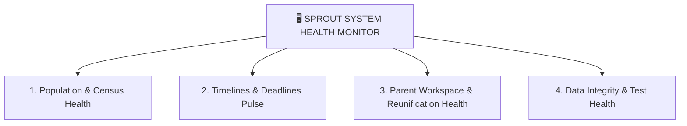

# SYSTEM HEALTH SPECIFICATION
**Initiative:** Sprout  
**Project:** Child & Family Success Operating System  
**Purpose:** Operational Pulse & Health Dashboard Specification (Zero-Investigation Architecture)  
**Target Version:** Sprout v3.2 Foundation Baseline  

---

## 1. Operating Principle: Zero-Investigation Architecture

> **The Founder must never have to become a detective.**
>
> When Candy opens Sprout or reviews system status, she should never have to:
> - Query SQLite tables to find who is active.
> - Dig through folders to check if court packets are ready.
> - Guess whether parent evidence was uploaded.
> - Manually verify if automated tests are passing.
>
> The system must continuously surface its own operational health.

---

## 2. Master System Health Dashboard Layout



---

## 3. The 12 Health Telemetry Indicators

### Section A: Population & Census Health

| Telemetry Metric | Real Data Source | Healthy Threshold | Failure / Warning Condition |
| :--- | :--- | :---: | :--- |
| **1. Children In Care** | `SELECT count(*) FROM children` | $\ge 1$ active child | Count = 0 (Displays empty onboarding state) |
| **2. Caregiver Households** | `SELECT count(*) FROM households` | Exactly 2 live residences (Elmwood + Parkside) | Unexpected households detected in live DB |
| **3. Parent Participants** | `SELECT count(*) FROM parent_users` | $\ge 1$ linked parent per active reunification goal | Unlinked child with reunification goal |

---

### Section B: Timelines, Visits & Deadlines Pulse

| Telemetry Metric | Real Data Source | Healthy Threshold | Failure / Warning Condition |
| :--- | :--- | :---: | :--- |
| **4. Pending Action Tasks** | `timeline_records WHERE follow_up_needed = 1 AND is_completed = 0` | $\le 5$ pending items | $>10$ pending action items |
| **5. Overdue Items** | `WHERE follow_up_due_date < date('now')` | **0 overdue items** | $\ge 1$ item past due (Trigger red badge alert) |
| **6. Upcoming Family Time Visits** | `timeline_records WHERE category = 'family_time' AND event_date >= date('now')` | Next visit scheduled within 7 days | No visit scheduled for active reunification case |
| **7. Upcoming Court Hearings** | `timeline_records WHERE category = 'legal' AND event_date >= date('now')` | Next review date within 90 days | Missing next CHINS court date |
| **8. Unread Alerts & Notices** | Smart notification draft engine | 0 unread high-severity alerts | Emergency alert unreviewed $>24$ hours |

---

### Section C: Parent Workspace & Reunification Health

| Telemetry Metric | Real Data Source | Healthy Threshold | Failure / Warning Condition |
| :--- | :--- | :---: | :--- |
| **9. Parent Scenario Health** | Parent state engine (`parent_users.state`) | 100% valid state assignment (1–10) | State = `UNLINKED` with unverified magic token |
| **10. Pending Evidence Reviews** | `parent_evidence WHERE verified = 0` | 0 unverified uploads $>48$h | Uploaded certificates unreviewed by caregiver |

---

### Section D: Platform Infrastructure, Exports & Testing Health

| Telemetry Metric | Real Data Source | Healthy Threshold | Failure / Warning Condition |
| :--- | :--- | :---: | :--- |
| **11. Sample Data Health** | Dual-sphere partition check | Exactly 15 synthetic homes in Sandbox; 0 synthetic homes in Live DB | **Zero-leakage breach detected (Immediate Halt)** |
| **12. Export & Testing Health** | Automated test runner (`test_e2e_flows.py`) | **73 / 73 Tests Passing (100%)** | $\ge 1$ failing unit/e2e test |

---

## 4. Immediate Visual Health Widget Spec (Cockpit View)

When embedded into the Mission Control or Settings dashboard, this renders as a compact, self-auditing telemetry pill:

```
┌────────────────────────────────────────────────────────────────────────┐
│  🟢 SPROUT SYSTEM HEALTH: ALL SYSTEMS NOMINAL                          │
│  ────────────────────────────────────────────────────────────────────  │
│  👶 Children: 1 Active (CD)       🏡 Caregivers: 3 Registered (CC, RD) │
│  👨‍👩‍👧 Parent: Angela Davis (75%)   ⏱️ Next Visit: Thursday 3:30 PM      │
│  ⚠️ Overdue: 0 Items              📋 Pending Follow-Ups: 2 Actions     │
│  🔒 Privacy: 100% Local (0 Leaks)  🧪 Test Suite: 73/73 Passed (100%)   │
└────────────────────────────────────────────────────────────────────────┘
```

If any indicator violates healthy thresholds, the banner changes color and displays the single high-priority action:
- *Example:* `🔴 ATTENTION: 1 Overdue Action Item: Schedule Pediatric 6-Month Well-Child Check [Click to Resolve]`
