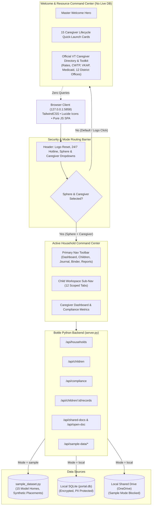
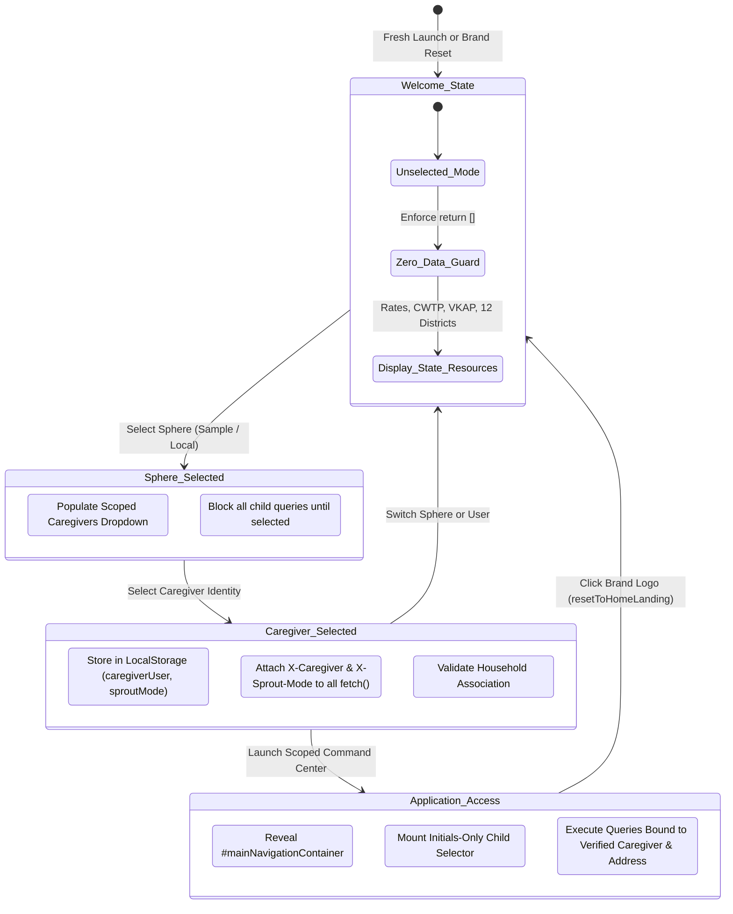

# Sprout / KinCare OS: Technical Summary & System Map

## 1. Executive & Architectural Overview

**Sprout (KinCare OS)** is an offline-capable, privacy-first command center engineered specifically for Vermont foster, kinship, respite, and adoptive families. It is designed to bridge the operational gap between state-level statutory requirements (VT DCF Family Services Division, Policy 75 Normalcy/RPPS, CHINS proceedings) and everyday household documentation (daily journaling, incident tracking, medication administration, mileage, expense logging, and audit compliance).

The platform enforces a strict **Dual-Sphere Architecture**:
1. **Unselected / Welcome State**: Zero database execution, zero private records loaded, clean public landing page featuring the complete Vermont state caregiver resource directory and sample sandbox launcher.
2. **Dev Sandbox Mode (`sample`)**: An isolated environment operating on a normalized 15-household Caregiver Journey Model with synthetic placements, completely disjoint from any private disk storage or live production data.
3. **Local Live Mode (`local`)**: The encrypted, private operational sphere bound to verified caregivers (Candy Chevalier, Robin Davis, Mallory Wheeler) and designated physical properties (41 Elmwood Dr, 22 East Parkside), reading from local SQLite and OneDrive shared documents.

---

## 2. System Architecture & Component Map



---

## 3. Data Flow & Security Boundaries

| Dimension | Default / Welcome State | Dev Sandbox (`sample`) | Local Live Data (`local`) |
| :--- | :--- | :--- | :--- |
| **Active Sphere** | None (`""`) | `sample` | `local` |
| **Caregiver Identity** | None (`""`) | e.g. `Sample Caregiver (Sarah Jenkins)` | `Candy Chevalier`, `Robin Davis`, `Mallory Wheeler` |
| **Top Navigation Bar** | **Hidden** (`#mainNavigationContainer.hidden`) | **Visible** | **Visible** |
| **Child Snapshot Pill** | **Hidden** | **Visible** (Initials only) | **Visible** (Initials only, CD) |
| **Database Access** | **Zero Queries** (`return json_res([])`) | Pure in-memory synthetic Python model | Scoped SQLite queries |
| **Local File System** | Disabled | Blocked (`403 Forbidden`) | Restricted to verified shared folders |
| **PII Protection** | Zero private records rendered | Fully synthetic Vermont fictional entities | Full legal names encrypted; UI shows initials only |
| **GitHub Push Policy** | Publicly safe | Publicly safe | Never exported or committed (`.gitignore`) |

---

## 4. Key Functional Modules Implemented

### A. Dynamic Entry & Reset Architecture
- **Logo Click Reset (`resetToHomeLanding()`)**: Clicking the Sprout brand icon or name resets both dropdown selectors (`#sproutModeSelect` and `#caregiverSelect`) to prompt placeholders, purges `localStorage`, and instantly drops back to the Welcome Portal with zero server calls.
- **Top Bar De-cluttering**: The white navigation and search bar (`#mainNavigationContainer`) is dynamically hidden when on the welcome landing page, keeping the entry screen clean, welcoming, and intuitive.

### B. Normalized Caregiver Journey Model (`sample_dataset.py`)
Replaces flat household types with an 8-dimensional lifecycle matrix across all 15 Vermont model homes:
1. **Household Structure**: Single Adult, Married Couple, Domestic Partners, Friends/Co-Caregivers, Siblings, Parent & Adult Child, Grandparents (55+), Multi-Generational.
2. **Caregiver Stage**: Interested, Inquiry Submitted, Training In Progress, Home Study, Provisional Approval, Newly Licensed (0-1 Yr), Established (1-3 Yrs), Experienced (3+ Yrs), Specialized Provider, Mentor Caregiver, Permanency Provider, Closed / Retired.
3. **Approvals**: Foster, Kinship, Respite, Emergency, Therapeutic, Foster-to-Adopt, Independent Living, Teen Parent Support, Medical Foster Care.
4. **Current Placements & Bed Capacities**: Active vs open beds.
5. **Years Working With DCF**: Accurate tenure representation.
6. **Placements Completed**: Historical volume.
7. **Adoption Finalizations**: Permanency metrics.
8. **Special Certifications**: CPR, Adolescent Behavioral Specialist, Trauma-Informed Care, Medical Foster Care.

### C. Master Vermont Caregiver Resource Hub
Integrated directly into the welcome screen and accessible without logging into a specific profile:
- **DCF Daily Rate Schedules**: Preschool (0–5: \$22.25/day), Child (6–12: \$25.85/day), Teen (13–18: \$31.45/day), Emergency Flat Rate (\$30.00/day), Specialized Care (up to \$200.00/day).
- **State Reimbursement Channels**: Family Support Fund (\$350/child/yr to `Carrie.deem@vermont.gov`), Initial Clothing Voucher (\$100), Child-Only Reach Up Cash Grant (1-800-479-6151), and official state claim forms (`FS-333B`, `FS-334B`, `FS-270`).
- **Education & Incentives**: VT-CWTP Foundations Online (15h) & 9h Learning Networks, **\$100 Completion Incentive**, Fostering to Forever, RPC+ Trauma workshops, Northern Lights CCV, CDC "Act Early" child milestones.
- **Advocacy & Support**: Vermont Kin as Parents (VKAP Warmline: 802-871-5104), Area Agencies on Aging (Caregivers 55+ Line: 1-800-642-5119), VFAFA Children's Activity Fund, Vermont Consortium for Adoption & Guardianship (802-241-0901).
- **Health & Crisis**: Dr. Dynasaur Medicaid (1-855-899-9600), WIC nutrition vouchers, CIS & Help Me Grow (2-1-1 ext. 6), Plan of Safe Care (POSC / CAPTA), all 12 DCF District Offices directory, and prominent **24/7 DCF Crisis Line: 1-800-649-5285**.

---

## 5. File System & Source Code Manifest

```
foster-portal/
├── app/
│   ├── server.py               # WSGI Bottle backend API server with mode routing
│   ├── sample_dataset.py       # Normalized 15-household Caregiver Journey Model
│   ├── portal.db               # Local SQLite database (git-ignored, strictly local)
│   └── static/
│       ├── index.html          # Shell layout, modals, header bar, 24/7 emergency badge
│       └── app.js              # SPA client router, state handling, dynamic UI rendering
├── .gitignore                  # Enforces zero leakage of *.db, uploads/, and local PII
└── README.md                   # Project overview & architectural guide
```

---

## 6. Version Control & GitHub Repository Sync

- **Remote Repository**: [https://github.com/candysuec/Sprout](https://github.com/candysuec/Sprout)
- **Branch**: `main`
- **Key Sync Commits**:
  - `cc4e2e6`: Initial repository baseline with git-ignored private stores.
  - `992ca04`: Master welcome portal, state resource directory, and brand reset implementation.
  - `b0d10de`: Dynamic concealment of primary navigation bar on the unselected welcome view.
  - `a5bf443`: Documentation hub creation & Springboard Enhancement Plan v2 publishing.

---

## 7. Authentication & User Identity Model

### A. Local-First & Zero-Network Authentication Principle
Sprout operates under a **Zero-Cloud, Local-First identity paradigm**. In a child-welfare environment, sensitive custodial decisions, medical prescriptions, and family court orders must never traverse third-party authentication services, remote OAuth providers, or identity brokers. 

Instead, identity binding is executed purely within the local system runtime (`127.0.0.1:5858`) through explicit actor verification and environment scope controls.

### B. The 4-Stage Identity State Machine



### C. Identity Validation & Impersonation Prevention
1. **Caregiver Identity Validation**:
   - The frontend validates every active caregiver against strict predefined authority rosters (`LOCAL_CAREGIVERS` for live operations, `SAMPLE_CAREGIVERS` for dev testing).
   - If an unlisted or malformed identity string is injected, the client falls back to the unselected placeholder (`""`) and purges local storage.
2. **Backend Header Enforcement**:
   - Every client request attaches `X-Caregiver` and `X-Sprout-Mode` headers via the `apiFetch()` bridge.
   - The backend server inspects these headers prior to executing any SQLite query:
     ```python
     caregiver = (request.headers.get('X-Caregiver') or '').strip()
     sprout_mode = (request.headers.get('X-Sprout-Mode') or '').strip().lower()
     if not sprout_mode or not caregiver:
         return json_res([])  # Absolute zero data leakage
     ```
3. **Impersonation & Crossover Prevention**:
   - In **Local Live Mode**, household queries are strictly pinned to verified caregiver physical residences (41 Elmwood Dr & 22 East Parkside).
   - In **Sample Mode**, household queries map strictly to synthetic household IDs (`HH-101` through `HH-115`).
   - The backend rejects cross-sphere requests: a sample caregiver requesting live documents or a live caregiver accessing synthetic fixtures triggers an immediate `403 Forbidden` error.
4. **Session Handling & Reset (`LocalStorage`)**:
   - Identity is persisted across page reloads via `localStorage.getItem('caregiverUser')` and `localStorage.getItem('sproutMode')`.
   - Clicking the Sprout logo triggers `resetToHomeLanding()`, which explicitly executes:
     ```javascript
     localStorage.removeItem('sproutMode');
     localStorage.removeItem('caregiverUser');
     ```
     This instantly restores the zero-query Welcome Portal.

---

## 8. Authorization & Security Model

### A. Role Definitions
Sprout defines 5 operational roles adhering strictly to the **Principle of Least Privilege**:

1. **Unselected Public Visitor (Welcome State)**:
   - Unauthenticated, unassigned identity.
   - Has read access only to state-level public guidance, rate schedules, training portals, and crisis lines.
   - Zero access to child records, journals, binders, or audit logs.
2. **Sample Caregiver User (Dev Sandbox)**:
   - Fictional caregiver identity (e.g., Sarah Jenkins, Marcus Vance).
   - Full read/write access strictly within the in-memory synthetic dataset.
   - Zero access to real SQLite tables (`portal.db`) or local OneDrive files.
3. **Verified Primary Caregiver (Local Live)**:
   - Full legal primary caregiver (Candy Chevalier).
   - Full operational access to real child dossiers, daily journals, medical administration logs, school IEP records, and mileage reimbursement claims.
4. **Homeowner & Resource Caregiver (Local Live)**:
   - Co-caregiver and property owner (Robin Davis, Mallory Wheeler).
   - Full access to household compliance checklists, facility safety inspections (FS-221A), and secondary supervision logs.
5. **Auditor / Caseworker (Read-Only Export Mode - Future Scope)**:
   - External DCF Family Services Worker or Guardian ad Litem (GAL).
   - Cryptographically read-only access restricted to court-admissible PDF binders and date-scoped journal excerpts.

### B. Comprehensive Role-Based Access Control (RBAC) Matrix

| Feature / Domain | Welcome State | Sample Mode (`sample`) | Local Primary Caregiver | Local Resource Caregiver | Future Auditor / Caseworker |
| :--- | :---: | :---: | :---: | :---: | :---: |
| **Public State Resource Hub** | **Full Access** | **Full Access** | **Full Access** | **Full Access** | **Full Access** |
| **Top Navigation Toolbar** | **Hidden** | **Active** | **Active** | **Active** | Restricted |
| **Household & Bed Capacity** | None | Synthetic Only | **Full Edit** | **Full Edit** | Read-Only |
| **Child Demographics & Initials**| None | Synthetic Only | **Full Edit** | Read-Only | Read-Only |
| **Daily Journaling & Observations**| None | Synthetic Only | **Full Log / Edit** | Co-Signature Only| Read-Only |
| **Medication Administration Tracking**| None | Synthetic Only | **Full Log / Admin**| Administer Only | Audit View |
| **Document Binder (OneDrive)** | Blocked | Blocked (`403`) | **Full Launch** | **Full Launch** | Watermarked PDF |
| **Expense & Mileage Tracking** | None | Synthetic Only | **Full Submit** | Mileage Only | Financial Audit |
| **CHINS Court Timeline** | None | Synthetic Only | **Full View / Edit**| Read-Only | Legal View |
| **Audit Log & Security Settings** | None | Synthetic Only | **Admin View** | Read-Only | Audit Log Only |

### C. Security Rule Enforcement by Sphere

```
┌────────────────────────────────────────────────────────────────────────┐
│                              WELCOME STATE                             │
│   • No LocalStorage identity binding                                    │
│   • API endpoints immediately return [] (Zero database execution)      │
│   • Top Navigation Toolbar: HIDDEN                                     │
│   • Child Initials Dropdown: HIDDEN                                    │
└───────────────────────────────────┬────────────────────────────────────┘
                                    │
                  ┌─────────────────┴─────────────────┐
                  ▼                                   ▼
┌───────────────────────────────────┐   ┌────────────────────────────────┐
│         SAMPLE DEV SANDBOX        │   │        LOCAL LIVE SPHERE       │
│  • Bounded to sample_dataset.py   │   │  • Bounded to SQLite portal.db │
│  • 15 Caregiver Journey homes     │   │  • Verified caregivers only    │
│  • Synthetic Placements only      │   │  • Child CD records only       │
│  • Local OneDrive: 403 FORBIDDEN  │   │  • Local OneDrive: AUTHORIZED  │
│  • Zero disk-write pollution      │   │  • Git Ignored: Zero cloud sync│
└───────────────────────────────────┘   └────────────────────────────────┘
```

