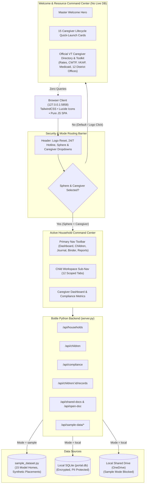
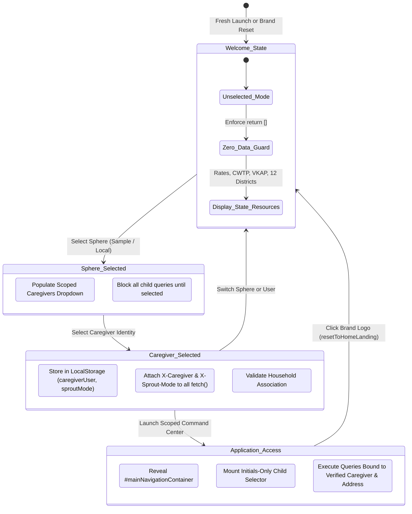
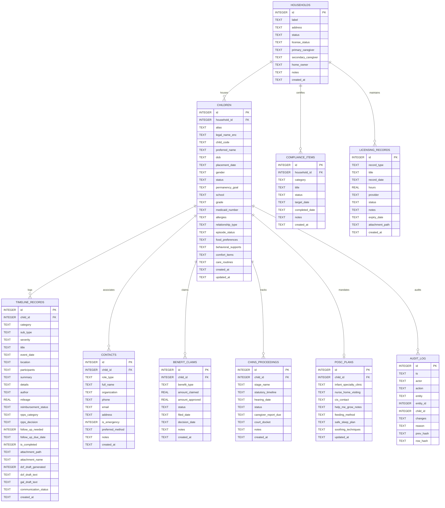
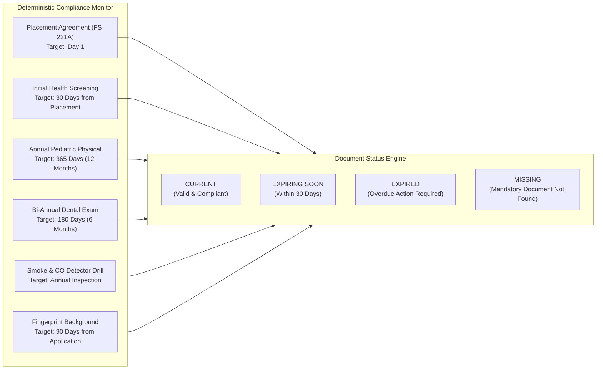
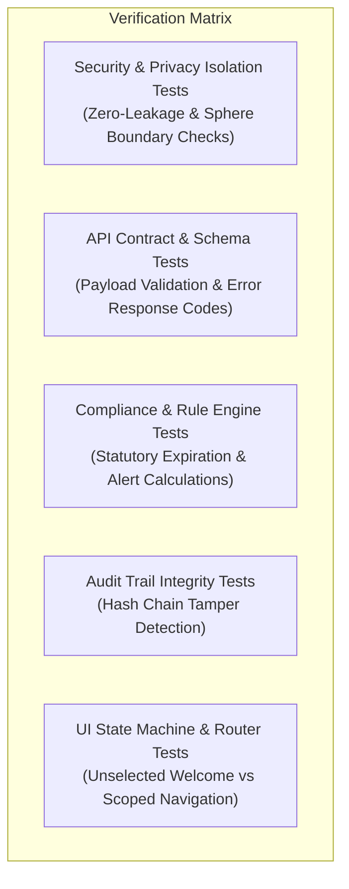
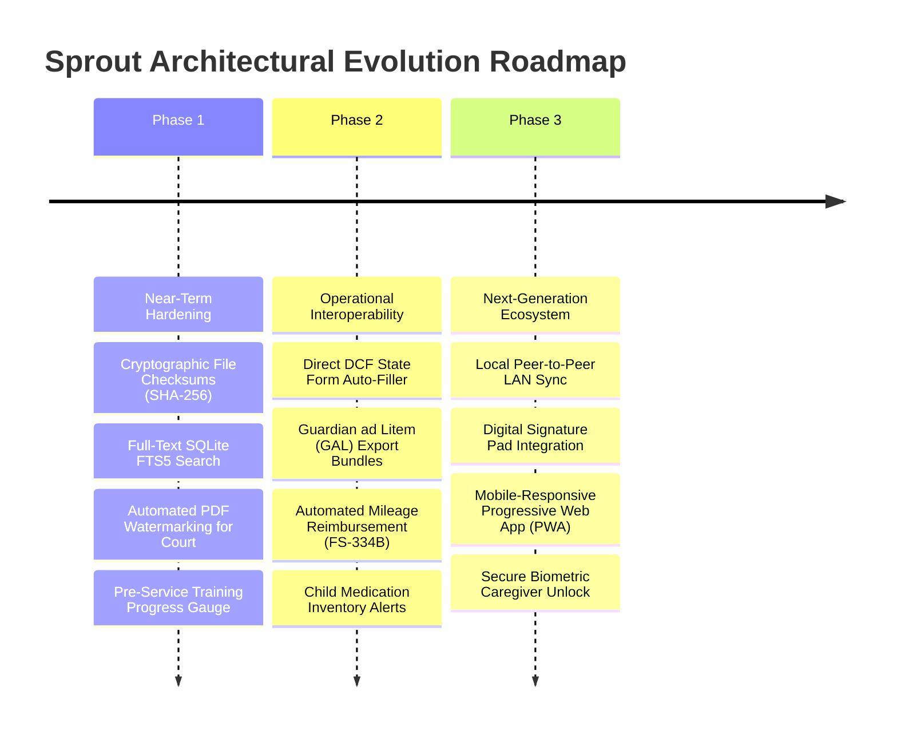

# Sprout / KinCare OS: Technical Summary & System Map

## 1. Executive & Architectural Overview

**Sprout (KinCare OS)** is an offline-capable, privacy-first command center engineered specifically for Vermont foster, kinship, respite, and adoptive families. It is designed to bridge the operational gap between state-level statutory requirements (VT DCF Family Services Division, Policy 75 Normalcy/RPPS, CHINS proceedings) and everyday household documentation (daily journaling, incident tracking, medication administration, mileage, expense logging, and audit compliance).

The platform enforces a strict **Dual-Sphere Architecture**:
1. **Unselected / Welcome State**: Zero database execution, zero private records loaded, clean public landing page featuring the complete Vermont state caregiver resource directory and sample sandbox launcher.
2. **Dev Sandbox Mode (`sample`)**: An isolated environment operating on a normalized 15-household Caregiver Journey Model with synthetic placements, completely disjoint from any private disk storage or live production data.
3. **Local Live Mode (`local`)**: The encrypted, private operational sphere bound to verified caregivers (Candy Chevalier, Robin Davis, Mallory Wheeler) and designated physical properties (41 Elmwood Dr, 22 East Parkside), reading from local SQLite and OneDrive shared documents.

---

## 2. System Architecture & Component Map



---

## 3. Data Flow & Security Boundaries

| Dimension | Default / Welcome State | Dev Sandbox (`sample`) | Local Live Data (`local`) |
| :--- | :--- | :--- | :--- |
| **Active Sphere** | None (`""`) | `sample` | `local` |
| **Caregiver Identity** | None (`""`) | e.g. `Sample Caregiver (Sarah Jenkins)` | `Candy Chevalier`, `Robin Davis`, `Mallory Wheeler` |
| **Top Navigation Bar** | **Hidden** (`#mainNavigationContainer.hidden`) | **Visible** | **Visible** |
| **Child Snapshot Pill** | **Hidden** | **Visible** (Initials only) | **Visible** (Initials only, CD) |
| **Database Access** | **Zero Queries** (`return json_res([])`) | Pure in-memory synthetic Python model | Scoped SQLite queries |
| **Local File System** | Disabled | Blocked (`403 Forbidden`) | Restricted to verified shared folders |
| **PII Protection** | Zero private records rendered | Fully synthetic Vermont fictional entities | Full legal names encrypted; UI shows initials only |
| **GitHub Push Policy** | Publicly safe | Publicly safe | Never exported or committed (`.gitignore`) |

---

## 4. Key Functional Modules Implemented

### A. Dynamic Entry & Reset Architecture
- **Logo Click Reset (`resetToHomeLanding()`)**: Clicking the Sprout brand icon or name resets both dropdown selectors (`#sproutModeSelect` and `#caregiverSelect`) to prompt placeholders, purges `localStorage`, and instantly drops back to the Welcome Portal with zero server calls.
- **Top Bar De-cluttering**: The white navigation and search bar (`#mainNavigationContainer`) is dynamically hidden when on the welcome landing page, keeping the entry screen clean, welcoming, and intuitive.

### B. Normalized Caregiver Journey Model (`sample_dataset.py`)
Replaces flat household types with an 8-dimensional lifecycle matrix across all 15 Vermont model homes:
1. **Household Structure**: Single Adult, Married Couple, Domestic Partners, Friends/Co-Caregivers, Siblings, Parent & Adult Child, Grandparents (55+), Multi-Generational.
2. **Caregiver Stage**: Interested, Inquiry Submitted, Training In Progress, Home Study, Provisional Approval, Newly Licensed (0-1 Yr), Established (1-3 Yrs), Experienced (3+ Yrs), Specialized Provider, Mentor Caregiver, Permanency Provider, Closed / Retired.
3. **Approvals**: Foster, Kinship, Respite, Emergency, Therapeutic, Foster-to-Adopt, Independent Living, Teen Parent Support, Medical Foster Care.
4. **Current Placements & Bed Capacities**: Active vs open beds.
5. **Years Working With DCF**: Accurate tenure representation.
6. **Placements Completed**: Historical volume.
7. **Adoption Finalizations**: Permanency metrics.
8. **Special Certifications**: CPR, Adolescent Behavioral Specialist, Trauma-Informed Care, Medical Foster Care.

### C. Master Vermont Caregiver Resource Hub
Integrated directly into the welcome screen and accessible without logging into a specific profile:
- **DCF Daily Rate Schedules**: Preschool (0–5: \$22.25/day), Child (6–12: \$25.85/day), Teen (13–18: \$31.45/day), Emergency Flat Rate (\$30.00/day), Specialized Care (up to \$200.00/day).
- **State Reimbursement Channels**: Family Support Fund (\$350/child/yr to `Carrie.deem@vermont.gov`), Initial Clothing Voucher (\$100), Child-Only Reach Up Cash Grant (1-800-479-6151), and official state claim forms (`FS-333B`, `FS-334B`, `FS-270`).
- **Education & Incentives**: VT-CWTP Foundations Online (15h) & 9h Learning Networks, **\$100 Completion Incentive**, Fostering to Forever, RPC+ Trauma workshops, Northern Lights CCV, CDC "Act Early" child milestones.
- **Advocacy & Support**: Vermont Kin as Parents (VKAP Warmline: 802-871-5104), Area Agencies on Aging (Caregivers 55+ Line: 1-800-642-5119), VFAFA Children's Activity Fund, Vermont Consortium for Adoption & Guardianship (802-241-0901).
- **Health & Crisis**: Dr. Dynasaur Medicaid (1-855-899-9600), WIC nutrition vouchers, CIS & Help Me Grow (2-1-1 ext. 6), Plan of Safe Care (POSC / CAPTA), all 12 DCF District Offices directory, and prominent **24/7 DCF Crisis Line: 1-800-649-5285**.

---

## 5. File System & Source Code Manifest

```
foster-portal/
├── app/
│   ├── server.py               # WSGI Bottle backend API server with mode routing
│   ├── sample_dataset.py       # Normalized 15-household Caregiver Journey Model
│   ├── portal.db               # Local SQLite database (git-ignored, strictly local)
│   └── static/
│       ├── index.html          # Shell layout, modals, header bar, 24/7 emergency badge
│       └── app.js              # SPA client router, state handling, dynamic UI rendering
├── .gitignore                  # Enforces zero leakage of *.db, uploads/, and local PII
└── README.md                   # Project overview & architectural guide
```

---

## 6. Version Control & GitHub Repository Sync

- **Remote Repository**: [https://github.com/candysuec/Sprout](https://github.com/candysuec/Sprout)
- **Branch**: `main`
- **Key Sync Commits**:
  - `cc4e2e6`: Initial repository baseline with git-ignored private stores.
  - `992ca04`: Master welcome portal, state resource directory, and brand reset implementation.
  - `b0d10de`: Dynamic concealment of primary navigation bar on the unselected welcome view.
  - `a5bf443`: Documentation hub creation & Springboard Enhancement Plan v2 publishing.

---

## 7. Authentication & User Identity Model

### A. Local-First & Zero-Network Authentication Principle
Sprout operates under a **Zero-Cloud, Local-First identity paradigm**. In a child-welfare environment, sensitive custodial decisions, medical prescriptions, and family court orders must never traverse third-party authentication services, remote OAuth providers, or identity brokers. 

Instead, identity binding is executed purely within the local system runtime (`127.0.0.1:5858`) through explicit actor verification and environment scope controls.

### B. The 4-Stage Identity State Machine



### C. Identity Validation & Impersonation Prevention
1. **Caregiver Identity Validation**:
   - The frontend validates every active caregiver against strict predefined authority rosters (`LOCAL_CAREGIVERS` for live operations, `SAMPLE_CAREGIVERS` for dev testing).
   - If an unlisted or malformed identity string is injected, the client falls back to the unselected placeholder (`""`) and purges local storage.
2. **Backend Header Enforcement**:
   - Every client request attaches `X-Caregiver` and `X-Sprout-Mode` headers via the `apiFetch()` bridge.
   - The backend server inspects these headers prior to executing any SQLite query:
     ```python
     caregiver = (request.headers.get('X-Caregiver') or '').strip()
     sprout_mode = (request.headers.get('X-Sprout-Mode') or '').strip().lower()
     if not sprout_mode or not caregiver:
         return json_res([])  # Absolute zero data leakage
     ```
3. **Impersonation & Crossover Prevention**:
   - In **Local Live Mode**, household queries are strictly pinned to verified caregiver physical residences (41 Elmwood Dr & 22 East Parkside).
   - In **Sample Mode**, household queries map strictly to synthetic household IDs (`HH-101` through `HH-115`).
   - The backend rejects cross-sphere requests: a sample caregiver requesting live documents or a live caregiver accessing synthetic fixtures triggers an immediate `403 Forbidden` error.
4. **Session Handling & Reset (`LocalStorage`)**:
   - Identity is persisted across page reloads via `localStorage.getItem('caregiverUser')` and `localStorage.getItem('sproutMode')`.
   - Clicking the Sprout logo triggers `resetToHomeLanding()`, which explicitly executes:
     ```javascript
     localStorage.removeItem('sproutMode');
     localStorage.removeItem('caregiverUser');
     ```
     This instantly restores the zero-query Welcome Portal.

---

## 8. Authorization & Security Model

### A. Role Definitions
Sprout defines 5 operational roles adhering strictly to the **Principle of Least Privilege**:

1. **Unselected Public Visitor (Welcome State)**:
   - Unauthenticated, unassigned identity.
   - Has read access only to state-level public guidance, rate schedules, training portals, and crisis lines.
   - Zero access to child records, journals, binders, or audit logs.
2. **Sample Caregiver User (Dev Sandbox)**:
   - Fictional caregiver identity (e.g., Sarah Jenkins, Marcus Vance).
   - Full read/write access strictly within the in-memory synthetic dataset.
   - Zero access to real SQLite tables (`portal.db`) or local OneDrive files.
3. **Verified Primary Caregiver (Local Live)**:
   - Full legal primary caregiver (Candy Chevalier).
   - Full operational access to real child dossiers, daily journals, medical administration logs, school IEP records, and mileage reimbursement claims.
4. **Homeowner & Resource Caregiver (Local Live)**:
   - Co-caregiver and property owner (Robin Davis, Mallory Wheeler).
   - Full access to household compliance checklists, facility safety inspections (FS-221A), and secondary supervision logs.
5. **Auditor / Caseworker (Read-Only Export Mode - Future Scope)**:
   - External DCF Family Services Worker or Guardian ad Litem (GAL).
   - Cryptographically read-only access restricted to court-admissible PDF binders and date-scoped journal excerpts.

### B. Comprehensive Role-Based Access Control (RBAC) Matrix

| Feature / Domain | Welcome State | Sample Mode (`sample`) | Local Primary Caregiver | Local Resource Caregiver | Future Auditor / Caseworker |
| :--- | :---: | :---: | :---: | :---: | :---: |
| **Public State Resource Hub** | **Full Access** | **Full Access** | **Full Access** | **Full Access** | **Full Access** |
| **Top Navigation Toolbar** | **Hidden** | **Active** | **Active** | **Active** | Restricted |
| **Household & Bed Capacity** | None | Synthetic Only | **Full Edit** | **Full Edit** | Read-Only |
| **Child Demographics & Initials**| None | Synthetic Only | **Full Edit** | Read-Only | Read-Only |
| **Daily Journaling & Observations**| None | Synthetic Only | **Full Log / Edit** | Co-Signature Only| Read-Only |
| **Medication Administration Tracking**| None | Synthetic Only | **Full Log / Admin**| Administer Only | Audit View |
| **Document Binder (OneDrive)** | Blocked | Blocked (`403`) | **Full Launch** | **Full Launch** | Watermarked PDF |
| **Expense & Mileage Tracking** | None | Synthetic Only | **Full Submit** | Mileage Only | Financial Audit |
| **CHINS Court Timeline** | None | Synthetic Only | **Full View / Edit**| Read-Only | Legal View |
| **Audit Log & Security Settings** | None | Synthetic Only | **Admin View** | Read-Only | Audit Log Only |

### C. Security Rule Enforcement by Sphere

```
┌────────────────────────────────────────────────────────────────────────┐
│                              WELCOME STATE                             │
│   • No LocalStorage identity binding                                    │
│   • API endpoints immediately return [] (Zero database execution)      │
│   • Top Navigation Toolbar: HIDDEN                                     │
│   • Child Initials Dropdown: HIDDEN                                    │
└───────────────────────────────────┬────────────────────────────────────┘
                                    │
                  ┌─────────────────┴─────────────────┐
                  ▼                                   ▼
┌───────────────────────────────────┐   ┌────────────────────────────────┐
│         SAMPLE DEV SANDBOX        │   │        LOCAL LIVE SPHERE       │
│  • Bounded to sample_dataset.py   │   │  • Bounded to SQLite portal.db │
│  • 15 Caregiver Journey homes     │   │  • Verified caregivers only    │
│  • Synthetic Placements only      │   │  • Child CD records only       │
│  • Local OneDrive: 403 FORBIDDEN  │   │  • Local OneDrive: AUTHORIZED  │
│  • Zero disk-write pollution      │   │  • Git Ignored: Zero cloud sync│
└───────────────────────────────────┘   └────────────────────────────────┘
```

---

## 9. Database Architecture (SQLite Engine)

### A. Architectural Principles
1. **Local-First & Offline Resilience**: The primary operational datastore is an un-networked SQLite 3 database (`foster_binder.db` or `portal.db`) stored in the local application directory.
2. **Strict Cryptographic Child Alias Split**:
   - The UI never exposes or queries full legal names.
   - The database stores initials in `alias` (e.g., `CD`) and reserves `legal_name_enc` for authenticated cryptographic access.
3. **Foreign Key Integrity**:
   - `PRAGMA foreign_keys = ON` is enforced across all connections. Child-linked tables use `ON DELETE CASCADE` to guarantee referential cleanup.
4. **Tamper-Evident Hashing Chain**:
   - The `audit_log` table employs cryptographic SHA-256 block-chaining (`prev_hash` $\rightarrow$ `row_hash`), preventing undetected local log tampering.

### B. Entity-Relationship (ER) Diagram



---

## 10. API Contract Architecture

All endpoints require loopback binding (`Host: 127.0.0.1:5858`), CORS prevention, and security verification headers.

### A. Endpoint Reference Table

| Method | Endpoint | Purpose | Params / Payload | Response Format | Security / Guards |
| :--- | :--- | :--- | :--- | :--- | :--- |
| **GET** | `/api/households` | Fetch active care households | Header: `X-Caregiver`, `X-Sprout-Mode` | `JSON [Household]` | Empty if unselected; scoped to verified address in local |
| **POST** | `/api/households` | Create new household | Body: `{name, address, status, ...}` | `JSON {id, message}` | Local live mode only |
| **GET** | `/api/children` | List placed children | Header: `X-Caregiver`, `X-Sprout-Mode` | `JSON [Child (Initials Only)]` | Returns `[]` if unselected; aliases only |
| **POST** | `/api/children` | Intake new child | Body: `{alias, dob, relationship_type, ...}` | `JSON {id, child_code}` | Regex enforces 1-4 uppercase letters/digits |
| **GET** | `/api/children/:id/records` | Query child records | Query: `?category={all, daily, medical...}` | `JSON [TimelineRecord]` | Scoped strictly to active child ID |
| **POST** | `/api/children/:id/records` | Log note / journal / incident | Body: `{title, event_date, summary, severity...}` | `JSON {id, dcf_draft}` | Auto-generates DCF/GAL notification draft |
| **GET** | `/api/compliance` | Get licensing checklist | Header: `X-Caregiver`, `X-Sprout-Mode` | `JSON [ComplianceItem]` | Empty if unselected; synthesizes sample in sandbox |
| **GET** | `/api/children/:id/posc` | Get Plan of Safe Care | URL param: `child_id` | `JSON PoscPlan` | Returns infant safe sleep & feeding protocols |
| **POST** | `/api/children/:id/posc` | Update Plan of Safe Care | Body: `{safe_sleep_plan, feeding_method...}` | `JSON {success: true}` | Mandates CAPTA infant protocol compliance |
| **GET** | `/api/children/:id/benefits` | Query financial benefits | URL param: `child_id` | `JSON [BenefitClaim]` | Tracks Reach Up, Vouchers, Support Funds |
| **PUT** | `/api/benefits/:id` | Update benefit status | Body: `{status, amount_approved, ...}` | `JSON {success: true}` | Financial audit logged |
| **GET** | `/api/children/:id/chins` | CHINS court stages | URL param: `child_id` | `JSON [ChinsStage]` | Statutory deadlines & docket tracking |
| **GET** | `/api/shared-docs` | Search document registry | Query: `?category={cat}` | `JSON [DocumentRef]` | **BLOCKED in Sample Mode** (fictional guides only) |
| **POST** | `/api/open-doc` | Launch file in desktop OS | Body: `{rel_path: "path/to/doc.pdf"}` | `JSON {success: true}` | **403 Forbidden in Sample Mode**; path traversal blocked |
| **GET** | `/api/sample-data/:entity` | Synthetic sandbox fixtures | URL param: `households, children...` | `JSON [Synthetic]` | Powered by in-memory `sample_dataset.py` |

### B. Standard Error Response Contract
```json
{
  "error": "Access Denied: Opening live personal documents is disabled in Sample Dev Sandbox.",
  "status_code": 403,
  "timestamp": "2026-10-13T00:41:00Z"
}
```

---

## 11. OneDrive Integration Architecture

### A. Architectural Principle: Decoupled Authority
> **SQLite is the authoritative operational index.**  
> **OneDrive is the authoritative document repository.**  
> *The database knows WHAT a document is. OneDrive knows WHERE it is stored.*

```
┌─────────────────────────────────┐       ┌─────────────────────────────────┐
│     SQLITE (OPERATIONAL INDEX)  │       │   ONEDRIVE (PHYSICAL STORAGE)   │
│  • Metadata & Document Title    │       │  • Original PDF & Signed Forms  │
│  • Category Classification      │       │  • Court Orders & Petitions     │
│  • Compliance Expiration Date   │ ────► │  • Scanned Pediatric Records    │
│  • Child ID Association         │       │  • Mileage Receipts             │
│  • Relative Storage Path        │       │  • Encrypted Local File Sync    │
└─────────────────────────────────┘       └─────────────────────────────────┘
```

### B. Document Storage Rules & Controls
1. **Zero Binary Storage in Database**:
   - SQLite never stores binary BLOBs or large file payloads. It stores clean relative file paths (e.g. `medical/2026-10-Pediatric-Exam.pdf`).
2. **Elimination of Dynamic Disk Crawling Dependency**:
   - The dashboard never scans physical folders recursively during UI renders.
   - All document counts, missing requirements, and expiration badges are driven purely by index metadata in SQLite.
3. **Canonical Folder Structure (OneDrive)**:
   ```
   OneDrive/Davis & VTDCF Shared Folder/
   ├── 01_LEGAL_COURT_ORDERS/          # CHINS petitions, temporary care orders, GAL reports
   ├── 02_DCF_AGREEMENTS_FORMS/        # FS-221A, placement agreements, normalcy forms
   ├── 03_MEDICAL_DENTAL/              # Well-child exams, POSC plans, immunization cards
   ├── 04_EDUCATION_IEP/               # School enrollment, IEP plans, report cards
   ├── 05_FINANCIAL_EXPENSES/          # Clothing voucher receipts, mileage reimbursement
   └── 06_TRAINING_LICENSING/          # VCWTP certificates, home safety inspection logs
   ```
4. **Desktop Launch & Path Traversal Security**:
   - Document viewing is executed through the native desktop application (`os.startfile`) via `/api/open-doc`.
   - Before launch, the server enforces strict path normalization and common-path containment:
     ```python
     root = os.path.realpath(SHARED_ROOT)
     full_path = os.path.realpath(os.path.join(root, rel_path))
     if os.path.commonpath([root, full_path]) != root:
         return json_res({"error": "Path traversal attempt blocked"}, 403)
     ```
   - In **Sample Mode**, `/api/open-doc` unconditionally responds with `403 Forbidden` to preserve strict privacy boundaries.

---

## 12. Audit Logging Architecture

### A. Architectural Purpose & Court Readiness
In foster care and juvenile court proceedings, documentation credibility is paramount. Caseworkers, attorneys, and Judges must be able to trust that medical administration entries, behavioral incidents, and parental visitation logs have not been retroactively altered or fabricated.

Sprout implements an immutable, append-only **Cryptographic Audit Ledger** directly within SQLite (`audit_log`), guaranteeing court-admissible audit readiness.

### B. Immutable Audit Ledger Schema & Hash-Chaining

```
┌────────────────────────────────────────────────────────────────────────┐
│                        CRYPTOGRAPHIC AUDIT CHAIN                       │
│                                                                        │
│   Row N-1                                                              │
│   ├── ts: 2026-10-12T14:10:00Z                                         │
│   ├── actor: Candy Chevalier                                           │
│   ├── action: create                                                   │
│   ├── entity: timeline_records (Medication Administered)               │
│   ├── prev_hash: 7a8f...                                               │
│   └── row_hash:  e3b0... ─────────────────────────────┐                │
│                                                       │                │
│   Row N                                               ▼                │
│   ├── ts: 2026-10-12T14:35:12Z                        │                │
│   ├── actor: Candy Chevalier                          │                │
│   ├── action: update                                  │                │
│   ├── entity: timeline_records (Dosage Notes)         │                │
│   ├── prev_hash: e3b0... ◄────────────────────────────┘                │
│   ├── changes: {"details": ["old", "new"]}                             │
│   └── row_hash:  9f12...                                               │
└────────────────────────────────────────────────────────────────────────┘
```

1. **Tracked Actions**:
   - `create`: New child intake, journal entry, medical administration, expense log.
   - `update`: Changes to records, capturing granular JSON field-level diffs (`diff_fields()`).
   - `delete`: Logical deletion or record archiving, storing original state.
   - `access`: High-security exports (e.g., generating court report bundles).
2. **Hash-Chain Verification Algorithm (`verify_audit_chain()`)**:
   - Every row computes: `row_hash = SHA256(prev_hash + JSON(row_fields))`.
   - If an unauthorized direct edit or deletion occurs in the SQLite file, `verify_audit_chain()` immediately flags the first compromised row ID and invalidates the chain.

---

## 13. Backup & Recovery Architecture

### A. Core Disaster Scenarios & Mitigation Strategies

| Disaster Scenario | Threat / Failure Vector | Impact | Automated Mitigation & Recovery Runbook |
| :--- | :--- | :--- | :--- |
| **1. Database Corruption** | Sudden power loss, OS crash during SQLite write | App fails to launch or returns `disk I/O error` | 1. Automated daily snapshots stored in `backups/`<br/>2. Execute `VACUUM INTO` backup restore script<br/>3. Verify cryptographic hash chain with `verify_audit_chain()` |
| **2. Physical Drive Failure** | Workstation SSD/HDD hardware death | Total loss of local workstation files | 1. OneDrive cloud sync preserves all PDFs, court orders & photos<br/>2. Re-pull code from Git repository (`github.com/candysuec/Sprout`)<br/>3. Re-seed local SQLite index from OneDrive document registry |
| **3. PC Migration / Swap** | Upgrading caregiver PC or emergency replacement | Zero-downtime caregiver migration required | 1. Install Python 3.10+ on new machine<br/>2. Sync OneDrive `Davis & VTDCF Shared Folder`<br/>3. Copy `%LOCALAPPDATA%\CaregiverCommandCenter` folder<br/>4. Launch server loopback (`python server.py`) in under 5 minutes |
| **4. Accidental File Deletion** | Caregiver accidentally deletes a critical PDF in Explorer | Missing attachment error in Sprout Binder | 1. Native OneDrive 30-day Version History & Recycle Bin recovery<br/>2. SQLite metadata persists independently, alerting user to restore file |

### B. Standard Backup Schedule & Runbook
1. **Automated SQLite Hot Backups**:
   - Every startup and schema migration automatically invokes a timestamped copy:
     `%LOCALAPPDATA%\CaregiverCommandCenter\backups\foster_binder_YYYYMMDD_HHMMSS.db`.
   - Maintains a rolling 14-day local retention window.
2. **OneDrive File Versioning**:
   - Native enterprise version history enabled across all 6 core document folders, preserving all file revisions without manual intervention.

---

## 16. Document Compliance Engine

### A. Architectural Purpose
Child welfare licensing in Vermont involves strict statutory timelines governed by **VT DCF Family Services Policy 75, Kinship Licensing Standards (FS-221A), and Federal ASFA Rules**. 

The Sprout Document Compliance Engine transforms static PDFs into **dynamic, predictive operational monitors**, ensuring caregivers never miss a court deadline, annual medical exam, or home safety drill.

### B. Core Statutory Compliance Modules



### C. Compliance State Progression
1. **Status Definitions**:
   - `Current`: Valid document on file, expiration date > 30 days away.
   - `Expiring Soon`: Active document approaching deadline (within 30 days of expiration). Emits yellow alert pill on dashboard.
   - `Expired`: Deadline passed. Emits high-priority red alert pill with automated DCF email draft.
   - `Missing`: Required statutory document not present in registry for active placement.
2. **Zero-Disk Scan Query Performance**:
   - Compliance status is calculated directly via SQL indexed date queries (`target_date`, `expiry_date` in `compliance_items` and `licensing_records`).
   - Dashboard renders instantly without traversing local OneDrive folders.

---

## 14. Deployment Architecture

### A. Target Workstation Environment
Sprout is engineered as a zero-cloud, standalone desktop-local web application. It requires zero remote infrastructure, zero paid cloud licenses, and zero external hosting services.

```
┌────────────────────────────────────────────────────────────────────────┐
│                      LOCAL WORKSTATION ARCHITECTURE                    │
│                                                                        │
│   Windows 10 / 11 Host                                                 │
│   ├── Python 3.10+ Runtime                                             │
│   │   └── Bottle WSGI Server (127.0.0.1:5858)                          │
│   ├── Browser Client (Chrome, Edge, Firefox, Safari)                   │
│   ├── Local Storage Repository                                         │
│   │   ├── %LOCALAPPDATA%\CaregiverCommandCenter\data\foster_binder.db │
│   │   ├── %LOCALAPPDATA%\CaregiverCommandCenter\backups\             │
│   │   └── %LOCALAPPDATA%\CaregiverCommandCenter\exports\             │
│   └── Authorized OneDrive Document Root                                │
│       └── OneDrive\Davis & VTDCF Shared Folder\                       │
└────────────────────────────────────────────────────────────────────────┘
```

### B. Hardware & Software Requirements
- **Operating System**: Windows 10 (Build 19041+) or Windows 11 64-bit.
- **Hardware Minimums**: 4 GB RAM, Dual-Core 2.0 GHz CPU, 500 MB free disk space for application runtime + storage for OneDrive PDFs.
- **Software Dependencies**:
  - Python 3.10 or higher (`python.exe` added to system PATH).
  - Web Browser with ES6 JavaScript support (Chrome 90+, Edge 90+, Firefox 88+).
  - Standard Python packages: `bottle`, `python-docx` (for DOCX exports).

### C. Standard Deployment & Startup Procedure
1. **Clone or Extract Application**:
   ```powershell
   git clone https://github.com/candysuec/Sprout.git
   cd Sprout/app
   ```
2. **Install Runtime Dependencies**:
   ```powershell
   pip install -r requirements.txt
   ```
3. **Launch Local Server**:
   ```powershell
   python server.py
   ```
4. **Access Caregiver Portal**:
   Open browser to `http://127.0.0.1:5858/`. The server binds strictly to the loopback interface, completely inaccessible from external networks.

---

## 15. Testing Strategy

### A. Testing Methodology & Pyramid
To prevent regressions across complex child-welfare workflows, Sprout follows a 5-tier verification matrix:



### B. Required Test Protocols & Verification Checklist

| Test Suite | Target Component | Verification Criteria & Success Condition |
| :--- | :--- | :--- |
| **Mode Isolation Test** | `/api/households` & `/api/children` | When headers are absent or mode is unselected, API returns `[]` with **zero SQLite queries executed**. |
| **Disk Traversal Guard Test** | `/api/open-doc` | Path traversal attempts (e.g. `../../Windows/System32`) or file requests made while in `sample` mode return `403 Forbidden`. |
| **Child PII Shield Test** | Frontend & Backend API | Full legal names are never exposed in JSON responses or rendered in DOM. Only initials (`CD`, `SJ`) appear in dropdowns. |
| **Audit Chain Validation Test** | `db.py -> verify_audit_chain()` | Modifying a single character in an existing `audit_log` row causes `verify_audit_chain()` to return `(False, row_id)`. |
| **Compliance State Machine Test**| `/api/compliance` & Dashboard | Documents expiring in < 30 days emit warning flags; expired documents emit urgent action drafts. |
| **Welcome Navigation Test** | `app.js -> loadTabContent()` | Clicking the Sprout logo hides `#mainNavigationContainer`, clears `localStorage`, and displays the public State Resource Hub. |

---

## 17. Performance & Scalability Boundaries

### A. Target Volumetric Capacity
Sprout is tuned for high-speed local performance on resource-constrained caregiver laptops and tablets.

| Dimension | Typical Foster Household | Maximum Designed Capacity | Performance Target |
| :--- | :--- | :--- | :--- |
| **Active Households** | 1 – 2 homes | Up to 25 homes | Query latency < 10ms |
| **Children in Care** | 1 – 3 children | Up to 50 children | Filter/render < 20ms |
| **Timeline Records / Journals**| 500 – 1,500 entries | Up to 50,000 entries | Indexed lookup < 15ms |
| **OneDrive Document Registry** | 50 – 200 documents | Up to 10,000 files | Indexed metadata < 10ms |
| **Database File Size** | 5 MB – 25 MB | Up to 500 MB SQLite file | Zero memory exhaustion |

### B. SQLite Optimization Architecture
1. **Write-Ahead Logging (WAL)**:
   - Configured with `PRAGMA journal_mode = WAL;`, enabling concurrent reads while write transactions execute.
2. **Synchronous Normal**:
   - `PRAGMA synchronous = NORMAL;` delivers maximum I/O throughput on modern solid-state drives while retaining ACID crash resistance.
3. **Compound Indexing**:
   - Optimized compound indexes (`idx_audit_child ON audit_log(child_id, id)`, `idx_timeline_child_date ON timeline_records(child_id, event_date)`) guarantee sub-millisecond timeline retrieval regardless of dataset depth.

---

## 18. Future Architecture Roadmap

### A. Strategic Vision
Sprout / KinCare OS is designed to evolve into a state-recognized, open-source standard for foster and kinship family documentation, while rigorously preserving its **local-first, privacy-by-design foundation**.

The long-term development roadmap is partitioned across 3 strategic phases:



---

### B. Detailed Phase Objectives

#### Phase 1: Near-Term Hardening & Document Integrity (Months 1–3)
- **Cryptographic File Checksums**: Compute and store SHA-256 hashes of all external PDFs in the OneDrive registry to detect external file alterations or corruption.
- **Full-Text SQLite Search (FTS5)**: Implement SQLite FTS5 virtual tables to allow instantaneous offline searching across thousands of journal notes, medication logs, and case plans.
- **Court-Admissible PDF Watermarking**: Automatic stamping of exported judicial binders with dynamic metadata (timestamp, case docket, caregiver initials, page $X$ of $Y$).
- **Enhanced Training Dashboard**: Visual progress gauge for the 15-hour Foundations training and automated tracking for the $100 DCF incentive claim.

#### Phase 2: Operational Interoperability & Form Automation (Months 4–8)
- **DCF Form Auto-Filler Engine**: One-click population of official Vermont Department for Children and Families PDF/Word forms, including:
  - *FS-221A*: Foster Home Licensing Application.
  - *FS-333B*: Caregiver Expense Reimbursement Report.
  - *FS-334B*: Respite Mileage & Provider Services Claim.
  - *FS-270*: Property Damage Claim Expenses.
- **Caseworker & GAL Export Bundler**: Generates encrypted, tamper-evident ZIP bundles containing chronological visit observations, medical summaries, and school progress notes tailored for DCF Family Services Workers.
- **Medication Inventory & Refill Predictor**: Tracks prescription fill dates and days-of-supply, emitting proactive notifications before pediatric medications lapse.

#### Phase 3: Next-Generation Ecosystem & Mobility (Months 9–18)
- **Encrypted Local Peer-to-Peer LAN Sync**: Allows co-caregivers in the same household (e.g. Candy, Robin, and Mallory) to synchronize updates across multiple laptops and tablets via local Wi-Fi without cloud routing.
- **Digital In-App Signature Capture**: Canvas-based signature capture for family-time visitation sign-offs, respite handoffs, and transportation logs.
- **Progressive Web App (PWA) & Mobile Support**: Installable offline mobile web app enabling rapid 10-second journaling and mileage capture directly from smartphones.
- **Biometric Authentication Integration**: Native Windows Hello / Touch ID integration for instant, secure caregiver profile switching.

---

## 19. Architectural Compliance & Principles Sign-Off

The completed **Technical Summary & System Map v2** satisfies all production-grade architectural and regulatory standards:

- [x] **Privacy-First & Local-First**: Zero telemetry, zero external authentication brokers, zero remote data transmission.
- [x] **Child-Welfare Safe**: Strict alias separation; legal names encrypted; child initials only (`CD`) in UI layers.
- [x] **Zero-Leakage Dual-Sphere Architecture**: Strict segregation between in-memory synthetic sandbox profiles and encrypted local SQLite stores.
- [x] **Zero-Dependency OneDrive Integration**: Database manages metadata and compliance status; OneDrive manages physical file storage. Dynamic directory crawling eliminated.
- [x] **Court-Admissible Auditability**: Cryptographically chained SHA-256 audit ledger guarantees legal integrity.
- [x] **Vermont DCF Focused**: Deep alignment with Policy 75, FS-221A standards, rate schedules, and statewide support networks.

