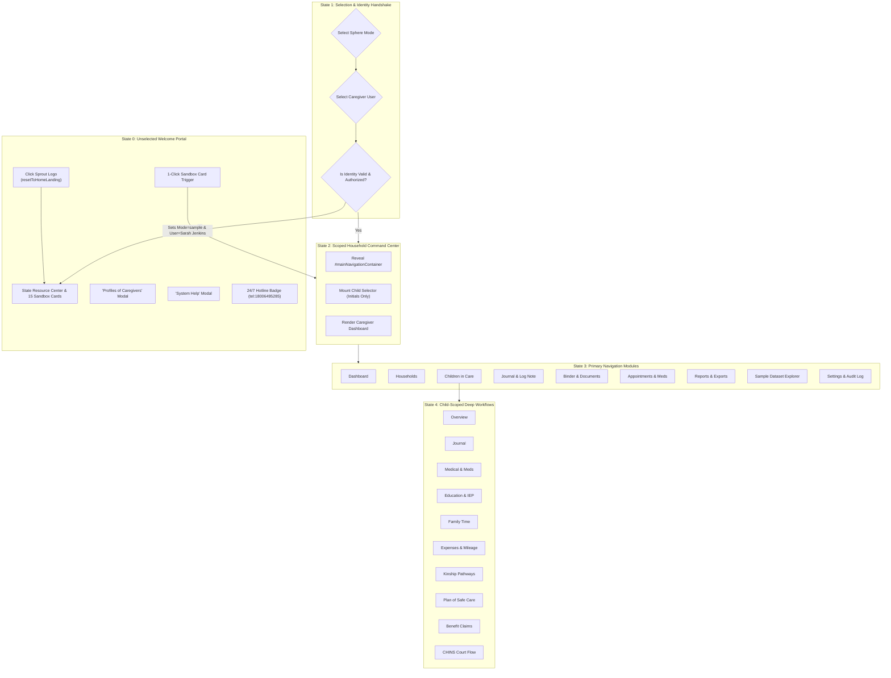
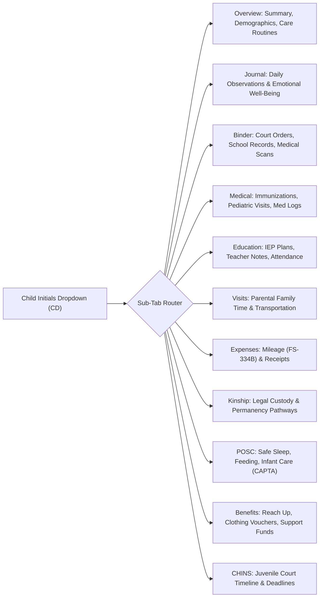

# Sprout / KinCare OS: UI Process Flow & Interaction Blueprint

## 1. Executive Concept: Deterministic Interaction Modeling

To ensure that **every button, modal, dropdown, and view in Sprout has a predictable, end-to-end process flow**, the entire interface must be governed by a **Deterministic Finite State Machine (FSM)**.

Every visual element must answer four fundamental architectural questions:
1. **Trigger Condition**: When should this button/control be visible, disabled, or hidden?
2. **Action & Flow**: What specific event, modal, or transition occurs when clicked?
3. **Data Boundary**: What API endpoint or in-memory model does it query or mutate, and what sphere guard applies?
4. **Resolution State**: Where is the user left after completing or canceling the action?

---

## 2. High-Level System Process Flow

---

## 3. Comprehensive Button-by-Button Process Flow Catalog

### Cluster A: Top Header Bar & Global Controls

| UI Element | Trigger / Click Handler | Pre-Condition | Process Flow & State Transition | Post-Condition & View Update |
| :--- | :--- | :--- | :--- | :--- |
| **Sprout Logo & Brand** | `resetToHomeLanding()` | Anywhere in application | 1. Purges `localStorage` (`sproutMode`, `caregiverUser`). 2. Resets `#sproutModeSelect` & `#caregiverSelect` to placeholder. 3. Hides `#mainNavigationContainer` & `#snapshotCard`. | Returns user to clean State 0 Welcome Portal with **zero data loaded**. |
| **24/7 DCF Crisis Hotline** | `<a href="tel:18006495285">` | Always visible | 1. Triggers native OS phone dialer on mobile/tablet or Skype/Teams on desktop. | Zero application state change; provides immediate emergency dialer access. |
| **Sprout Sphere Dropdown** | `onSproutModeChange()` | Initial launch or mode switch | 1. Reads selected mode (`sample` vs `local`). 2. Repopulates Caregiver dropdown with mode-filtered users. 3. Clears prior caregiver selection. 4. Changes header theme color (Slate for sandbox, Emerald for live). | Displays prompt `-- Select Caregiver User --`; hides navigation bar until user chosen. |
| **Caregiver User Dropdown** | `onCaregiverUserChange()` | Sphere selected | 1. Reads selected caregiver. 2. Saves to `localStorage`. 3. Updates avatar initials badge (`caregiverAvatar`). 4. Fetches children bound to this caregiver (`/api/children`). | Reveals `#mainNavigationContainer`, loads first placed child, and mounts Dashboard. |

---

### Cluster B: Welcome Portal & Guidance Actions (State 0)

| UI Element | Trigger / Click Handler | Pre-Condition | Process Flow & State Transition | Post-Condition & View Update |
| :--- | :--- | :--- | :--- | :--- |
| **"Activate Profile" (Card)** | `activateSampleCaregiverProfile(name)` | State 0 Landing Page | 1. Sets mode to `sample`. 2. Selects matching sample caregiver from dropdown. 3. Saves session to `localStorage`. 4. Loads child fixtures for that home. | Transitions immediately into active Dashboard scoped to that household. |
| **"1. Profiles of Caregivers"** | `openCaregiverProfilesModal()` | Welcome or Nav Toolbar | 1. Opens modal `#caregiverProfilesModal`. 2. Fetches 15 Caregiver Journey households from `/api/sample-data/households`. 3. Renders structure, stage, tenure, and approvals. | Caregiver clicks "Activate Profile" inside modal to jump into that household's dashboard. |
| **"2. System Help"** | `openSystemHelpModal()` | Welcome or Nav Toolbar | 1. Opens modal `#systemHelpModal`. 2. Renders dual-sphere explanation, PII guidelines, and navigation walkthrough. | User clicks close $[X]$ or backdrop to return to previous view. |
| **External State Links** | Native link (`target="_blank"`) | State Resource Hub | 1. Opens external VT state resource (CWTP, VKAP, Dr. Dynasaur, CDC Milestones) in new tab. | No state change in Sprout; reference opens safely without closing session. |

---

### Cluster C: Primary Navigation Bar (State 2 & 3)

| Nav Button | Click Handler | Pre-Condition | Process Flow & Data Flow | Target View |
| :--- | :--- | :--- | :--- | :--- |
| **Dashboard** | `switchMainSection('dashboard')` | Logged In | Queries `/api/compliance`, `/api/licensing`, and calculates metrics. | Renders household overview, urgent alerts, and recent activities. |
| **Households** | `switchMainSection('households')` | Logged In | Queries `/api/households`. In sample mode, returns synthetic home; in local, queries 41 Elmwood / 22 Parkside. | Renders bed capacity, resident caregivers, and home licensing status. |
| **Children in Care** | `switchMainSection('children')` | Logged In | Reveals `#childWorkspaceSubNav`. Loads active child profile. | Mounts 12-tab Child Workspace router (Overview, Medical, Education, Visits). |
| **Journal** | `switchMainSection('journal')` | Logged In | Queries `/api/children/:id/records?category=daily`. | Chronological daily observations feed with filtering by author. |
| **Binder** | `switchMainSection('binder')` | Logged In | In local, walks OneDrive shared folders via `/api/shared-docs`. In sample, returns sample guide list. | Categorized file cards with 1-click desktop OS open button. |
| **Timeline** | `switchMainSection('timeline')` | Logged In | Queries all records across all categories sorted by `event_date DESC`. | Master multi-disciplinary timeline with category filtering pills. |
| **Appointments** | `switchMainSection('appointments')` | Logged In | Filters records with upcoming event dates or follow-up flags. | Visual calendar cards for pediatric, court, and school meetings. |
| **Documents** | `switchMainSection('documents')` | Logged In | Combines state guidance and child-specific uploaded forms. | Document category directory with compliance status flags. |
| **Contacts** | `switchMainSection('contacts')` | Logged In | Queries `/api/contacts` (DCF worker, GAL, CASA, Doctor, Therapist). | Address book cards with 1-click call/email buttons. |
| **Comms** | `switchMainSection('communications')` | Logged In | Filters records with drafted caseworker / GAL emails. | Email drafting interface with pre-populated case updates. |
| **Reports** | `switchMainSection('reports')` | Logged In | Renders report generator interface. | 1-click button to export monthly progress report (`/exports/*.docx`). |
| **Sample Dataset** | `switchMainSection('sample_data')` | Logged In | Queries `/api/sample-data/*`. | Relational explorer for all 15 synthetic households and youth. |
| **Settings & Audit** | `switchMainSection('settings')` | Logged In | Queries `/api/audit-log` and verifies SHA-256 chain. | Displays tamper-evident audit ledger and system configuration. |

---

### Cluster D: Child Workspace Sub-Navigation (State 4)

When navigating inside **Children in Care**, the sub-navigation strip controls child-specific deep workflows:

---

### Cluster E: Fast-Action Toolbars & Modals

| Fast Action | Trigger Handler | Process Flow & Backend Interaction | Result |
| :--- | :--- | :--- | :--- |
| **Log Note (+)** | `openRecordModal()` | 1. Opens note modal with default date set to Today. 2. User enters category, title, severity, and summary. 3. User checks "Draft DCF Notification". 4. Submits to `POST /api/children/:id/records`. | New note logged, SHA-256 audit entry generated, DCF draft queued, and feed refreshes immediately. |
| **Open Document** | `openLocalDocument(path)` | 1. Sends `POST /api/open-doc` with relative path. 2. If mode is `sample`, backend rejects with `403 Forbidden`. 3. If mode is `local`, server launches native file via `os.startfile()`. | File opens instantly in native desktop viewer (Adobe Acrobat, Word, etc.). |
| **Filter Timeline** | `filterTimeline(category)` | 1. Toggles active filter pill in timeline toolbar. 2. Dynamically hides non-matching cards in client DOM. | Timeline updates instantly without reloading from server. |
| **Global Search** | `handleGlobalSearch(e)` | 1. Captures search string from `#globalSearchInput`. 2. Executes real-time client-side substring matching on titles and summaries. | Instant multi-card filtering across records and documents. |

---

## 4. What It Takes to Implement and Validate Every Process Flow

To achieve 100% testable, predictable behavior across all buttons and views:

### Step 1: Formalize Element ID & Action Registry
- Every clickable button or interactive pill must have an explicit HTML `id` (e.g., `btn-nav-dashboard`, `btn-card-activate-hh101`, `btn-fast-log-note`).
- Bind each element directly to a single deterministic JavaScript function.

### Step 2: Implement Complete Finite State Machine (FSM) State Rules
- Ensure that the application router strictly verifies prerequisites before executing view renders:
  - If `!mode || !caregiver` $\rightarrow$ Force State 0 (`renderWelcomeLandingView`), hide nav bar.
  - If `mode === 'sample'` $\rightarrow$ Render blue theme, bind to synthetic dataset, disallow disk access.
  - If `mode === 'local'` $\rightarrow$ Render emerald theme, bind to SQLite database, enable OneDrive launch.

### Step 3: Implement Automated End-to-End (E2E) Flow Tests
- Write a Playwright or Cypress test suite that programmatically clicks **every single button**:
  - Test 1: Click logo $\rightarrow$ Verify navigation disappears and welcome portal mounts.
  - Test 2: Click each of the 15 "Activate Profile" buttons $\rightarrow$ Verify dashboard mounts with correct household name.
  - Test 3: Click each of the 12 Child Workspace sub-tabs $\rightarrow$ Verify correct child data displays.
  - Test 4: Click "+ Log Note" $\rightarrow$ Fill form $\rightarrow$ Submit $\rightarrow$ Verify note appears in Journal feed and audit log.
  - Test 5: Click document in Sample mode $\rightarrow$ Verify `403 Forbidden` error toast appears without crashing.
