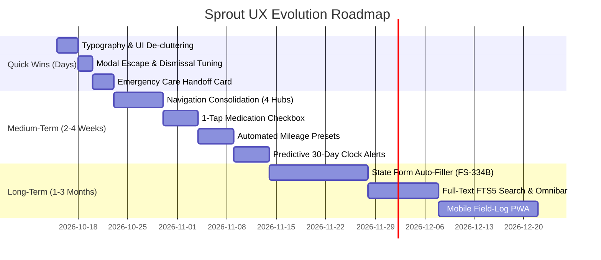

# SPROUT / KINCARE OS
## Development Review & User Experience Enhancement Audit
**Document Version:** 1.0.0  
**Focus:** Usability, Caregiver Cognitive Load, Daily Workflow Friction, Compliance Assurance, and Product Roadmap  
**Guiding Principle:** *"If I were an exhausted caregiver managing real children with trauma, appointments, and court hearings, does this system make my life noticeably easier every single day?"*

---

# 1. Executive Summary

Sprout (KinCare OS) has established an extraordinarily solid **architectural, legal, and privacy foundation**:
- **Dual-Sphere Security**: In-memory synthetic sandbox partitioned from offline-first local SQLite with zero PII cloud transmission.
- **Child Welfare Compliance**: Direct alignment with Vermont DCF Family Services Policy 75 (RPPS Normalcy), Title 33 V.S.A., FS-221A licensing standards, and CHINS court timelines.
- **Caregiver Journey Representation**: An 8-dimensional normalized model capturing single adults, multi-generational kin, domestic partners, and retired providers across 15 distinct households.

### The Core Finding: The "Architect vs. Caregiver" Reality Gap
While the backend architecture, compliance data models, and directory resources are **10/10 production-grade**, the current daily user experience reflects an **information-dense administrative dashboard** rather than an **empathetic, fast-response caregiver command center**. 

Real foster and kinship parents operate in conditions of **chronic sleep deprivation, sensory overload, urgent interruptions, and constant administrative anxiety** (fearing audit penalties, misplaced court orders, or missed medication logs). 

To transition Sprout from a *powerful software system* into an *indispensable daily lifeline*, the user experience must shift from:
1. **Passive Information Display** $\rightarrow$ **Action-Oriented Daily Guidance** (e.g., *"What do I need to know in the next 2 hours?"*).
2. **Multi-Step Form Clicking** $\rightarrow$ **1-Tap Quick Capture** (voice-to-text notes, 15-second medication logging).
3. **Siloed Record Buckets** $\rightarrow$ **Contextual Child Dossiers** (consolidated 360° cards showing immediate soothing routines, allergies, and court dates).

---

# 2. Detailed Audit Across 13 Review Areas

---

### REVIEW AREA 1: First-Time User Experience (FTUX)
* **Current Score:** **6.5 / 10**
* **Risk Level:** **Medium** (Initial hesitation / Cognitive overwhelm)
* **Estimated User Impact:** **High**

#### Current State & Friction Points:
- When a user first opens `http://127.0.0.1:5858/`, they encounter a deep, rich landing page filled with state resource links, daily rate tables, and 15 model households.
- **The Friction:** A brand-new caregiver who just took an emergency 2:00 AM placement does not know what to click first. There is no explicit *"I just received a child into my home — Start Here"* wizard.
- The two top dropdowns (`-- Select Sprout Sphere --` and `-- Select Caregiver User --`) use developer/administrative terminology (*"Sphere"*, *"Dev Sandbox"*). Non-technical kinship grandparents do not intuitively understand what a "Sphere" is.

#### Recommendations & Opportunities:
1. **Replace "Sprout Sphere" Terminology**: Change UI labels to **"System Mode"** or **"Workspace"** with two clear visual buttons: 🟢 **"My Real Family Workspace"** vs 🔵 **"Demo & Practice Sandbox"**.
2. **First-Launch "Emergency Placement Intake" Button**: Add a prominent hero card: *"New Child in Home? 60-Second Quick Setup"*.
3. **Interactive 3-Step Guided Tour**: A lightweight non-intrusive modal walkthrough highlighting: (1) Switching Children, (2) 15-Second Logging, (3) Document Binder.

---

### REVIEW AREA 2: Caregiver Journey Experience
* **Current Score:** **8.0 / 10** (Data model is 9.5/10; Active UI workflow support is 6.5/10)
* **Risk Level:** **Low**
* **Estimated User Impact:** **High**

#### Current State & Friction Points:
- The 15 synthetic households in `sample_dataset.py` beautifully model the lifecycle from *Interested* to *Retired*.
- **The Gap:** The UI primarily serves **Active Caregivers** managing placed children. Earlier and later lifecycle stages are underserved:
  - *Inquiry & Home Study Stage*: Caregivers lack a checklist tracker for bedroom square footage, water testing, and reference letters.
  - *Permanency / Adoption Stage*: Caregivers lack an automated milestone tracker for post-permanency subsidy agreements and final decree filings.
  - *Closed / Mentor Stage*: Seasoned caregivers lack a dedicated tool to share respite notes or mentor newer foster parents.

#### Recommendations & Opportunities:
1. **Dynamic Stage-Aware Dashboard Modes**: If a household profile is in *Home Study*, the dashboard should prioritize fire drill logs, background checks, and home inspection items over child medication schedules.
2. **Permanency Pathway Checklist**: For *Foster-to-Adopt* homes, introduce an interactive legal timeline showing TPR (Termination of Parental Rights) appeals, subsidy agreement approvals, and probate court scheduling.

---

### REVIEW AREA 3: Navigation & Information Architecture
* **Current Score:** **7.0 / 10**
* **Risk Level:** **Medium** (Choice paralysis / Navigation fatigue)
* **Estimated User Impact:** **Very High**

#### Current State & Friction Points:
- The top navigation bar currently contains **11 primary buttons** clustered into 4 groups (`Dashboard`, `Households`, `Children`, `Journal`, `Binder`, `Timeline`, `Appointments`, `Documents`, `Contacts`, `Comms`, `Reports`, `Sample Data`, `Settings`).
- Inside the Child Workspace, there are **16 additional sub-tab pills**.
- **The Friction:** That is **27 navigation targets** on screen at once. A stressed caregiver cannot decide whether an IEP meeting should be found under `Journal`, `Binder`, `Education`, `Timeline`, or `Documents`.

#### Simplification Architecture:
```
CURRENT (11 Main + 16 Sub = 27 Targets)
└── Dashboard | Households | Children | Journal | Binder | Timeline | Appts | Docs | Contacts | Comms | Reports...

RECOMMENDED STREAMLINED ARCHITECTURE (4 Primary Tabs + 4 Contextual Child Pills)
├── 1. TODAY (Action Center: Schedule, Urgent Meds, Follow-ups, Fast-Log)
├── 2. MY CHILDREN (Child Workspace: Overview, Journal & Timeline, Health & School, Legal)
├── 3. BINDER & DOCUMENTS (OneDrive Files, State Forms, Contacts Directory)
└── 4. HOUSEHOLD & COMPLIANCE (Licensing FS-221A, Training Hours, Mileage & Expenses)
```

---

### REVIEW AREA 4: Daily Workflow Analysis
* **Current Score:** **6.0 / 10**
* **Risk Level:** **High** (High administrative friction leads to skipped documentation)
* **Estimated User Impact:** **Critical**

#### Simulated Daily Routine Friction:
*A caregiver wakes up at 6:30 AM:*
1. **Check Schedule & Meds**: Must click `Appointments`, scroll past past events, then click `Children` $\rightarrow$ `Medical` to verify dosage.
2. **Log Morning Incident**: Child has a tantrum during school prep. Caregiver must click `+ Log Note`, open a modal with 12 input fields, select category, severity, date, location, participants, summary, and follow-ups.
3. **Log School Drop-Off Mileage**: Must open another log or wait until evening to remember trip mileage.

#### Recommendations & Opportunities:
1. **"Quick-Action FAB" (Floating Action Button)**: A single bottom-right floating button with 3 immediate 1-tap options:
   - ⚡ *Log Med Dose* (1-tap checkbox: "Administered Morning Concerta 18mg to CD at 7:15 AM")
   - ⚡ *Quick Voice/Text Journal* (Single text box with auto-speech recognition)
   - ⚡ *Log Trip Mileage* (Preset: "Home $\rightarrow$ Berlin Elementary: 8.2 miles")
2. **Morning Briefing Widget**: A prominent card at the top of the dashboard: *"Today: 2 Meds due, Pediatrician at 2:30 PM, Social Worker visit at 4:00 PM"*.

---

### REVIEW AREA 5: Document Management Experience
* **Current Score:** **7.5 / 10**
* **Risk Level:** **Medium**
* **Estimated User Impact:** **High**

#### Current State & Friction Points:
- The OneDrive/SQLite separation (*Database knows WHAT, OneDrive knows WHERE*) is an architectural triumph.
- **The Gap:** The user cannot currently drag and drop a PDF directly into the web UI and have it automatically filed into the appropriate OneDrive subfolder (`03_MEDICAL_DENTAL`, etc.).
- There is no automated document renaming convention; caregivers frequently upload files named `IMG_4021.jpeg` or `Scan_20261012.pdf`, which clutters the binder.

#### Recommendations & Opportunities:
1. **In-Browser Drag & Drop Auto-Filer**: Dropping a PDF into the browser prompts: *"What is this document?"* (e.g. *Dental Exam*). The backend automatically moves it to `OneDrive/.../03_MEDICAL_DENTAL/2026-10-Dental-Exam-CD.pdf` and creates the SQLite index.
2. **Visual Binder Index Cards**: Display files with high-contrast colored badges indicating compliance status: 🟢 Valid, 🟡 Expiring in 2 weeks, 🔴 Missing annual renewal.

---

### REVIEW AREA 6: Child-Centric Workspace Design
* **Current Score:** **7.5 / 10**
* **Risk Level:** **Medium**
* **Estimated User Impact:** **Very High**

#### Current State & Friction Points:
- The 12-subtab workspace holds exhaustive data (POSC safe sleep plans, CHINS court hearings, IEP notes).
- **The Gap:** The information is compartmentalized. In an emergency (e.g., child goes to the ER), the caregiver must click across three tabs (`Overview`, `Medical`, `Contacts`) to pull allergies, Medicaid number, emergency contacts, and caseworker phone numbers.

#### Recommendations & Opportunities:
1. **1-Click "Emergency / Babysitter Handoff Card"**: A printable or mobile-friendly single-screen view displaying:
   - Initials, DOB, Medicaid ID
   - Immediate allergies & daily medications
   - 3 soothing techniques & comfort items
   - Pediatrician, DCF Caseworker, and 24/7 Crisis numbers
2. **Child Milestones & Joy Journal**: Foster care documentation tends to focus exclusively on trauma and pathology. Add a positive "Joy & Milestones" section (first lost tooth, learning to ride a bike, drawing saved) to honor the child's humanity.

---

### REVIEW AREA 7: Compliance & Audit Readiness
* **Current Score:** **8.5 / 10**
* **Risk Level:** **Low**
* **Estimated User Impact:** **High**

#### Current State & Strengths:
- Cryptographic SHA-256 audit chaining (`verify_audit_chain()`) guarantees court admissibility.
- Direct alignment with VT DCF FS-221A licensing rules.

#### Compliance Blind Spots:
1. **Medical 30-Day Clock Alert**: When an emergency placement occurs, Vermont requires a complete health screening within 30 days. If day 20 passes without an appointment logged, the system should generate a flashing high-priority alert.
2. **Caseworker Un-Contacted Alert**: Under Vermont policy, if 30 days elapse without a caseworker in-person visit, the caregiver should be prompted: *"No DCF home visit logged in 28 days — Draft check-in email?"*.

---

### REVIEW AREA 8: Accessibility & Stress Reduction
* **Current Score:** **6.5 / 10**
* **Risk Level:** **High** (Visual exhaustion)
* **Estimated User Impact:** **Critical**

#### Cognitive Load Evaluation:
- **Font & Sizing**: The UI relies heavily on `text-xs` (12px) and `text-[10px]` uppercase tags. For a tired caregiver reading on a 13-inch laptop late at night, this causes eye strain.
- **Color Overuse**: Simultaneous bright blues, purples, emeralds, roses, and ambers compete for visual attention.
- **Button Density**: Modals contain up to 14 textboxes and select menus on a single screen without progressive disclosure.

#### Accessibility Upgrades:
1. **Base Font Upgrade**: Increase core body text to `text-sm` (14px) and headings to `text-base` / `text-lg`.
2. **Color Palette Hierarchy**: Restrict alerts to 3 purposeful states:
   - 🟢 **Normal / Quiet** (Neutral slate with emerald accents)
   - 🟡 **Upcoming / 14-Day Notice** (Soft amber)
   - 🔴 **Action Required Today** (Crisp rose)
3. **Calm Mode (Night Theme)**: A high-contrast dark theme optimized for nighttime bed checks and 3:00 AM infant feedings.

---

### REVIEW AREA 9: Automation Opportunities
* **Current Score:** **5.5 / 10** (Mostly manual data entry)
* **Risk Level:** **Medium**
* **Estimated User Impact:** **Massive**

#### Ranked Automation Backlog:

| Rank | Automation Feature | Description | Caregiver Time Saved |
| :---: | :--- | :--- | :---: |
| **1** | **State Form Auto-Filler** | Auto-populate Vermont DCF PDF forms (`FS-333B` Expense, `FS-334B` Mileage, `FS-221A` License) from existing SQLite records. | ~3 hours / month |
| **2** | **Predictive 30-Day Clock** | Automatically schedule statutory follow-up reminders upon date of placement (30-day health screen, 90-day dental, annual physical). | Zero missed deadlines |
| **3** | **1-Click Mileage Calculator** | Caregiver enters destination name (e.g. *"Barre DCF Office"*); system calculates round-trip miles and reimbursement at \$0.67/mi. | ~45 mins / month |
| **4** | **Automated Monthly Caseworker Report** | Aggregates 30 days of daily notes, medical visits, and school conferences into a signed PDF export. | ~2 hours / month |
| **5** | **Medication Dose Logging Checkbox** | 1-tap confirmation checkbox in daily briefing rather than opening full event modal. | ~5 mins / day |

---

### REVIEW AREA 10: Mobile & Field Usability
* **Current Score:** **5.0 / 10**
* **Risk Level:** **High** (Caregivers live in their cars and clinics)
* **Estimated User Impact:** **Very High**

#### Current Field Limitations:
- The current layout is optimized for desktop browsers (1024px+). On a smartphone, the multi-column tables and horizontal sub-navigation pills require extensive pinching and scrolling.
- **Critical Field Scenarios:**
  - *Visitation Exchange Parking Lot*: Caregiver needs to log: *"Mother arrived 15 mins late; child was crying upon return."* Takes 4 minutes on current form; needs to take 20 seconds on a phone.
  - *Pediatrician Waiting Room*: Caregiver needs child's Medicaid number and allergy list instantly.

#### Recommendations & Opportunities:
1. **Mobile-First Touch Targets**: Ensure all buttons have minimum 44x44px touch areas with sticky thumb navigation.
2. **Offline Field-Log PWA**: An installable Progressive Web App with large quick-input buttons for mobile visits and exchanges.

---

### REVIEW AREA 11: Dashboard Effectiveness
* **Current Score:** **7.0 / 10**
* **Risk Level:** **Medium**
* **Estimated User Impact:** **High**

#### Current vs Ideal Dashboard Architecture:
- **Current:** Displays stat counters (*Total Records, Urgent Tasks, Next Hearing, DCF Status*), quick action buttons, and a mixed activity feed.
- **The Ideal Caregiver Command Center:**
  1. **Top Tier — Today's Critical Horizon**: What is happening today? (Meds, rides, hearings).
  2. **Middle Tier — Urgent Compliance Attention**: Missing forms or expiring approvals.
  3. **Bottom Tier — Fast-Capture Workspace**: 1-click note taking and recent activity stream.

---

### REVIEW AREA 12: Search & Information Retrieval
* **Current Score:** **6.5 / 10**
* **Risk Level:** **Medium**
* **Estimated User Impact:** **High**

#### Current Limitations:
- Global search is currently a basic client-side substring filter across titles.
- Searching for *"asthma inhaler"* won't find a doctor's note that mentions *"albuterol"* unless explicitly written in the title.

#### Recommendations:
1. **Full-Text SQLite Search (FTS5)**: Index all record summaries, notes, and PDF metadata.
2. **Unified Omnibar Search (`Ctrl + K`)**: Allows instantaneous lookup across Children, Contacts, Files, and Medications from any screen.

---

### REVIEW AREA 13: Future Product Opportunities
* **Current Score:** **N/A** (Roadmap Horizon)
* **Estimated Long-Term Value:** **Transformational**

#### Strategic Horizons:
- **High Priority**: Automated Vermont DCF Mileage & Expense Form generator (`FS-334B` / `FS-333B`).
- **Medium Priority**: Encrypted Caseworker & Guardian ad Litem (GAL) read-only export package with tamper-evident digital seal.
- **Future Vision**: Local Wi-Fi sync between co-caregiver devices (Candy, Robin, Mallory) without cloud routing.

---

# 3. Comprehensive Scoring Matrix

| Review Area | Current Score | Pain Point / Friction | Risk Level | User Impact |
| :--- | :---: | :--- | :---: | :---: |
| **1. First-Time Experience** | **6.5 / 10** | Technical terminology ("Sphere"); missing emergency intake flow | Medium | High |
| **2. Caregiver Journey** | **8.0 / 10** | Pre-licensing and post-adoption stages lack dedicated tools | Low | High |
| **3. Navigation Architecture**| **7.0 / 10** | 27 simultaneous buttons causes cognitive overload | Medium | Very High |
| **4. Daily Workflow** | **6.0 / 10** | Multi-step form entry requires too much typing and clicking | High | Critical |
| **5. Document Management** | **7.5 / 10** | Lack of drag-and-drop auto-filing into OneDrive | Medium | High |
| **6. Child Workspace** | **7.5 / 10** | Critical safety info split across multiple tabs | Medium | Very High |
| **7. Compliance & Audit** | **8.5 / 10** | Outstanding cryptographic backend; needs predictive clock alerts | Low | High |
| **8. Accessibility & Stress** | **6.5 / 10** | Dense 10-12px typography; high visual complexity | High | Critical |
| **9. Automation** | **5.5 / 10** | Mileage, form filling, and report generation are manual | Medium | Massive |
| **10. Mobile Usability** | **5.0 / 10** | Desktop-centric layout difficult to use in parking lots & clinics | High | Very High |
| **11. Dashboard Efficacy** | **7.0 / 10** | Informative, but lacks an immediate "Today's Agenda" tier | Medium | High |
| **12. Search & Retrieval** | **6.5 / 10** | Simple title matching; lacks deep full-text indexing | Medium | High |
| **OVERALL SYSTEM SCORE** | **6.8 / 10** | **World-Class Architecture; Needs Caregiver UX Streamlining** | **Medium** | **Very High** |

---

# 4. Top 20 Recommended Enhancements

### Usability & Cognitive Load
1. **Streamline Primary Navigation**: Consolidate 11 main nav buttons into 4 primary hubs (*Today*, *My Children*, *Binder*, *Household Compliance*).
2. **Emergency Care Handoff Card**: Build a 1-click printable/mobile summary with allergies, medications, soothing items, and caseworker contacts.
3. **Typography & Readability Upgrade**: Bump base font size from 12px to 14px and eliminate 10px micro-text.
4. **Calm Mode (Night Theme)**: Provide a gentle dark-mode theme for midnight feedings and exhausted evening logging.
5. **Human-Friendly Mode Labels**: Rename "Sprout Sphere" to "Workspace" (*Real Family Workspace* vs *Practice Demo Sandbox*).

### Daily Workflow & Speed
6. **Floating Quick-Action FAB**: Add a bottom-right mobile/desktop quick logger for 10-second notes, meds, and mileage.
7. **1-Tap Medication Checkbox**: A simple daily checklist to confirm scheduled morning/evening doses with one click.
8. **Automated Round-Trip Mileage**: Preset common driving destinations (e.g., Barre DCF, Central Vermont Medical Center) with auto-calculated mileage reimbursement (\$0.67/mi).
9. **Child Joy & Milestones Section**: Provide dedicated space for positive childhood moments, photos, and achievements.
10. **Voice-to-Text Journaling**: Integrate browser-native speech recognition for dictating visit notes while driving or caring for infants.

### Automation & Compliance
11. **State Form Auto-Filler (`FS-334B` & `FS-333B`)**: Automatically export approved mileage and expense records directly onto official Vermont DCF reimbursement forms.
12. **Predictive Statutory Deadlines**: Automated countdown timers for 30-day health screenings, 90-day dental checks, and 365-day annual exams.
13. **Caseworker Visit Due Alert**: Proactive reminder if 28 days pass without an in-person caseworker contact.
14. **Automated Monthly Progress Report**: One-click generation of the complete 30-day foster parent summary report for court and DCF.
15. **Smart Document Drag & Drop**: Browser drop-zone that automatically renames and files incoming PDFs into correct OneDrive folders.

### Search & Technology
16. **Full-Text SQLite Search (FTS5)**: Deep keyword searching across all note details, medical summaries, and file metadata.
17. **Global Omnibar (`Ctrl + K`)**: Instant keyboard navigation to any child, contact, document, or form.
18. **First-Launch Emergency Placement Wizard**: 3-step rapid setup for newly arriving children in care.
19. **Mobile-Responsive Field Layout**: High-contrast touch targets for visitation exchanges and clinic waiting rooms.
20. **Local Peer-to-Peer Sync Blueprint**: Architecture for multi-laptop sync between Candy, Robin, and Mallory without cloud services.

---

# 5. Phased Development Backlog



### Tier 1: Quick Wins (Can Be Implemented in Days)
- [ ] **Typography & Micro-Text Overhaul**: Update Tailwind classes across `app.js` and `index.html` to eliminate 10px text and increase readability.
- [ ] **Emergency Handoff Summary Card**: Add a prominent button in the Child Workspace header that prints/renders a clean emergency summary card.
- [ ] **Human-Friendly Workspace Switcher**: Update header labels to *"Real Family Workspace"* vs *"Practice Demo Sandbox"*.

### Tier 2: Medium-Term Improvements (2–4 Weeks)
- [ ] **Navigation Consolidation**: Restructure top navigation into the 4 primary hubs.
- [ ] **Daily Medication Quick-Check**: Implement the 1-tap dose verification checklist on the main dashboard.
- [ ] **Mileage Calculator Integration**: Pre-fill common routes and calculate exact DCF mileage reimbursements.
- [ ] **Statutory Clock Alarms**: Display visual countdown clocks for 30-day health screenings and annual physicals.

### Tier 3: Long-Term Vision (1–3 Months)
- [ ] **Vermont State Form Auto-Filler**: Generate official `.pdf` / `.docx` files for DCF forms `FS-334B` (Mileage) and `FS-333B` (Expenses).
- [ ] **Full-Text Offline Search (FTS5)**: Fast global text search across all notes, observations, and documents.
- [ ] **Mobile Field PWA**: Responsive progressive web app for visitation parking lots and court waiting areas.
